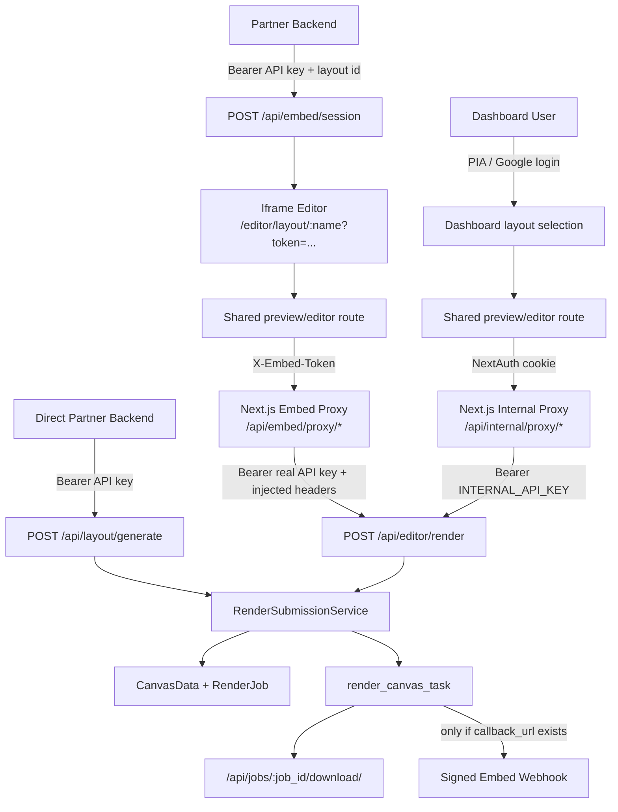

# CLAUDE.md

This file provides guidance to Claude Code (claude.ai/code) when working with code in this repository.

**This file holds current rules and current state only.** The incidents, measurements and dated reversals that explain *why* a rule exists live in [docs/HISTORY.md](docs/HISTORY.md), organised under the same headings as this file. When a rule here seems arbitrary, look it up there before relaxing it. When you learn something new the hard way, add the rule here and the story there.

## What This Project Does

Product Editor is a full-stack print-file generator for Printo.in. Customers upload and compose photos on an interactive canvas editor; the system asynchronously renders 300-DPI print files (PNG, with PDF as an alternate format) and delivers them either via direct download (dashboard users fetch the ZIP) or via a signed webhook to the embed caller's `callback_url` (printo.in's storefront then pulls the same download URL from its backend). The app does NOT push files to any internal OMS — it's a standalone generator.

## Docs — and which of them to trust

**This file is the current-state reference.** `docs/` is mostly *not*: a few files describe present behaviour and the rest are shipped-feature design records or plans. Count them with `ls docs/*.md` rather than trusting a number written anywhere. Index with per-file status: [docs/README.md](docs/README.md). **Where a doc and the code disagree, the code wins**, and where a doc and this file disagree, this file was more recently verified.

The ones to actually rely on:

| Doc | Use it for |
|---|---|
| [docs/INTEGRATION.md](docs/INTEGRATION.md) | The only doc with an **external** audience — printo.in's storefront team. Webhook payload, HMAC verification, the four download URLs, the daily request cap, drop-in Node/Python handlers. Changing `notify_caller_webhook_task` means updating this. |
| [docs/DATA_LIFECYCLE.md](docs/DATA_LIFECYCLE.md) | Any retention or DPDP question. One clock (`EXPORT_RETENTION_DAYS`, default 7, **prod runs 3**), what the purge deletes, backups (customer data lives at most 7 days there, and a restore re-erases purged orders). |
| [docs/AI_GUARDRAILS.md](docs/AI_GUARDRAILS.md) | Condensed rules that exist because breaking them already cost something. Overlaps this file deliberately. |
| [docs/HISTORY.md](docs/HISTORY.md) | The incidents and reversals behind the rules in this file, dated. |
| [docs/LOAD_BASELINE.md](docs/LOAD_BASELINE.md) | Load numbers. Append runs, never edit old ones. |

Nothing in `docs/` is checked by CI, so no claim there is self-verifying. If you correct a fact in one, check whether this file or `docs/AI_GUARDRAILS.md` states it too.

## Knowledge Graph

A knowledge graph of this codebase lives in `graphify-out/`. Before investigating architecture questions, tracing data flows, or understanding how components interact, query it first — it's much faster than grepping.

```bash
graphify query "how does the render pipeline work"
graphify path "EditorRenderView" "notify_caller_webhook_task"
graphify explain "render_canvas_task"
```

**Read the node/edge/community counts and the source commit out of `graphify-out/GRAPH_REPORT.md`** ("Graph Freshness"), never from a doc; compare the commit to `git rev-parse HEAD` to see whether the graph is stale. Community names are in the same report and can change when the graph re-clusters; among the largest are Ops Views & Permissions, S3 Storage Backend, Layout Templates API, Render Submission & Task, LayoutEngine Core and Calendar & Book Validators. The doc nodes (this file, the PRDs) are hubs because they reference so much code; `S3Backend` is the in-memory S3 test double in `services/tests/fake_s3.py`, not production code.

Rules for maintaining it:

- **Committed:** `graph.json`, `GRAPH_REPORT.md`, `manifest.json`, `cost.json`, `.graphify_labels.json`. **Not committed:** `graph.html` — regenerate it with `graphify export html` (seconds, no API key) and open it in a browser. It was committed until 2026-10-13, when its history made up most of the repository's size.
- **To update the graph, run this, not graphify:** `$(cat graphify-out/.graphify_python) scripts/graphify-refresh.py`. This is what a request to update the graph or `/graphify --update` means here. It is AST only, no LLM, a few seconds. Keeps the committed doc nodes, drops nodes whose file is gone or ignored and rewrites the manifest from the scan, carries a community's name across when at least half its nodes held that name before, and prints an `unlabeled>=3` count for new communities to name.
- **After doc changes:** only a full `/graphify` run re-extracts docs (subagents, no API key). Build from the repo root so shell-script node IDs match the committed graph (`grep -c private_tmp graphify-out/graph.json` must be 0), validate each subagent chunk's ids against the AST before merging (`[name]` files come out as `name_…`, inner hook functions have no AST node and map to their hook), and carry community names across from the old `graph.json` by node overlap rather than re-clustering from scratch.
- **Don't use `graphify update .` or `graphify . --update`.** The first re-adds per-heading doc nodes a full rebuild removes and unnames communities; the second needs an LLM API key the graphify Python doesn't have. The skill's `/graphify --update` re-clusters and re-labels from scratch as well. `GRAPH_REPORT.md` is generated with a line recommending `graphify update .`: ignore it.
- `.graphifyignore` excludes the vendored Scalar bundle, `backend/django/*/migrations/`, the e2e fixture photos and `public/icons/` (trivial nodes, a vision agent each).
- The health check's ~1,100 "dangling-endpoint" edges are AST imports of external packages (react, os, django) with no node in the corpus. Normal. The semantic layer should show zero.

---

## Hard constraints — git and shipping

This repo has no `staging` branch, so **`main` is production**. `deploy.sh` git-pulls `main` on the server; anything merged is one deploy away from customers. The gate between "written" and "live" is your check-in with the user — there is nothing else.

- **BEFORE ANY CODE EDIT: create a branch from freshly-pulled `main`. NO EXCEPTIONS. NO COMMITS ON MAIN.**
  ```bash
  git checkout main && git pull && git checkout -b feature/your-name
  ```
  Even a one-line fix. Never branch from wherever the tree happens to be. This checkout is shared with other Claude Code sessions, so local `main` goes stale within minutes and another session may switch the branch under you mid-task; prefer a scratchpad worktree (`git worktree add <dir> -b <branch> origin/main`) for anything longer than a few minutes.
- **Never push, open a PR, or merge without checking in first.** A request to do the work is not a request to ship it. Do the work, run the checks, STOP and report what changed and what you verified, then wait for an explicit go-ahead before `git push`, `gh pr create`, or `gh pr merge`.
- **Run `git status` and `git log --oneline -5` before every commit. Never `git add -A` or `git commit -a` — stage explicit paths.** Uncommitted files in the shared tree may not be yours. **Say what you found and left behind**, naming the files.
- **Never delete a branch — local or remote — without asking first and getting an explicit yes.** Includes `git branch -d`/`-D`, `git push origin --delete`, `gh pr merge --delete-branch`. Ask ("merged — want me to delete `<branch>`?") every time.
- **A PR number is not something to predict.** Use the URL `gh pr create` returns.

## Commands

### Frontend (Next.js)
```bash
cd frontend/nextjs
pnpm dev          # http://localhost:3000 direct, or http://localhost:5004 via Docker
pnpm dev:clean    # rm -rf .next first — use when routes 404 in dev
pnpm build
pnpm typecheck    # tsc --noEmit, full strict mode — run before pushing
pnpm lint         # eslint src
pnpm lint:fix
```
The dev Mac's system node is v16; prefix `PATH=$HOME/.nvm/versions/node/v22.23.2/bin:$PATH` on every pnpm command.

### Backend (Django)
```bash
cd backend/django
python manage.py migrate
python manage.py showmigrations
python manage.py shell
```

### Tests

Three harnesses: frontend Jest, backend DB-free `services/tests/`, and backend DB-backed `api/tests/`.

**Frontend — Jest** (`next/jest` + SWC + `@happy-dom/jest-environment`; config in `frontend/nextjs/jest.config.ts`). Only `src/**/__tests__/**` is collected. happy-dom rather than jsdom because jsdom auto-requires the native `canvas` module Fabric.js peer-deps.

```bash
cd frontend/nextjs
pnpm test
pnpm test:watch
pnpm test -- src/lib/__tests__/dpi-utils.test.ts
pnpm test -- -t "clamps the offset"
pnpm test:parity          # calendar TS↔Python parity suites only
```

**Editor page characterization suite** — `src/app/editor/layout/[name]/__tests__/page.characterization.test.tsx` renders the whole editor page under Jest against `FakeBackend` (`editor-page-harness.tsx`) and pins what the page sends and when (Add-Files appends, autosave only after restore settles and without `data:` previews, the quantity rules, the embed render payload and `pe:render_job` target origin, the dashboard download hand-off, the calendar holiday gate, the book page count, Escape behaviour in the prompts, the pinned toolbar, card keyboard handling, the template-first rule). It must pass unchanged across any editor refactor. Real timers, ~35 s. Gotchas: `useRouter`/`useParams` stubs must return the **same object every render**, and the over-quantity prompt is `role="alertdialog"`.

**Editor smoke suite (Playwright)** — `pnpm e2e`. Drives Chrome against the local stack and a production build on :3057: embed journeys inside a fake storefront, the slow-restore check, quantity rules, HEIC, the canvas editor, the dashboard (minted cookie, never PIA credentials) with a real render to a ZIP, the calendar preview, a phone-profile tap-to-swap, the Templates page's design import from paste to a real render. Local only, purges what it creates, skips the render test without a Celery worker. Setup: [frontend/nextjs/e2e/README.md](frontend/nextjs/e2e/README.md).

**Backend — `services/tests/`: standalone modules, no pytest, no `manage.py test`.** Every `test_*.py` ends in an `if __name__ == "__main__":` block that runs its own `test_*` functions. CI globs them, so a new module needs no workflow edit. Keep them DB-free and mediapipe-free (CI installs a mediapipe-stripped requirements subset). Count them with `ls backend/django/services/tests/test_*.py | wc -l`.

Run through the container — the dev Mac has no Pillow/Django. **Override the entrypoint**: it ignores `$@` and would boot gunicorn and hang. **The image bakes in source via `COPY`**; `docker-compose run backend` tests the last build, not your tree, and a new module reads as "not found" rather than "not rebuilt". Either `docker-compose build backend` first, or mount the tree over `/app`:

```bash
docker-compose run --rm --entrypoint /opt/venv/bin/python backend -m services.tests.test_caption_layout
# or, against a worktree without rebuilding:
docker run --rm --network product-editor_web --env-file .env -e DEBUG=1 -e SENTRY_DSN= \
  -v "$PWD/backend/django:/app" -w /app --entrypoint /opt/venv/bin/python product-editor-backend:latest \
  -m services.tests.test_caption_layout
```

All of them, as CI does:
```bash
docker-compose run --rm --entrypoint bash backend -c 'for f in services/tests/test_*.py; do /opt/venv/bin/python -m "services.tests.$(basename "$f" .py)" || echo "FAIL $f"; done'
```
With a local venv the bare form works; `DEBUG=1` is mandatory or the production `DJANGO_SECRET_KEY` fail-fast aborts first.

**Backend — `api/tests/`: ordinary Django `TestCase`s, real Postgres + Redis, `manage.py test`.** For things that genuinely need the DB or the real cache (`LayoutCatalogue` collation, `invalidate_layout_caches`, order purge, templates, the API-key daily cap). Don't fake the DB with sqlite — the case-sensitivity guarantee is Postgres collation. `api/tests/__init__.py` must exist or discovery crashes.

```bash
docker-compose up -d db redis backend
docker-compose exec backend python manage.py test api.tests --verbosity 2
```
**If you touch `invalidate_layout_caches` or `LayoutCatalogue`, run this suite** — nothing else catches a regression there.

**CI** (`.github/workflows/ci.yml`, push/PR to `main`): `backend` (the DB-free loop + OpenAPI schema validation), `backend-db` (Postgres 16 + Redis 7 service containers, `manage.py test api.tests`), `frontend` (`typecheck` → `lint` → `test -- --ci`). The org is on GitHub Free with Actions billing-locked, so checks may show red for reasons unrelated to the code — verify locally.

### Verifying UI changes in a real browser (no PIA login)

**Editor route** (`/editor/layout/[name]`) is not auth-gated; use an embed token:

```bash
docker-compose up -d db redis backend        # backend on :8000
# frontend must run from source (pnpm dev) — the Docker image serves a BUILD
KEY=$(grep -E "^DIRECT_API_KEY=" .env | cut -d= -f2-)
curl -s -X POST http://localhost:8000/api/embed/session \
  -H "Authorization: Bearer $KEY" -H 'Content-Type: application/json' \
  -d '{"order_id":"TEST-1"}'
# → open http://localhost:3000/editor/layout/<name>?token=<token>
```

**Auth-gated pages** (`/dashboard`, `/editor/layouts`) — mint a NextAuth cookie. Run **inside `frontend/nextjs`** so `next-auth` resolves, with `AUTH_SECRET` from `frontend/nextjs/.env.local` (it differs from the root `.env`; the wrong one silently yields a rejected cookie):

```js
import { encode } from 'next-auth/jwt';
const now = Math.floor(Date.now() / 1000);
await encode({ salt: 'authjs.session-token', secret: AUTH_SECRET, token: {
  id: 'LOCAL-DEV', name: 'Local Dev', email: 'local@printo.in',
  role: 'admin',
  is_staff: false,                 // ADMIN tier — gates /django-admin/
  is_ops_team: true,               // OPS tier — template/calendar/holiday writes
  registration_status: 'ACTIVE',    // anything else is refused per request
  accessToken: 'x', refreshToken: 'x', accessTokenExpires: (now + 3600) * 1000,
  sub: 'LOCAL-DEV', iat: now, exp: now + 3600 } });
// then: document.cookie = "authjs.session-token=<jwt>; path=/"
```

Mint one per tier (`is_staff: true` Admin; `is_ops_team: true` alone Ops; both false Editor). `role: 'admin'` is legacy and expresses none of the tiers.

**You cannot swap that cookie a second time from JavaScript.** Once the page calls `/api/auth/session`, NextAuth re-issues it HttpOnly and a second `document.cookie` write is silently ignored. Sign out server-side first:

```js
const { csrfToken } = await fetch('/api/auth/csrf').then(r => r.json());
await fetch('/api/auth/signout', { method: 'POST',
  headers: { 'Content-Type': 'application/x-www-form-urlencoded' },
  body: new URLSearchParams({ csrfToken, json: 'true' }) });
```
Corollary: **`authjs.session-token` missing from `document.cookie` does not mean there is no session.** Read `/api/auth/session` and assert on the flags there. Local dev only; delete the script afterwards.

**Getting a photo onto the canvas:** draw on an off-screen canvas, wrap in `File`/`DataTransfer`, assign through the native setter (`Object.getOwnPropertyDescriptor(HTMLInputElement.prototype,'files').set`) on the input with `multiple=true` (the other is the replace-photo input), then dispatch a bubbling `change`.

**Known automation limits:**
- The layout-card action buttons (View Raw JSON / Delete / Edit / Duplicate) do not respond to synthetic clicks. Automation artifact, reproduced on unmodified `main`. Verify via code + `curl` and ask the user for one manual click.
- To assert Fabric object state, walk the React fiber from `canvas.lower-canvas` (`__reactFiber$…`) up through `memoizedState` for a hook whose `.current` has `_objects` + `renderAll`; `fc.fire('object:moving', {target})` exercises the real handlers.
- Pixel-sampling a Fabric canvas must allow for alpha blending (guides draw at 0.7–0.8 opacity): test hue dominance, not an exact hex.
- `next.config.mjs` is **not** hot-reloaded; restart the dev server after editing it.
- Routes 404ing in dev → `pnpm dev:clean`.
- IntersectionObserver never fires in automated browser panes; screenshots force delivery.

**A worktree's own stack on side ports** (used for the print-sheet work, 2026-10-26): copy the root `.env` and `frontend/nextjs/.env.local` into the worktree (both gitignored), then from the worktree `POSTGRES_HOST_PORT=5440 BACKEND_HOST_PORT=8013 FRONTEND_HOST_PORT=5013 docker-compose -p <task> build backend celery-worker-standard` and `... up -d db redis redis-cache backend celery-worker-standard`. The project gets its own volumes and network, an empty DB (the entrypoint migrates and seeds the keys; `DIRECT` is ops-flagged, so `POST /api/ops/layouts/<name>` works with it) and collides with nothing. **Start the worker too, capped**: a Download or Save & Continue queues a render job that only `celery-worker-standard` runs, and on the dev Mac Celery's auto-detected concurrency is the Docker VM's 11 CPUs, so 11 prefork children blow the worker's 2 GB cap and the render process dies with signal 9 (`OOMKilled: true`, job stuck in `processing`; 2026-10-29). Put `CELERY_CONCURRENCY=2` in the worktree's `.env` before `up -d … celery-worker-standard`. A job stuck that way is re-run by `render_canvas_task.apply_async(args=[canvas_data_id, job_id], queue='standard')` from `manage.py shell`. Run the frontend from source with a gitignored `.claude/launch.json` entry that sets `INTERNAL_API_URL` and `NEXT_PUBLIC_API_BASE_URL` to `http://127.0.0.1:8013/api` and `pnpm dev -p 3010`; a dev server started by a Claude session stops with that session, so hand the user the command to run in their own Terminal. The editor's leave-page guard blocks an automated navigation away from a page with a design on it: navigate with the discard flag. When running `services/tests` over a source mount, mount `storage/` too (`-v "$PWD/storage:/app/storage"`) or the parity-fixture modules fail on a missing file. Tear down with `docker-compose -p <task> down -v`.

### Checking a deployed UI change on production (Claude in Chrome)

For a layout or sizing change, check the *deployed* build, not only the local one: the dashboard puts two header bars above the cards that the embed does not (a local embed check missed a 41px overflow, PR #289). The user signs in themselves in the Chrome tab (never enter their credentials), then, from that session and **only with the user's go-ahead for each write**:

- **Measure** with `javascript_tool` against `/editor/layout/<name>`: add a photo with the `DataTransfer` trick above and read `getBoundingClientRect()` of the card (`[role=button][aria-label^="Edit canvas"]`, its parent) against `innerHeight`; step window sizes with `resize_window` (outer size; note the original first and restore it, the screen caps the height).
- **Make test data without an API key** through the dashboard's own proxy, same-origin with the session cookie: `POST /api/internal/proxy/ops/layouts/<name>` (multipart `layout_data`) creates a layout; `POST /api/internal/proxy/embed/session` with `{"order_id":"ZZ-..."}` returns an embed token. Load `/editor/layout/<name>?token=<token>` in a **same-origin `<iframe>`** (build it from a blank same-origin page such as `/api/health`) to measure the embed at storefront sizes; a cross-origin printo.in page can only be screenshotted. Keep tokens out of logs.
- **Purge is the user's call.** `DELETE .../ops/orders/<id>/purge?api_key=DIRECT` (the dashboard authenticates as `DIRECT` while the two keys are equal) is refused by the auto-mode classifier as irreversible; test orders (`PE-…`, `ZZ-…`) otherwise expire on the retention clock (3 days). Name test layouts `zz_…` and tell the user what was left behind.

### Real-phone check (needs the user's phone)

A desktop window narrowed under 640 px is **not** a phone: touch, the address-bar height, safe areas and the on-screen keyboard are not emulated. So before calling a change to the editor's phone layout (`<sm`: the 86vw `max-w-sm` card, the quick-action rail, the toolbar, the sideways-scrolling two-sided row, tap-to-swap, pinch) verified, **ask the user for a screenshot from a real phone with a short message**, and say exactly what to look at:

1. Send me a phone (iPhone Safari and/or Android Chrome) screenshot of the editor with **one photo** and then with **several**.
2. Is the whole card visible without sideways scrolling, and is the quick-action rail (rotate, fit, blur, delete) fully on the card?
3. Are Save & Continue / Download reachable without a zoom?
4. For a front/back product, does the row scroll sideways with both sides reachable?

To give the user something to open, create a session as above and send them `https://product-editor.printo.in/editor/layout/<name>?token=<token>` (valid about 2 hours) or have them use a real product page on `alpha.printo.in/product-editor`. Until a phone screenshot exists, report phone behaviour as **not verified on a device**. State of play (2026-10-23): the card-sizing rules (#285, #286, #289) change nothing below `sm` and were checked only in desktop windows down to 500 px.

### Docker (primary workflow)
```bash
docker-compose up -d
docker-compose exec backend python manage.py migrate   # always via the backend container
docker-compose ps celery-worker-standard celery-beat
docker-compose logs -f <service>
```

**First run on a fresh clone:** the `proxy` service bind-mounts `proxy/nginx/certs/{origin.crt,origin.key}`, which are gitignored. Run `./deploy.sh` once (it generates a self-signed bootstrap cert) or:
```bash
mkdir -p proxy/nginx/certs
openssl req -x509 -nodes -days 3650 -newkey rsa:2048 \
  -keyout proxy/nginx/certs/origin.key -out proxy/nginx/certs/origin.crt \
  -subj "/CN=localhost/O=product-editor self-signed"
chmod 600 proxy/nginx/certs/origin.key
```
Copy `.env.example` → `.env` and fill the required secrets (`DJANGO_SECRET_KEY`, `AUTH_SECRET`, `EMBED_INTERNAL_SECRET`, `INTERNAL_API_KEY`, `POSTGRES_PASSWORD`, `DIRECT_API_KEY`). Sibling projects take 5432/5004; this repo's `.env` remaps to 5434/5005.

### Utilities
```bash
./deploy.sh                                                    # Production deployment (on the server)
./fresh-install.sh
./reset-db.sh
./benchmark.sh
API_KEY=<key> [BASE=<url>] ./scripts/smoke-test-embed.sh       # embed flow end-to-end
API_KEY=<key> [BASE=<url>] ./scripts/smoke-test-calendar.sh    # calendar/ops surface
API_KEY=<key> [BASE=<url>] ./scripts/smoke-test-book.sh
API_KEY=<key> [BASE=<url>] ./scripts/smoke-test-templates.sh  # + ENABLE_OPS_WRITE=1 [SMOKE_RENDER=1]
./scripts/test-backup-restore.sh                               # restore into a throwaway DB + assert row counts
```
Smoke tests default to `BASE=http://localhost:5004`; for the nginx edge use `BASE=https://localhost` with `-k`. Rebuild the frontend image before testing frontend-side changes. The scripts print their own pass/fail totals — read those. The shared colour/print helpers are `scripts/lib/print.sh` (deploy, reset-db) and `scripts/lib/smoke.sh` (the smoke tests).

## Architecture

### Stack
- **Frontend**: Next.js 16 (App Router), React 19, TypeScript, Fabric.js 7.2, Tailwind CSS
- **Backend**: Django 5 + DRF, Celery 5.3.4, Pillow 10.3.0
- **Infrastructure**: PostgreSQL 16, Redis 7, nginx 1.27 (edge proxy), Docker Compose

### Key Data Flow

All exports go through one unified server-side pipeline: every Submit/Download triggers a Celery render job regardless of canvas count (the client-side shortcut was removed in v1.8).

**Access-mode invariant:** the dashboard login flow and the iframe embed flow must produce the same print output for the same layout, uploads, transforms, overlays, calendar data, colours, `export_format` and `include_uploads`. Authentication and delivery differ; editor state, render behaviour and the artifact contract must not.

**Editor → render → delivery:**

1. Customer composes on the Fabric.js editor (`frontend/nextjs/src/app/editor/`).
2. On Save & Continue (embed) or Download (dashboard), `executeServerRender()` (`useServerRender.ts`) uploads every `File` via the chunked upload API (2 MB chunks, 4 parallel; `src/lib/upload-utils.ts`), then POSTs `/api/editor/render` with `{ layout_name, order_id, canvases[] }`.
3. Backend creates `CanvasData` + `RenderJob` through `RenderSubmissionService` and dispatches `render_canvas_task`.
4. Celery: `LayoutEngine` consumes the submit-time `CanvasData.render_state` snapshot — **and only that**; `editor_state` is the autosave's field and is never read by the pipeline — and Pillow renders at 300 DPI (PNG, or PDF when `export_format='pdf'`).
5. Files land under `EXPORTS_DIR/<job_id>/`, served by `GET /api/jobs/<job_id>/download/`. The same task writes the job's **restore manifest** (see Restore manifest below) onto `RenderJob.restore_manifest`.
6. **Embed delivery:** if `EmbedSession.callback_url` was set, `notify_caller_webhook_task` POSTs the payload below with `X-Signature: sha256=<hmac>` signed with the api_key; the caller fetches the ZIP(s) with Bearer auth. *No internal OMS push exists.*
7. **Dashboard delivery:** the browser polls `/api/render-status/{job_id}/` with backoff and fetches the ZIP directly.
8. After submit the embed posts `window.parent.postMessage({ type: 'pe:render_job', jobId, orderID })` for the parent's "preparing your design" UX; files travel by webhook, not postMessage.

**Direct partner API (`GenerateLayoutView`, `POST /api/layout/generate`)** shares the same `RenderSubmissionService` and output contract; direct callers poll `/api/render-status/<job_id>/`. Webhooks are configured only via `EmbedSession.callback_url`. External partners have been told embed-only; the direct endpoints are kept deliberately.



### Frontend Structure

- `src/pia-auth.ts` — NextAuth v5 config; Credentials providers (PIA password, Google ID token); `jwt`/`session`/`redirect` callbacks; `CredentialsSignin` subclasses for outage vs. timeout; PIA fetches use `AbortSignal.timeout(10_000)`.
- `src/proxy.ts` — Next.js 16 proxy file (formerly `middleware.ts`). Server-side auth gate for `/dashboard/*` and `/editor/layouts/*`; bounces logged-in users off `/login`. Excludes `/editor/layout/[name]`, which serves both the dashboard and the embed. A signed-out visitor is sent to `loginHref(pathname, search)` (`lib/callback-url.ts`), path **and** query, so a filtered dashboard link survives the login (2026-10-29).
- `src/app/login/page.tsx` + `src/app/actions/auth.ts` — login form + server action; per-IP rate limit (5/min, in-memory, single-process — swap for Redis if the frontend is ever scaled). The `callbackUrl` the actions return and the page hands to `window.location` goes through `safeCallbackPath` (`lib/callback-url.ts`): a same-site path only (no `//host` or `/\host`), else `/dashboard`. NextAuth's `redirect` callback never sees that hop, so this check is the one that stops `/login?callbackUrl=https://elsewhere` (fixed 2026-10-29).
- `src/app/dashboard/page.tsx` — the layout picker. The tag filter and search ride the address as `/dashboard?tag=<key>&q=<text>` (`lib/dashboard-filter.ts`: `readDashboardFilter`, `dashboardFilterQuery`, `rememberDashboardFilter`, `dashboardHref`; `replaceState`, no history entry per keystroke, remembered per tab so the editor's Back to Layouts returns to the filtered list; the tag is its fixed key, so a saved link survives a rename; since 2026-10-29). Each card carries the Portrait / Landscape pill and a template badge counted for that choice (see Layout orientation and Layout templates).
- `src/types/next-auth.d.ts` — type augmentation for `Session`/`JWT`; never `(session as any)`.
- `src/app/editor/layout/[name]/` — the editor page and its split. `page.tsx` (~700 lines) holds shared state, the active-side sync effects, the hook calls in their original order, and the markup. **"Add Files" appends, it does not replace** (a native file input is never cumulative). Pieces beside it:

  | File | Owns |
  |---|---|
  | `editor-utils.ts` | helpers and constants (`resolveRotation`, `activatesCard`, `isLostLocalImage`, …) |
  | `useEditorEnvironment.ts` | layout name, embed token, parent origin, order id and its URL sync, ordered qty, `?template=`/`template_flow`, which proxy to call; `useLoginRedirect` |
  | `useLayoutLoader.ts` | the `/editor/init` load (adopts the embed session's order id *before* setting the layout), fonts, templates; `useActiveSurfaceLayout` |
  | `useSubmitGuards.ts` | blank-side and low-resolution warnings |
  | `useUnprintableText.ts` | text the print can't draw in its font (emoji, Indian scripts): removed from the text box in the canvas editor with a note, a badge on a card that already carries it, the pre-submit notice |
  | `useCanvasGeneration.ts` | `useObjectUrls`, `useRenderCanvas`, `generateCanvases` (orientation, smart crop, edits kept by file identity, template seeding) |
  | `useFileIntake.ts` | `handleFileChange` (appends), `processSelectedFiles` (CMYK, calendar 12-page cap, qty check, multi-surface dealing, book overflow, re-pick-over-edits), Replace, the prompt decisions and state |
  | `useCardActions.ts` | open/close the canvas editor (`?canvas=` deep link), quick actions via `updateCanvasState`, remove, tap-to-swap, drag-and-drop; `usePanGesture.ts` |
  | `useServerRender.ts` | `executeServerRender` (blank sides sent blank under their key, each photo uploaded once, `pe:render_job` to `parentOrigin` or poll+download), `executeBatchDownload`, `handleSubmitDesign`, submit-side state |
  | `useDesignPersistence.ts` | `useAutosaveAndRestore` (one debounced writer `scheduleAutosave`, run-once restore, `reclaimUnusedFiles`), `usePhotoStore` (IndexedDB) |
  | `useParentRestore.ts`, `restore-messages.ts`, `restored-photos.ts` | a design restored from the embedding company's copy: the three `pe:restore_*` messages, photos fetched through our server and shown as previews, originals on opening a card, the stand-in bookkeeping that keeps a preview out of the print |
  | `useCalendarEditor.ts` | theme/type/palette/per-day entries, `selectCalendarDate`, day-photo upload, `printedHolidays`; `useCalendarDefaults` |
  | `useBookPages.ts` | page count via `reconcilePageCount`, pages held back on shrink, overflow prompt state, spread/spine memos |
  | `useImposition.ts` + `ImpositionModal.tsx` | print-sheet settings, Fabric sheet preview, full-res export |
  | `useStickyToolbar.ts`, `EditorToolbar.tsx` (+`useDashboardHeader`), `EditorBanners.tsx`, `ProcessingOverlay.tsx`, `EditorNotices.tsx`, `EmbedSubmittedOverlay.tsx` | page chrome |
  | `CanvasGrid.tsx`, `CanvasCard.tsx`, `EmptyState.tsx`, `BookSpreadPreview.tsx`, `CalendarSection.tsx`, `CalendarCards.tsx`, `dialogs/` (eight dialogs) | main content |
  | `FabricEditor.tsx`, `CanvasEditorModal.tsx`, `CanvasEditorSidebar.tsx`, `AlignmentToolbar.tsx`, `IconBrowser.tsx` | the canvas editor modal |
  | `fabric-renderer.ts`, `frame-fill.ts` | the thumbnail renderer and the client-shared frame fill |
  | `canvas-merge.ts`, `layout-template.ts`, `template-authoring.ts`, `imposition.ts`, `pinch-utils.ts` | pure logic |

  Two things stay in `page.tsx` on purpose: `duplicateFills` (reads `intentionalDupesRef` during render, tolerated only there by the compiler lint) and the document-level Escape handler plus beforeunload guard (they read state several hooks own).
- `src/components/` — shared React components; `ui/Dropdown.tsx` and `ui/NumberField.tsx` are the on-brand controls; `CalendarLayoutEditor.tsx` and `BookLayoutEditor.tsx` are the ops authoring UIs (same-named `draftToLayoutJson`/`validateDraft` in each are different schemas, not a duplicate); `ImportDesignDialog.tsx` is the Templates page's import of a design made in the older design tool (see Layout templates).
- `src/components/ServiceWorkerRegistration.tsx` + `public/sw.js` — production-only cache-first SW for `/_next/static/*` and `/static/*`; bump `CACHE_VERSION` to bust.
- `src/lib/` — pure modules: `fabric-renderer`-adjacent maths (`dpi-utils.ts`, `caption-layout.ts`, `calendar.ts`, `book-layout.ts` — each with a Python twin and parity tests), `upload-utils.ts`, `zip-utils.ts` (still used by imposition; don't delete), `file-store.ts` (IndexedDB, falls back to memory under Safari ITP), `file-identity.ts` (`fileExtension`, `fileFingerprint` — the one place a File's identity string is defined), `heic-convert.ts`, `pdf-import.ts`, `ml-orientation.ts`, `submit-guards.ts`, `roles.ts`, `ops-guard.ts`, `read-error.ts`, `units.ts`, `layout-utils.ts` (`getCanvasSpec`, `getFrames`), `icon-raster.ts`, `overlay-fonts.ts`, `overlay-text.ts`, `overlay-geometry.ts`, `shape-catalog.ts`, `print-coverage.ts` (asks the server which characters a text box can't print; no rule of its own), `icon-source.ts` (`ownIconUrl`: an icon is loaded from our server whatever address the design stores), `overlay-fonts.ts` (`overlayFontStack`: the print's font file, then the blank font), `layout-tags.ts` (`useLayoutTags`, `keyForName`), `online-canvas-import.ts` (reads an export of the older design tool into a layout and a template's artwork; see Layout templates).
- `src/app/api/embed/proxy/[...path]/route.ts` — embed proxy; resolves token → `{ apiKey, orderId, callbackUrl, includeUploads, qty }`, injects `X-Order-ID`, `X-Callback-URL`, `X-Include-Uploads`, `X-Order-Qty`, caches in-process (110 min, 10k cap). **Anything injected as a header must be in the cached tuple.** Streams upstream bodies.
- `src/app/api/internal/proxy/[...path]/route.ts` — dashboard proxy; NextAuth session → `INTERNAL_API_KEY`; the ops-tier gate lives here (see Role model). Streams upstream bodies.
- `src/app/dev/calendar-preview/` — developer page, `notFound()` in production builds.

### Backend Structure

- `api/views/` — a package split by area; `__init__.py` re-exports so `from api.views import X` works. `render.py` (`GenerateLayoutView`, `EditorRenderView`, `RenderStatusView`), `downloads.py`, `embed.py` (`EmbedSessionView`, `EmbedSessionValidateView`, `EditorInitView`, `CanvasStateView`), `uploads.py`, `layouts.py`, `layout_admin.py` (`LayoutManagementView`, `invalidate_layout_caches`, `_store_uploaded_masks`), `layout_tags.py` (`LayoutTagsView`, `LayoutTagManagementView`, `with_layout_tag_names`), `templates.py`, `design_import.py` (`DesignImportArtworkView`, `DesignImportFontView`: the server half of the Templates page's design import), `calendar_assets.py`, `system.py` (`HealthView`, `ConfigView`, `CSPReportView`), `ops.py`, `media.py`, `icons.py` (`IconSvgView`, `IconSearchView`), `_common.py` (`is_safe_layout_name`). **A test that patches a name must patch the module the view lives in**, not the package re-export. **Pillow's 500 MP pixel ceiling is set at startup** in `api/apps.py` from `services/image_loader.MAX_IMAGE_PIXELS`, pinned by `services/tests/test_image_pixel_cap.py`.
- `api/render_submission.py` — `RenderSubmissionService`, the one place a render is accepted (CanvasData upsert, RenderJob, queue, dispatch).
- `api/tasks.py` — `render_canvas_task`, `notify_caller_webhook_task` (only when `callback_url` set; HMAC-SHA256 of api_key), `notify_caller_render_failed_task`, `garbage_collector_task` (`soft_time_limit=3300` / `time_limit=3600`).
- `api/models.py` — `APIKey`, `EmbedSession`, `CanvasData`, `RenderJob`, `UploadedFile`, `ExportedResult`, `APIRequest`, `LayoutCatalogue`, `LayoutTemplate`.
- `api/authentication.py` — `BearerTokenAuthentication` (API keys; enforces the daily cap), `PIAAuthentication`.
- `api/middleware.py` — `APIRequestLoggingMiddleware` (audit rows + the quota counter), `RateLimitMiddleware`; `_get_client_ip` is shared so both trust the same hop.
- `api/validators.py` — `MAX_FILE_SIZE_MB` from `settings.MAX_UPLOAD_FILE_SIZE_MB`; `validate_calendar_layout`, `validate_book_layout`.
- `api/purge.py` — `purge_order_data` (DPDP erasure); `services/purge_ledger.py` records each purge so a restore can re-apply it.
- `layout_engine/engine.py` — Pillow renderer at 300 DPI; `_smart_downscale` to 2× frame target; transpose fast-path for 90/180/270; per-frame pan/zoom/rotation; explicit `Image.close()` + `gc.collect()` between canvases; `_composite_canvas` calls `services.overlay_renderer.render_overlays` after frames and before the artwork mask; `_generate_for_surface` loads both mask slots once per surface, builds the mock from the full canvas (frame picture on top) and crops the print to the print sheet (`services/print_sheet.py`, see Export Flag); `_load_mask` reads local disk then `get_storage().read_mask()` and never prints without the mask.
- `services/` — pure modules: `overlay_renderer.py`, `shape_catalog.py` (Python twin of `lib/shape-catalog.ts`), `google_fonts.py` + `fonts.py` (variable-font axes set **by tag**, never by position), `text_coverage.py` (which characters a font file can print, read from its `cmap`; `printable_text` is what `_draw_text` draws), `icon_store.py` (icons fetched once from Iconify and kept; the search; the server-wide fetch cap), `image_loader.py` (**the single choke point for opening customer photos** — never `Image.open(...).convert("RGBA")` directly, it drops the ICC profile), `heic.py`, `calendar_layout.py`, `calendar_renderer.py`, `calendar_holidays.py`, `holiday_refresh.py`, `book_layout.py`, `template_decoration.py`, `layout_tags.py`, `print_sheet.py` (the print sheet and the two mask slots), `order_qty.py`, `request_quota.py`, `storage.py` (`LocalStorage`, `S3Storage`, `get_storage`), `asset_store.py`, `fs_utils.py` (`is_uuid`, `dir_size_bytes` — shared by the GC sweeps), `orphan_exports.py`, `chunk_staging.py`, `gc_status.py`, `jobs_per_day.py`, `url_safety.py`, `design_import.py` (the artwork fetch for an imported design, through `photo_fetch`), `ops_config_backup.py`.
- `product_editor/celery.py` — queue routing (all tasks → `standard`), `worker_max_tasks_per_child = 50`, `worker_prefetch_multiplier = 1`, `task_acks_late`, and `close_old_connections` on **both** `task_prerun` and `task_postrun`.
- `product_editor/settings.py` — `CONN_HEALTH_CHECKS: True`; django-csp after `SecurityMiddleware`, report-only via `CSP_REPORT_ONLY`; Redis split: `REDIS_URL` db 0 is the durable broker, `REDIS_CACHE_URL` (`redis-cache`, allkeys-lru) is the Django cache.
- **Backend Dockerfile** is multi-stage; `collectstatic` runs at build time with an inline build-only `DJANGO_SECRET_KEY`. Verify Dockerfile/settings-import changes with a **clean** build.

### API reference (Scalar) — `GET /docs/api/`

Scalar renders the OpenAPI document drf-spectacular generates from `@extend_schema` decorators. Schema at `/api/schema/`; page template `api/templates/scalar.html`.

- **A view with no `@extend_schema` is dropped from the document**, not merely undocumented. Body-carrying methods need explicit `request=`, every operation explicit `responses=`.
- Auth schemes come from `OpenApiAuthenticationExtension` subclasses in `api/schema.py`, registered from `ApiConfig.ready()`. (`SECURITY_DEFINITIONS` is a drf-yasg name and is ignored.) `api/schema.py` also holds `ProductEditorAutoSchema`, which names a detail route after its trailing parameter so dual-mounted views get stable operationIds.
- `FontsView`, `CalendarStylesView`, `HolidaysView` declare `AllowAny` and gate writes in the handler; their operations carry explicit `auth=` (`auth=[]` on reads, `OPS_WRITE_AUTH` on writes). **If you add a method to one of these, set `auth=` explicitly.**

Verify after touching any decorator (must exit 0 silently; not in CI; rebuild first or you validate the last build):
```bash
docker-compose run --rm --entrypoint /opt/venv/bin/python backend \
  manage.py spectacular --validate --fail-on-warn --file /dev/null
```

### Async Queue

**One** Celery worker service, `celery-worker-standard`, consuming `-Q priority,standard`. Nothing routes to `priority`; the worker drains it anyway so a task someone sends there cannot sit in Redis forever. It is a safety net, **not** a QoS tier — Celery round-robins across `-Q` queues. Express orders that need to jump the line need a second worker *and* a dispatch site.

Concurrency auto-detects from CPU count per replica (2 slots on the 2-core prod box); cap with `CELERY_CONCURRENCY`. Memory cap 2 GB per replica. Scale: `docker compose up -d --scale celery-worker-standard=4`.

Retry: `self.retry()` with exponential backoff (2s → 4s → 8s), max 3; `MemoryError` and `SoftTimeLimitExceeded` skip retries. **Never `autoretry_for`.** `render_canvas_task` has a poison-pill guard (counts only genuine broker redeliveries via `delivery_info.redelivered`, aborts after 3) and a 500 MB disk pre-flight. Always `transaction.on_commit(lambda: task.apply_async(...))` **inside** the `atomic()` block.

### Garbage collection

`garbage_collector_task` runs **every 6 hours** (00/06/12/18 UTC): exports expire in a 03:00–12:00 UTC wave, so a nightly sweep lagged a day. If retention or the customer timezone changes, re-plot expiries by hour before trusting the schedule.

- **Check whether it is running via `garbage_collector.stale` / `.failing` on `GET /api/celery/monitor/`** (ops-only), recorded by `services/gc_status.py` to `storage/gc_last_run.json`. Do NOT infer it from `ExportedResult.is_deleted` — the sweep tombstones and hard-deletes in the same pass, so that count reads 0 either way. Alert on `stale` OR `failing`; they answer different questions. Read `docker-compose logs --since 24h celery-worker-standard` before theorising; those logs die on container recreation.
- The same endpoint carries a live `disk` block (`used_percent`, `free_gb`, `pressure` at >80%), read at request time.
- **Orphaned export directories** (`services/orphan_exports.py`): the one sweep that deletes on the *absence* of a DB row. `GC_ORPHAN_SWEEP` = `off` | `dry_run` | `delete` (prod runs `delete`). Five conditions must all hold (`_classify`): UUID name, no `RenderJob`, no `ExportedResult` path, no `CanvasData.order_id`, mtime older than retention + 1 day. **Any new export-directory naming convention must be added there.** A DB failure keeps everything.
- **Abandoned chunk staging** (`services/chunk_staging.py`): reclaims `UPLOADS_DIR/.chunks/<uuid>/` untouched for `CHUNK_STAGING_MAX_AGE_HOURS` (24), judged by the newest mtime of the directory *and its contents*. Deletes by default — part files are unusable without `/complete`.
- Expired `EmbedSession` rows older than 30 days and `APIRequest` rows older than `API_AUDIT_RETENTION_DAYS` are swept here too. **Before adding a sweep, grep the whole of `garbage_collector_task`** — an existing one may report under an unexpected counter name.

### Celery and stale database connections

`CONN_MAX_AGE` does nothing in a worker on its own (no request signals). Two halves, both required: `close_old_connections` on `task_prerun` **and** `task_postrun` in `celery.py`, and `CONN_HEALTH_CHECKS: True` in settings. Pinned by `services/tests/test_gc_status.py`.

## Layout Loading

**Layouts load from the Postgres `LayoutCatalogue`, not disk.** Every path — dashboard, embed init, embed submit, direct API sync and async — queries `LayoutCatalogue` and passes the definition in:

```python
layout_obj = LayoutCatalogue.objects.get(name=layout_name, is_deprecated=False)
engine = LayoutEngine(storage.layouts_dir(), job_exports_dir, layout_definition=layout_obj.definition)
```
**Missing `layout_definition` causes `[Errno 2] No such file or directory` on render.** Customer-facing lookups go through `LayoutCatalogue.resolve_active(name)` (walks `renamed_to`).

## Server-Side Render Flow

**Triggers:** always — `handleSubmitDesign` (embed) and `executeBatchDownload` (dashboard) both call `executeServerRender()`.

| Step | Detail |
|---|---|
| Collect files | every canvas → frame → `originalFile`, deduplicated; a lost `source: 'local'` image (`isLostLocalImage`) blocks the submit and is named |
| Upload | `uploadFiles()` — 2 MB chunks, 4 parallel; resumes acked chunks; a GC'd session (404) restarts once |
| Build payload | per frame `{ upload_id, offset_x, offset_y, scale, rotation, fit_mode }`; per canvas the **real `surface_key`** (`surfaceStates[0]?.key ?? activeSurfaceKey` — a literal matched no surface and printed blank) |
| Submit | `POST /api/editor/render` (or via the embed proxy); `order_id` in body |
| Embed | `postMessage({ type: 'pe:render_job', jobId, orderID })` → submitted panel |
| Dashboard | poll `/api/render-status/{job_id}/`; fetch the ZIP on `completed` |

### Chunked Upload API

```
POST /upload/init               { filename, file_size, total_chunks }  → { upload_id, chunk_size }   # UUID v4; 50 MB per file
PUT  /upload/{upload_id}/chunk?index=N   raw bytes                       → { chunk_index, received, total }
POST /upload/{upload_id}/complete                                        → { file_path, filename, file_size }
```
UUID v4 regex guard on chunk and complete; chunks staged in `UPLOADS_DIR/.chunks/{upload_id}/`, assembled with size + PIL validation; `UploadedFile.upload_session_id` maps `upload_id → file_path`. `total_chunks` is bounded, disk is pre-checked (507), each chunk body is capped at 2× `CHUNK_SIZE`.

### POST /api/editor/render

```json
{ "layout_name": "circle_48mm", "order_id": "EXT-JOB-123", "export_format": "png",
  "canvases": [ { "canvas_index": 0, "surface_key": "front",
      "frames": [ { "frame_index": 0, "upload_id": "<uuid>", "offset_x": -12.5, "offset_y": 3.0, "scale": 1.2, "rotation": 0, "fit_mode": "cover" } ] } ] }
```
Response `202`: `{ "job_id", "order_id", "status_url": "/api/render-status/<uuid>/", "queue": "standard" }`. `order_id` priority: `X-Order-ID` header (embed proxy) → body.

### Embed Session & Order ID Flow

```
Caller → POST /api/embed/session { order_id, callback_url, qty, include_uploads, template_id, template_flow }
       ← { token, order_id, callback_url, qty, expires_at, editor_url }
iframe loads ?token=<uuid>; every request → embed proxy resolveSession(token)
       → path+method allowlist (403 before token resolution) → cache 110 min
       → inject X-Order-ID, X-Callback-URL, X-Include-Uploads, X-Order-Qty
EditorRenderView persists callback_url onto CanvasData, snapshots include_uploads into render_state,
and looks qty up from EmbedSession (order_id + api_key) — NOT the header — to reject over-count with 400.
After render, only when canvas.callback_url is set: notify_caller_webhook_task POSTs with X-Signature.
```

`callback_url` never appears in the iframe URL, and the caller has no need to put `order_id` there. An `order_id` does show in the editor's address (the editor writes the session's id into it, and printo.in passes a reorder's source job that way), so **it is customer-editable and nothing in the embed reads saved data by it** (see Hardening surfaces, Embed order id). Validation at session creation: `order_id` **required**, `^[A-Za-z0-9_.\-]{1,64}$`; `qty` via `parse_order_qty` — a whole positive integer ≤ `MAX_ORDER_QTY` (10,000), **numeric strings and integral floats accepted** (`"12"`, `12.0`), absent means NULL (unchecked), `0`/negative/fraction/bool rejected 400 — NULL and 0 must stay distinguishable; `callback_url` https, ≤ 2000 chars, SSRF-checked, no domain allowlist (the api_key is the auth).

**Sliding session TTL:** 2 h at creation; `EmbedSessionValidateView` extends by 1 h when under 30 min remain.

**Webhook payload:**
```json
{ "order_id", "job_id", "status": "completed|failed",
  "download_url", "print_download_url", "mock_download_url", "uploads_download_url",
  "expires_at", "file_count", "layout_name", "export_format",
  "qty_summary": { "ordered_qty", "placed_photos", "shortfall", "customer_acknowledged_shortfall", "summary" } }
```
`X-Signature: sha256=<hex>` = HMAC-SHA256(api_key, raw body). `download_url` is the combined archive (`1_customer_uploads/`, `2_mock/`, `3_print/`); the three `*_download_url`s are the same job split by `?content=print|mock|uploads` on one endpoint, nothing duplicated on disk; `uploads_download_url` is `null` when `include_uploads=false`; `content=mock` on a job without previews is 404. `qty_summary` is `null` unless the session set an enforceable qty; counts are server-derived, only `customer_acknowledged_shortfall` comes from the editor. `file_count` counts output files, not photos.

**Embed proxy allowlist — path AND method** (`ALLOWED_PATH_METHODS` in [route.ts](frontend/nextjs/src/app/api/embed/proxy/[...path]/route.ts); pinned by `__tests__/allowlist.test.ts`):

| Prefix | Methods |
|---|---|
| `layouts`, `layouts/masks`, `templates`, `templates/assets`, `editor/init`, `render-status`, `jobs`, `fonts`, `holidays`, `calendar-styles`, `config`, `embed/session`, `icon-search` | **GET** only |
| `canvas-state` | GET, PUT |
| `upload` (init, chunk, complete, `from-url`) | POST, PUT |
| `photos` (a held photo's preview or original, own order only) | **GET** only |
| `editor/render`, `orientation`, `heic`, `text/printable` | POST |

Fail-closed: anything else is 403 before token resolution. **The method half is load-bearing**: the proxy injects the session's real api_key, and `fonts`/`holidays`/`calendar-styles` accept ops writes upstream. **A new customer-facing endpoint must be added here AND in `allowlist.test.ts`**; ops/admin paths (`ops/*`, `exports/*`, `celery/monitor`, `django-admin`) must never be.

### HEIC decoding (iPhone photos)

`convertHeicFileIfNeeded` (`lib/heic-convert.ts`) tries, in order: `heic2any` (bundled libheif, 2021), the browser's own codec (Safari/iOS only), then `POST /api/heic/convert` → `services/heic.py` (pillow-heif). Current iPhones write gain-map HDR HEICs that `heic2any` cannot decode and Chrome has no codec for, so the server path is what makes them work there. `services/heic.py` preserves the ICC profile (colour-managed later by `image_loader`), writes **no EXIF** (libheif already applied `irot`/`imir`), and does not `register_heif_opener()` (global Pillow patch).

### Order quantity (`qty`)

Stored on `EmbedSession.qty` (nullable). The browser's copy reaches the editor via `X-Order-Qty` → `EditorInitView`; **the submission-time cap does not trust that header** — `EditorRenderView` looks `EmbedSession.qty` up by `(order_id, api_key)`, most recent wins, so a direct POST with the real key is capped too.

| Photos placed | Behaviour |
|---|---|
| **Over** `qty` | **Hard cap, both sides.** The picker offers *Keep first N* / *Choose again* (which must actively reopen the picker); the server rejects with 400. |
| **Under** `qty` | **Warn and proceed, both sides.** Banner + `QtyShortfallWarning`; submit works. |

Under-upload must never block (a wrong caller-supplied qty would strand a real order). **`qty_violation` has one `>` and no lower bound; don't add one.** Single-surface products only: `checkOrderQty` opts out on `surfaceCount > 1`; the server also exempts `productType` calendar/book — **the server half is deliberately narrower than the browser's and fails open** (unreadable layout, absent or unparseable value → don't check). Both halves count *placements* (frames with an `upload_id`), not distinct uploads — auto-fill repeats one photo. The legacy `?qty=N` URL param is a fallback the editor reads when the session carries none; nothing server-side honours it.

**Calendars measure against their own photo count, not `qty`.** The session's `qty` counts calendars bought, so for `productType: calendar` the editor uses `calendarPhotoSlots(layout)` (pages = `monthRange.count`, 12 when unreadable, × photo windows per page) in its place (`photoQty` in `page.tsx`): the same "X of Y photos" banner, *Choose which to repeat* picker and `QtyShortfallWarning`, and the page cap on cards (no longer a literal 12; the poster is 1). Skipping leaves today's print behaviour: page *i* uses photo *(i mod N)*. The server writes `qty_summary` for every calendar submit with `calendar_qty_summary` (same shape, calendar wording), whatever the session's `qty`, and never caps or summarises a calendar by `qty`. Twins `calendarPhotoSlots` ↔ `calendar_photo_slots`, pinned by `storage/parity-fixtures/calendar-photo-slots.json`.

| | File |
|---|---|
| Browser rule | `checkOrderQty` — `src/lib/submit-guards.ts` |
| Server rule | `backend/django/services/order_qty.py` |
| Header plumbing | embed proxy `route.ts` |

### API key daily request cap

`APIKey.max_requests_per_day` is enforced (`services/request_quota.py`): one counter per key per **IST calendar day** in the Redis cache, advanced by `APIRequestLoggingMiddleware` for exactly the requests the audit trail records (same exemptions; a 429 is not spend), checked by `BearerTokenAuthentication`, which answers **429 with `Retry-After`** until midnight IST once reached. **Blank = no cap (the default); 0 blocks.** Fails open when Redis is unavailable. Set it in the Django admin; `entrypoint.sh` deliberately does not seed a value, so an admin-set cap survives deploys. Pinned by `services/tests/test_request_quota.py` and `api/tests/test_apikey_quota.py`; the partner-facing description is in `docs/INTEGRATION.md`.

### postMessage Contract

| Type | When | Payload |
|---|---|---|
| `pe:render_job` | after every embed submit | `{ type, jobId, orderID }` |
| `pe:back` | customer taps the embed's Back button | `{ type, orderID }` |
| `pe:restore_request` | the embed opened with `restore_order_id` and has no design of its own yet, or lacks photos | `{ type, orderId, restoreOrderId }` |
| `pe:restore_data` | **from the page**, in answer | `{ type, orderId, schema_version, layout_version?, editor_state, photos: [{ file_id?, name, url, kind? }], error? }` |
| `pe:restore_result` | once the restore is over | `{ type, orderId, restoreOrderId, status: restored\|partial\|none, mode?: design\|photos, reason?, photos: { total, loaded, failed } }` |

`pe:back` exists because an iframe shares the tab's one session history: `history.back()` inside the frame can walk the *parent* off printo.in mid-checkout. The parent decides what Back means. **`targetOrigin` is never `'*'`**: `parentOrigin` = `ancestorOrigins[0]` → `document.referrer` origin → `NEXT_PUBLIC_EMBED_PARENT_ORIGIN` → `https://printo.in`.

### Engine behaviour worth knowing

- `_smart_downscale` pre-shrinks sources to 2× the frame target (BOX resample) before compositing; the defensive `.copy()` was removed, callers reassign the return value.
- PNGs are written without `optimize=True`; ZIPs use `STORED`.
- Source images open inside `with Image.open(...)`; canvases, intermediates and masks are closed and `gc.collect()`ed per canvas.
- Per-frame transform order: rotate (`expand=True`) → smart downscale → `extra_scale` → cover/contain → pan (`int(offset)`) at paste.
- Partial failure on a multi-surface/calendar/book render removes every output so far and raises a tagged error naming the surface; the retry re-renders all.

### Restore manifest (`restore.json`)

We keep nothing past retention, so a company that wants a customer to reopen or reorder a design later keeps its own copy of the **uploads ZIP**, which carries `restore.json`: the design as at submit and one entry per distinct customer photo. `services/restore_manifest.py` is the one place its shape is defined (`SCHEMA_VERSION`, pure, DB-free).

- **The submit sends it.** `executeServerRender` adds `restore: { editor_state, files: [{file_id, upload_id}] }` to `POST /api/editor/render`. `editor_state` comes from `buildEditorState` (`useDesignPersistence.ts`), the same builder the autosave uses, called with the ids the submit lists so the two agree; a photo whose browser id has not reached the design yet gets one there. `EditorRenderView` reduces it with `normalise_restore_payload` into `render_state['restore']`, **only when the caller wants the uploads**, and never refuses a submit over it.
- **The render builds it, per job.** `_build_restore_manifest` (`api/tasks.py`) runs after the outputs are verified and stores the result on `RenderJob.restore_manifest`. Per job, not on `CanvasData`: a second submit for the same order replaces `render_state` while the first job's files stay what they were. **On the row, not a file in `EXPORTS_DIR/<job_id>/`**: the GC removes only the files it has rows for and then `rmdir`s a folder only if it is empty, so a loose file would outlive the retention clock until the orphan sweep found it. A failure to build it never fails the render.
- **The photo list is the server's, not the editor's.** `referenced_uploads` reads the render contract: frame photos, then the customer's own image overlays (`source: 'local'`; an icon's or sticker's PNG is not one), then calendar date photos, each once. The editor's `files` only supply `file_id`. A calendar date photo has no browser id (the design names it by `uploadId`), so its `file_id` is its upload id. Uploads are looked up within the job's own api_key.
- **It also records what a later restore cannot recover:** `layout_version` (`LayoutCatalogue.version`, to tell the customer the product changed) and each photo's pixel `width`/`height`.
- **The download reads it.** With a manifest, the uploads part of `GET /api/jobs/<job_id>/download/` is one entry per photo named by `zip_entry` (`001_<name>`) plus `restore.json` (root for `content=uploads`, inside `1_customer_uploads/` for the combined archive). Without one (older jobs) it is packaged the old way from `CanvasData.image_paths`. Never in `content=print` or `content=mock`.
- **Changing the saved design's shape:** bump `SCHEMA_VERSION` only when the restore code must change to read it, and keep reading every older version. `editor_state` copies held by embedding companies are years old by the time they come back.
- Pinned by `services/tests/test_restore_manifest.py`, `api/tests/test_restore_manifest_api.py`, and the `restore` cases in `__tests__/useServerRender.test.ts` and `useDesignPersistence.test.ts`. Partner-facing description: `docs/INTEGRATION.md` (ZIP fetch).

### Upload by link (`POST /api/upload/from-url`)

For a design brought back from an embedding company's own copy, the photos arrive as links to that company's storage. When the design opens the editor asks our server to fetch each photo from its link (see Restoring a design from the embedding page), so the customer's device never downloads and re-uploads it. `UploadFromUrlView` (`api/views/uploads.py`) fetches one link and stores it as **the same `UploadedFile` row a chunked upload makes** (`upload_session_id` is the returned `upload_id`), so the render payload, the quantity check, the GC, the purge and the uploads ZIP need to know nothing about it.

The link comes from the customer's browser, so three limits must all hold (`services/photo_fetch.py`):

- **The host is on the API key's own list.** `APIKey.allowed_photo_hosts` (Django admin, one exact host name per line, no scheme, path or wildcard; `clean()` refuses anything else). **Blank, the default, keeps the endpoint off for that key (403).** This is the opt-in, per company, and it is deliberately not a setting or an env var.
- **Public address, pinned connection, no redirects.** `services.url_safety.open_public_get`: the same check and getaddrinfo pin as the webhook sender, but the pin is released once the response headers arrive, and the body is read outside it. The web workers are threaded (`gthread`), so holding the process-wide pin lock for a whole download would queue every other fetch in that process.
- **Size counted while reading**, against `MAX_UPLOAD_FILE_SIZE`, whatever `Content-Length` says; a 60 s deadline for the whole fetch; then the same `validate_image_file` a chunked upload gets.

Also: plain `https` on port 443 with no user name or password; an order id is required (`X-Order-ID` or body); per order at most `PHOTO_FETCH_MAX_FILES_PER_ORDER` files and `PHOTO_FETCH_MAX_ORDER_MB`, and `PHOTO_FETCH_PER_MINUTE` fetches a minute (its own counter in the cache, fail-open, because `/api/upload/` is exempt from the per-IP limit). The fetch stages into `UPLOADS_DIR/.chunks/<upload_id>/`, so an interrupted one is reclaimed by the chunk-staging sweep. **The link's query string is never logged or echoed** (it may carry a signature). It is audited, and it is reachable through the embed proxy under the existing `upload` prefix (POST). It runs on the web workers, not Celery, which is no heavier than a customer uploading the same photos; move it only if a 200-photo run says so. Pinned by `services/tests/test_photo_fetch.py`, `test_url_safety.py` (the pinned GET) and `api/tests/test_upload_from_url.py`. Nothing in the editor calls it yet.

**A photo already fetched for the order is returned, not fetched again.** `UploadedFile.source_key` (migration 0028) is a hash of the link's host and path (`photo_fetch.source_key_for`; the query string is left out because it may be a signature that changes). A second call for the same photo and order answers **200** with the copy held and downloads nothing, checked *before* the limits. A restored design asks for every photo each time it is opened, so this is what makes a refresh, a reopened order or a dropped connection cost nothing, to us and to the company whose storage it is. The answer carries `width`/`height` as a browser shows the photo (`image_loader.displayed_size`: EXIF orientation applied), so the editor can judge print resolution without holding the original.

**Reading a held photo back: `GET /api/photos/<upload_id>/preview`** (`PhotoPreviewView`). The editor draws a restored card from a small preview and asks for the original only when the customer opens the card. Default long edge `PHOTO_PREVIEW_PX` (**1600**, because a card is drawn at up to 0.75x the layout canvas on a high-resolution phone: about 1350 px tall for a 4x6, 1575 for a 5x7); `?size=` 256 to 4096; **`size=full` returns the original bytes**. The preview goes through `image_loader.open_source_preview`, the same colour path as the print (EXIF applied, sRGB), JPEG, or WebP when the photo has transparency; a photo already within the size is returned as it is. **An embed session is served only its own order's photos** (`X-Order-ID` must equal the row's `order_id`, 404 otherwise), the same rule as `CanvasStateView.get`. `/api/photos/` is exempt from the per-IP limit and keeps its own counter (`PHOTO_PREVIEW_PER_MINUTE`); on the embed allowlist as `photos`, GET only. Pinned by `PhotoPreviewTest` in `api/tests/test_upload_from_url.py`.

### Restoring a design from the embedding page

The editor half of the long-term restore. **Embed only, and only when the embedding page put `restore_order_id=<its own order reference>` on the iframe address**; without it nothing here runs. Our server never sees that reference: the editor passes it to the page, and the page decides whether this customer may have that order.

- **Messages** (`restore-messages.ts`, pure): `requestRestore` posts `pe:restore_request` to `parentOrigin` and waits 10 s for `pe:restore_data`. **A reply counts only from `window.parent`** (never a sibling frame or pop-up; unframed is refused outright) and, where the browser reports `ancestorOrigins`, only from that origin. `parseRestoreData` fails closed: wrong `orderId`, a design over 2 MB, more than 2,000 photos or anything off-shape is `invalid_reply`; a single bad photo entry (not https, bad `file_id`, a repeated id) is dropped. Which hosts may be fetched is the server's decision (`allowed_photo_hosts`), not the browser's.
- **It runs inside the one restore** (`useParentRestore.restoreFromParent`, called from `useAutosaveAndRestore`'s restore effect before `restoreSettled` flips), so **autosave stays off until the page has answered or been given up on**. Don't move it out: an empty design saved during the wait is what the restore-settled rule exists to prevent.
- **This order's own saved design wins.** The page is asked for a design only when ours has no cards **and** was not already restored from that reference (`editor_state.restoredFrom`, saved with the design, so a design the customer cleared stays cleared on refresh). When ours has cards but names photos this browser does not hold (every refresh: restored photos are never written to IndexedDB), the page is asked for those photos only and they are matched by `file_id`. Work the customer started during the wait is never replaced (`design_in_progress`).
- **Photos come through our server, as previews.** For each photo, in card order, three at a time, two tries: `POST upload/from-url` then `GET photos/<upload_id>/preview`. The preview sits in the frame as an ordinary `File` (a **stand-in**), so crop, rotate, swap, fit and adding more photos work unchanged; `rememberImageSize` records the original's pixel size against it so the low-resolution warning judges what prints. Arrivals are put on the cards in batches with functional state updates, and a thumbnail is kept only if the card is still the very object it was drawn from. A card whose photo is on its way says "Loading photo…"; a failed one says "Couldn't load this photo. Tap to try again." (`restoreNoteForCard`, `CanvasCard.tsx`), and blocks the submit like any missing photo.
- **A stand-in never prints** (`restored-photos.ts`). `useServerRender` leaves every file with a server upload on record out of `uploadFiles` and sends that upload's id in the render payload and the `restore` block; a file marked as a stand-in with no upload on record stops the submit. **Any new code path that uploads a frame's `originalFile` must ask `restoredPhotos.serverPhotoOf` first.**
- **Opening a card loads its originals** (`prepareOriginals`, via `useCardActions`' `beforeOpenEditor`): `GET photos/<id>/preview?size=full`, up to 8 s, then the canvas editor is given `getEditFileUrl`, which answers with the original where it is loaded. The design's `File` stays the stand-in throughout, so nothing in state changes and the print is the server's original either way. One card's originals are held at a time.
- **The restore's own thumbnail redraw** (`regenerateCanvasPreviews`) now replaces a card only if it is untouched since it was restored; it used to overwrite the whole list, which would wipe a photo that arrived while it drew.
- **When the design cannot simply be put back, the photos are placed again** (`placePhotosAgain`): no `editor_state` (an order from before `restore.json`), a design for another layout, or one whose cards hold a different number of photos than the layout has windows now (`designFitsLayout`; a book is never judged, its pages are made to match). Every photo is fetched first (a progress line shows "Bringing back your photos… N of M"), then handed to `useFileIntake.processSelectedFiles` as one pick, **so the over-quantity dialog, the calendar and book limits and the truncation check are the existing ones, unchanged**. Which photos: the design's frame photos in card order when there is a design, else everything the page listed minus entries it marked `kind: overlay|calendar` (`photosToPlaceAgain`). **A photo sent without `file_id` gets one made from its link's host and path** (`fileIdFromLink`, the query string left out because it may be a signature), so a refresh, where our own design now names those ids, matches the photos again. `restoredFrom` is written only once the photos are placed, so a refresh mid-load asks again.
- **Notices** (`RestoreNotice.tsx`, in the page above the cards, not floating; wording agreed with Kannan, `RESTORE_NOTICE_TEXT`): *photos only* → "We brought back your photos from last time. Cropping may look different, and text or stickers were not saved. Please look through them before you continue."; *the product changed* → "This product has changed a little since your last order. Your photos may sit differently. Please look at each one before you continue.", shown when the design no longer fits, or when it does but `layout_version` in the page's reply differs from the `layout_version` `/editor/init` now reports (read outside the layout cache). **The version rises on every ops save, tags included, so this notice errs towards showing**; there is nothing else to compare, since the old definition is not kept. Shown on the first opening only, never on a refresh.
- **Calendar date photos** (`restoreCellPhotos`): a cell's image names an upload of the earlier order, long gone. Each is fetched again from its link (`restore.json` lists it with `file_id` = that upload id) and `calendarCells` is pointed at the new upload; the day editor's preview is read from `photos/<id>/preview?size=512`. On a refresh the cells already name this order's uploads, so the previews are read straight from our server with no question to the page.
- **A stand-in is never written to IndexedDB** (`usePhotoStore`'s `restoredPhotos` guard): a stored preview would come back after a refresh as an ordinary photo and be uploaded in the original's place. For the same reason the autosave builds the design with each photo's known id (`fileIdByFileRef`), so a placed-again photo is never saved by file name alone.
- `pe:restore_result` carries `mode: design | photos`. Reasons for `none`: `timeout`, `declined`, `invalid_reply`, `not_embedded`, `design_in_progress`, `no_photos`.
- Pinned by `__tests__/restore-messages.test.ts`, `restored-photos.test.ts`, the restored-photo cases in `useServerRender.test.ts`, and `page.restore.test.tsx` (the whole page against a stand-in embedding page and `FakeBackend`'s `upload/from-url` + `photos/…/preview`).

### Known Limitations

- **50 MB per-file limit** (`ChunkedUploadInitView`); RAW files may exceed it.
- **No duplicate render guard**: the same `order_id` submitted twice creates a new `RenderJob` each time; the button is disabled during `isDownloading`.

## Auth & Login Flow

The dashboard side is auth-gated; the embed iframe is not (embed token, not session).

- **NextAuth v5** in `src/pia-auth.ts`; Credentials provider POSTs to `${PIA_API_BASE_URL}/auth/`; JWT strategy; the `jwt` callback silent-refreshes via `/auth/token/refresh/`.
- **Server gate** `src/proxy.ts` for `/dashboard/*` and `/editor/layouts/*`.
- **Login server action** (`actions/auth.ts`): per-IP limit 5/60 s (IP from `X-Forwarded-For` as nginx sets it), then `signIn("credentials", …)`, mapping `PiaTimeout` / `PiaServiceUnavailable` to messages.

| PIA response | `authorize` | UX |
|---|---|---|
| 2xx + `access` | user object | logged in |
| 4xx | `null` | "Invalid credentials" |
| 5xx | `PiaServiceUnavailableError` | "temporarily unavailable" |
| timeout | `PiaTimeoutError` | "taking too long" |

**Google Sign-In:** a second Credentials provider (`id: "google"`) takes a GIS ID token (client-id only) and POSTs `{ id_token }` to `{PIA_API_BASE_URL}/auth/google/login/`, which returns the same payload as `/auth/`. The `@printo.in` domain gate is enforced server-side in `authorize` (`hd === 'printo.in'` or verified email) → `GoogleDomainNotAllowedError`. Client ID from `NEXT_PUBLIC_GOOGLE_CLIENT_ID` (build-time). `/login` carries no CSP; if it ever does, GIS needs `script-src`/`frame-src`/`connect-src https://accounts.google.com`. Anything reading PIA flags must fail closed — the Google path has omitted fields before.

**Open-redirect protection:** the `redirect` callback clamps `callbackUrl` to same-origin. `lib/callback-url.ts::safeCallbackPath` does the same for the `callbackUrl` the login actions hand to `window.location`, which that callback never sees.

**Session shape** (`src/types/next-auth.d.ts`):

```ts
session.user.id / name / email
session.user.role            // "admin" | "user" — legacy; expresses none of the tiers. Use lib/roles.ts.
session.accessToken          // PIA JWT, forwarded by /api/internal/proxy as Bearer
session.is_staff             // ADMIN tier — /django-admin/. Read via lib/roles.ts.
session.is_ops_team          // OPS tier — template / calendar / holiday writes. Admin implies ops.
session.registration_status  // checked at login AND per request; ABSENT counts as active on purpose
session.is_deliveryq, session.pia_access   // other PIA products; nothing gates on them
session.error                // "RefreshAccessTokenError" → redirect to /login
```
`is_super_user` never existed in PIA; `is_superuser` there is disputed and nothing reads it — never gate on it. **PIA flags are captured only at sign-in**; a flag granted later needs a sign-out/in. `[pia-login]` in the frontend logs prints what PIA sent. `session.error === 'RefreshAccessTokenError'` is checked by `proxy.ts`, the internal proxy and every protected page — keep them in sync.

### Role model (three tiers)

Rules live in **`src/lib/roles.ts`**; the gate and the header badge both import them. For an administrator the badge reads **Django Admin** and *is* the link to `/django-admin/` (`lib/header-role-label.ts`); hidden below `lg`.

| Tier | Flag | Gets |
|---|---|---|
| **Admin** | `is_staff` | `/django-admin/`, plus everything below |
| **Ops** | `is_ops_team` | template / calendar / holiday **writes** |
| **Editor** | authenticated | upload, generate, download |

`is_staff` is held by two people, granted by PIA's tech team; if it ever widens to most of engineering, revisit the table rather than quietly widening the gate.

**Why the gate has to be in the internal proxy:** everything through it presents the shared ops-flagged `INTERNAL_API_KEY`, so Django's `IsOpsTeam` sees one privileged identity whoever is signed in. **A Django-side permission class cannot substitute.** `requiresOpsTier()` is method-aware (reads stay open; POST/PUT/PATCH/DELETE under `ops/` and on `OPS_OWNED_PATHS` — `fonts`, `calendar-styles`, `holidays` — need Ops). **Views mounted on a second, non-`ops/` path must be gated on both sides**: `OPS_OWNED_PATHS` in the proxy and `http_method_names=READ_ONLY` in `api/urls.py` (pinned by `lib/__tests__/ops-guard.test.ts`, `ops-tier-gate.test.ts`, `services/tests/test_ops_write_routes.py`). `isDestructiveOpsPath()` keeps the DPDP purge gated regardless of method. Deactivated employees are rejected per request (`isRegistrationActive` in the proxy and `verify-django-admin`). `ops/*` is absent from the embed allowlist.

### Django admin SSO

Passing the nginx `auth_request` gate signs you into the admin: `verify-django-admin` returns `X-PE-Admin-Id/-Email/-Exp/-Sig`, nginx forwards them, `product_editor/admin_sso.py` verifies and provisions an `auth_user` with `is_staff` + `is_superuser` and no usable password. **The signature is not decoration** — anything reaching `backend:8000` on the Docker network could otherwise mint itself superuser. Key = `HMAC(EMBED_INTERNAL_SECRET, "django-admin-sso/v1")` over `id\nemail\nexp`, 60 s TTL; pinned by `services/tests/test_admin_sso.py`. Flags are asserted on **every** request, so a deliberately-limited `auth_user` whose username collides with a PIA id is raised to superuser. The admin mounts at `/django-admin/`; the "must arrive via the proxy" middleware keys off `admin_sso.ADMIN_PATH_PREFIX` — don't reintroduce a literal.

## Coordinate System

Fabric.js uses pixels; layouts specify mm. DPI conversion must match in `fabric-renderer.ts` and `engine.py`. Output is PNG or PDF only.

## Adding a New Layout Property

1. `src/types/` 2. `fabric-renderer.ts` 3. `layout_engine/engine.py` 4. `api/views/layout_admin.py` (`LayoutManagementView`) persists it.

## Three Frame Renderers — the drift trap

Anything drawn *inside a frame* exists in **three** implementations; add a feature to one and it silently disagrees with the other two:

| Renderer | File |
|---|---|
| Live editor | `editor/layout/[name]/FabricEditor.tsx` |
| Thumbnail / preview | `editor/layout/[name]/fabric-renderer.ts` |
| Print | `backend/django/layout_engine/engine.py` (+ `services/overlay_renderer.py`) |

Shared modules exist to stop the drift — extend them rather than adding parallel drawing code: `frame-fill.ts` (client blur/border/captions), and the TS↔Python twins pinned by parity tests on both sides with fixtures under `storage/parity-fixtures/`: `caption-layout.ts` ↔ `_resolve_caption_box`; `calendar.ts` ↔ `calendar_renderer.py`; `resolveDefaultYear` ↔ `resolve_default_year` (anything showing calendar months resolves the year through it, never `new Date()`); `printedHolidayLocale` ↔ the `holidaySource` gate in `materialize_surfaces` (anything showing holidays gates on it; an absent block is *off*, a missing locale is `generic`); `monthHeadingEnabled` ↔ `month_heading_enabled` (the month name above each calendar grid); `cellImagePlacement` ↔ `cell_image_placement` (a photo placed on a calendar date); `shape-catalog.ts` ↔ `shape_catalog.py`; `overlay-text.ts` ↔ `overlay_renderer` text layout; `book-layout.ts` ↔ `book_layout.py`; `checkOrderQty` ↔ `order_qty.py` (deliberately asymmetric, see above). Change one formula and both suites must change together.

**Text overlays** lay out as Fabric's `Textbox` on all three sides: `fontSize` is print px used unscaled, words wrap greedily in a box of `width` % of the canvas (80 when absent; a word wider than the box widens it), lines `fontSize × 1.13 × 1.16` apart centred on `y`, absent `textAlign` is centre. A text overlay prints in its `fontFamily` at its `fontWeight` through `services/google_fonts.py`; unknown or generic families print in the bundled Inter. **Shapes** come from the shared catalogue with Fabric's placement rules (`x/y` is the corner including the stroke, `strokeWidth` in print px, Paths placed by their bounds); a path the flattener can't draw is skipped with a warning, never printed as a rectangle. Pinned by `test_overlay_text_layout.py`, `test_overlay_shape_geometry.py`, `test_shape_catalog_parity.py` and the client twins. Captions render only when `layout.frameCaptionsEnabled` is set.

**Fonts:** `active_fonts()` returns Google Fonts only (`['Inter']` when ops chose nothing). **Ops never delete a font, they switch it off** — `save_fonts` moves it to `fonts/retired`, and the print allows active ∪ retired so a design never loses its font. For a *listed* font every failure is `FontUnavailable`, which the engine re-raises so the job retries and then fails rather than printing in another font. Font files cache memory → storage (`font-cache/`) → Google (`fonts.googleapis.com/css2` + `fonts.gstatic.com` only, redirects refused, names regex-checked). `deploy.sh` runs `manage.py refresh_fonts`. **Check before listing:** `google_fonts.font_available(family)` says whether the print could load a family that is not listed yet; the design import lists a font only when it can (a listed font that cannot be loaded fails every render that uses it). `services/fonts.py` serves the bundled `Inter-Variable.ttf`; axes set **by tag** (fvar order is `[opsz, wght]`).

**The print has no font fallback, and neither does the editor any more.** A text overlay prints from one font file. A character that file has no glyph for (an emoji in Pacifico, Tamil in any font on the list) used to print as nothing or as an empty box while both previews showed it, because a browser borrows a missing glyph from the device (complaint, printo job 6795066, found 2026-11-05). Now all three renderers leave the same characters out:

- **Editor and thumbnail draw from the print's own font file, then a blank font.** `overlayFontStack` (`lib/overlay-fonts.ts`) is `"<Family> (print)", "PE Blank"`: the first is the file `get_overlay_font` loads, fetched from `GET /api/fonts/file/<family>` through the page's proxy and registered with the FontFace API; the second (`public/fonts/pe-blank.ttf`, built by `scripts/make-blank-font.py`) has an empty, zero-wide glyph for every character, so the browser never reaches the device's fonts. **Not Google's copy of the family**: in a browser it is cut by `unicode-range` and lacks characters the file has (the bundled Inter draws ♥ ★ → ✓; Google's Inter does not), so the editor would hide text that prints. Google's copy still loads for the font picker, and is what the canvas draws with until the print file and the blank font are both loaded (`overlayFontsReady`), because a canvas never waits for a font and the blank font alone would hide every letter. `FabricEditor` syncs once more when they arrive; the thumbnail awaits `loadOverlayFonts` first. If either font fails to load the editor behaves as it did before.
- **The bundled Inter is pinned to `opsz` 14 in the browser** (`PRINT_FONT_DESCRIPTORS`): it is a variable font and a browser would otherwise pick a display cut for large text, 9% narrower at 60 px than what Pillow draws.
- **`canvasText` drops the variation selectors (U+FE0E/FE0F)** before text reaches Fabric: Chrome sends a symbol followed by the emoji selector (a heart) straight to the device's emoji font, past the font list. The state keeps the text as typed until a canvas edit writes the stripped text back, which changes nothing in the print.
- **The print drops what the font lacks** (`printable_text` in `services/text_coverage.py`, called by `_draw_text`) instead of drawing Pillow's missing-glyph box, and a mark the font lacks takes its base letter with it (a keycap emoji), as a browser's cluster fallback does. Line breaks and tabs stay.
- **Indian scripts print, in a font that has them, laid out by Raqm** (2026-11-06). Devanagari, Bengali, Gurmukhi, Gujarati, Odia, Tamil, Telugu, Kannada and Malayalam (`_SHAPED_FOR_PRINT` in `services/text_coverage.py`). `libfribidi0` in the backend image is what switches Raqm on (Pillow's wheel carries Raqm and HarfBuzz and loads FriBiDi at run time); without it `shaping_available()` is false and those letters are dropped again, because drawn one by one they print misspelt. **Every other text stays on Pillow's basic layout, named explicitly in `fonts.py` and `google_fonts.py`**: with Raqm present Pillow would default to it, and its kerning moves English (`AVATAR To You` at 100 px, 47 px narrower), so a line of English would print differently from every earlier order. `_draw_text` asks for Raqm per overlay (`get_overlay_font(..., shaped=text_needs_shaping(text))`), after `printable_text`, so English beside Hindi in one box is shaped with it and English alone never is. The other scripts in `_SHAPED_BLOCKS` (Arabic, Hebrew, Thai, Sinhala, ...) stay unprintable: nobody has proofed them, and Arabic and Hebrew run right to left, which the Fabric text box does not lay out. **A font has at most one Indian script.** Listed on production since 2026-11-06, each with English letters too and stored in the font cache: `Poppins`, `Hind`, `Mukta`, `Baloo 2`, `Noto Sans Devanagari` (Hindi); `Hind Madurai`, `Mukta Malar`, `Catamaran`, `Noto Sans Tamil` (Tamil); `Noto Sans Bengali`, `Gurmukhi`, `Gujarati`, `Oriya`, `Telugu`, `Kannada`, `Malayalam`. **The picker names the language beside each such font** ("Hind Madurai · Tamil"): `font_languages` on `/editor/init` and `GET /api/fonts`, read from the font file (`text_coverage.font_languages`, cached a week per family, warmed when ops save the list; empty while the print cannot shape; a failure only leaves a font unlabelled), shown through `fontOptionLabel`, so a font ops add later is labelled by itself. Measured on a real render through the worker, thumbnail against print, each text block's edges agree within 0.2% with Hindi and Tamil wrapped over several lines (Fabric's `Intl.Segmenter` split and whole-line draw keep it close). Pinned by `services/tests/test_indian_script_print.py`.
- **The canvas editor does not keep such a character: it removes it and says why** (decision 2026-11-05). `POST /api/text/printable` feeds `useUnprintableText.ts`; once the server has said a character of the text being edited won't print, the hook takes it out of the text box (`withoutUnprintable`, whole emoji at a time) and says why twice: a toast in the middle of the canvas editor (`TextRemovedToast`, fifteen seconds, again on each removal; centred and long by request, 2026-11-05: at the top left for eight seconds it was easy to miss) and the note under the box, both reading `UNSUPPORTED_REMOVED` (these characters can't print in this font, so we removed them; choose another font or use a clipart, image or icon from the sidebar; we also support Indian languages. `UNPRINTABLE_HELP` says the same for text already saved. Kannan chose this short wording 2026-11-06, over one naming each remedy; it is true of a script only once a font with its letters is on the list). The toast exists because the note alone was missed on production the day this shipped: it sits in the sidebar, behind the Layers bar on a short window, and is not on screen at all when the text was typed on the canvas. A second paste of a known character is removed without another request. Saved cards are never rewritten: one that already carries such text (saved before the answer came, or restored from an older design) gets a badge that opens the editor and a notice in both pre-submit dialogs (`UNPRINTABLE_HELP`), which warn and proceed. Keyboard English is never sent; the request carries only the special characters. A font the server can't read answers `checked: false`, which changes nothing. **An unanswered check (a failed request or `checked: false`) is asked again by itself**, after 1, 3 and 8 seconds, then left until the text changes: on production one request met a 502 while `deploy.sh` was recreating the containers, and the emoji stayed in the box with no toast. `setKnown` hands back the same map when nothing was answered; a new one re-ran the effect at once and asked in a loop for as long as the server stayed unsure. Icons from the Icons tab are images and do print.
- Not covered: frame captions (`frame-fill.ts`, `_draw_caption_box`) and calendar day text still draw with the browser's fallback in the editor and Pillow's missing-glyph box in the print.
- **Any check of "is this edit in the print" that redraws the edit with `render_overlays` shares the renderer's blind spots**; check the font's glyphs instead. Pinned by `services/tests/test_text_coverage.py` (the `cmap` reader against FreeType itself, and the print's pixels with and without emoji), `api/tests/test_text_printable.py`, `lib/__tests__/overlay-fonts.test.ts`, `print-coverage.test.ts`, `__tests__/useUnprintableText.test.ts`.

## Layout Identity

A layout's identifier is its **unique, case-sensitive, immutable `LayoutCatalogue.name`**. `display_name` is the ops-editable customer-facing name, carried as `displayName` on every layout-serving response, auto-filled by `default_display_name_for(name)` (mirrored by `formatLayoutDisplayName()`), and never blanked by a save that omits it. **`name` cannot be renamed** — the view rejects a differing `old_name` with 400 and `LayoutCatalogue.save()` raises if `.name` changed. The alias mechanism (`renamed_to` + `resolve_active`) remains so a pre-retirement rename keeps resolving; nothing can create a new pointer. Ops endpoints surface `isDeprecated` and `renamedTo`. **`create_only`** on the layout write (`POST /api/ops/layouts/<name>`) answers 409 instead of updating when a layout with that name exists, retired ones included; the Templates page's design import sends it, because its names are suggested, not typed.

## Layout orientation

printo.in's CMS may send `orientation` (`portrait` | `landscape`) on `POST /api/embed/session`; a layout drawn the other way round is turned a quarter turn **clockwise**, so nobody duplicates layouts. `services/layout_orientation.py::apply_orientation` is the one function: `EditorInitView` calls it with the proxy-injected `X-Order-Orientation` (so the editor, thumbnails and mock draw the turned layout from the served JSON, **no TS twin**), and `render_canvas_task` calls it again when the submit-time report says `applied`. Canvas width/height and their mm swap, frames move `(x,y,w,h) → (1-y-h, x, h, w)` with array order untouched (photo N still lands in frame N), a raster mask is served turned by `GET /api/layouts/masks/<f>?rotate=90` (`maskRotate: 90` tells the engine).

- **Never an error.** Missing, unknown, same-orientation, square or unturnable → served as authored; the report `{requested, applied, reason, orientation, blocked}` rides `/editor/init`, `render_state['orientation']` and the webhook. Reasons: `not_sent`, `invalid_value`, `already_that_orientation`, `square_layout`, `not_rotatable` (`orientationRotatable: false`, calendar, book), `has_captions`, `has_overlays`, `svg_mask`. The session call cannot report `applied` — the layout is named only in the iframe URL.
- **The render looks the session up itself** (`order_id` + `api_key`, most recent), like `qty`; the header is for display only. A new header injected by the embed proxy must be in the cached tuple.
- **The card is a plain `<a>`, not `next/link`.** The editor reads its address (`?orientation=`, `?template=`, `?token=`) while it first renders, and a client-side transition renders it before the address bar changes, so a `Link` silently dropped the choice (2026-10-23). Any new link into the editor that carries a parameter must load the page.
- **Dashboard cards, not the editor.** The dashboard has no session, so each layout card carries a Portrait / Landscape choice (`OrientationChoiceControl` in `dashboard/page.tsx`, from `orientationInfo` on `GET /api/layouts`); the card's link adds `?orientation=` and the editor opens already in that orientation. **There is deliberately no toggle inside the editor** (decision 2026-10-23): switching mid-design could leave some cards turned and some not and confuse the print. `editor/init` reads `?orientation=` from the query and `editor/render` from the body, **only for an ops-flagged key** (the internal one), never an embed caller's. A card is locked, with the reason as its tooltip, when `orientationInfo.blocked` is set.
- `orientationRotatable` defaults **on**; ops switch it off per layout with the "Can rotate" checkbox on `/editor/layouts`.
- A template is offered on a turned layout only when it faces that way (see Layout templates): nothing turns a design.
- Photos are not turned by this: each is re-fitted into its new frame by the normal pipeline, so **rotate-to-fill still applies** (decision 2026-10-23, kept as is): a portrait photo in a wide turned frame can be turned sideways, exactly as in a layout drawn that way.
- Printo is told not to send `orientation` until a layout has been printed turned and checked.
- The print sheet needs nothing on a turn: its bleed area is read from the turned frames at render time. Both mask slots are served `?rotate=90` and `svg_mask` applies to either.
- Pinned by `services/tests/test_layout_orientation.py`, `test_orientation_render.py` (real engine), `api/tests/test_orientation.py`, `embed/proxy/__tests__/order-orientation.test.ts`.

## Code Style

Use comments sparingly; only for complex or non-obvious logic.

**No direct DOM manipulation.** Drive UI through React state, props and refs. Exempt: off-screen `document.createElement('canvas')`, Fabric/Three roots via `useRef`, transient `<a>` for downloads, `window`/`document` listeners in an effect with cleanup. Raise existing violations rather than silently rewriting them.

**TypeScript:** full `strict` mode. Fabric custom properties are typed via `src/types/fabric-augmentation.d.ts`. No explicit `as any` casts in non-test source; use narrow typed casts. Plain `any` annotations still exist, so `@typescript-eslint/no-explicit-any` stays `off`. Run `pnpm typecheck` before pushing.

**Lint:** `eslint.config.mjs` (flat); `pnpm lint` exits 0 with 0 warnings and must stay that way; react-hooks rules are `error`; `^_` prefix marks intentionally unused bindings.

**Don't copy a helper into a second file.** `fileExtension`/`fileFingerprint` live in `lib/file-identity.ts`, `is_uuid`/`dir_size_bytes` in `services/fs_utils.py`, the shell print helpers in `scripts/lib/`, `NumberField` in `components/ui/`, `readError` in `lib/read-error.ts`.

## UI Conventions

- Glassmorphism: blur, transparency, vibrant gradients. Icons `lucide-react`; conditional classes `clsx`.
- A missing closing `` ` `` in a `className={`...`}` literal triggers ~17 cascade TypeScript errors.
- **`indigo` is not indigo:** `tailwind.config.ts` overrides Tailwind's `indigo` scale with Printo purple (`600 = #64318E`). Don't "fix" a class back to a hex and don't add a second purple scale. The accent orange `#F17A26` has no scale.
- `components/ui/Dropdown.tsx` over native `<select>` where the highlight must be on-brand; `CalendarLayoutEditor`'s selects stay native (its Jest suite drives them with `selectOptions`).
- **Corner radii:** popups, cards and panels `rounded-xl` (12 px); buttons, inputs, previews and icon tiles inside them `rounded-lg` (8 px); phone bottom sheets `rounded-t-2xl`; pills stay `rounded-full`. No `rounded-2xl`/`rounded-3xl` on surfaces (they read as bubbly, 2026-10-29). Popup shadow is `shadow-xl ring-1 ring-slate-900/5`.
- Header height is measured (`HeaderContext.headerHeight` from a `ResizeObserver`), never hardcoded.
- **z-index ladder:** header `z-[2000]`; editor dialogs and the print-sheet window `z-[2001]`; toasts `z-[3000]`; full-screen modals that must clear the header (the JSON Specification modal) `z-[200000]`.
- `TagFilter` (filter by tag key) and `TagPicker` (several tags per layout, used by the generic, calendar and book editors) both read `useLayoutTags()` from `lib/layout-tags.ts`. There is no hard-coded tag list any more.
- **a11y:** `lib/use-modal-a11y.ts` for every modal (focus in, Tab trap, focus return, optional Escape). The nine editor dialogs pass `onClose: null` and the page's one document-level handler closes them on Escape (cancelling the pick on the file-pick prompts). All carry `dialog`/`alertdialog`, `aria-modal`, an accessible name. Canvas cards are `role=button` + Enter/Space only when the card itself has focus (`activatesCard`).

## Export Flag

`isExport` controls frame outlines and preview overlays; they must be absent from download output. If they appear, the flag isn't reaching `FabricEditor.tsx` or `fabric-renderer.ts`. The **frame picture** mask (`frameMaskUrl`) follows the same rule: preview-only, never in an `isExport` render (quick download, imposition), exactly as the print never carries it. The **artwork** mask (`artworkMaskUrl`) is part of the design and is in every render, export included.

### Print sheet and the two mask slots

What a generic layout prints is its **print sheet** (`services/print_sheet.py`; TS twins `lib/print-sheet.ts` and `lib/mask-slots.ts`), set per layout and per surface of a `product` layout, by ops in the **Print file** box on `/editor/layouts` ("Whole canvas" / "Bleed area"), its own box after Print Areas Management: placing print areas and choosing the print file are separate things, and the live preview always draws the print file's outline in rose, around the canvas or around the bleed area:

- `printSheet: { mode: 'canvas' }` (and absent) prints the whole canvas, byte-identical to before. **`bleed` must never become a default**: `retro_polaroid_-_4.2x3.5_in` has its window inside a white border with a caption below, and that border is the product.
- `{ mode: 'bleed' }` prints the **bleed area from the photo windows**: the box around every frame's pixel rect (each already includes its own `bleedMm`, the strip hidden under the frame or trimmed), worked out at render time, nothing stored, so the print follows the windows wherever ops move them. **ONE file per surface**, however many windows: a frame with two holes gets one sheet with both photos placed. **Nothing is ever typed** (Kannan, 2026-10-26: what prints must be exactly what the customer's windows show); `LayoutManagementView` refuses any key but `mode` with a 400, and a turn needs nothing because the box is read from the turned frames.
- **Two mask slots; placement decides what prints, nothing is ticked.** `frameMaskUrl` sits outside the bleed area: every preview and the mock, never the print, even where its pixels overlap the bleed ring. `artworkMaskUrl` sits inside: previews, the mock and the print, cropped with everything else. Above photos and overlays the order is artwork, then frame. The legacy pair reads compatibly (`maskUrl` + `maskOnExport: true` → artwork, false/absent → frame; `resolve_mask_slots`, and the new keys win only when one holds a URL); a save converts a generic layout to the slots and drops the pair; **every layout-serving response carries all four keys for one release** (`with_legacy_mask_fields`: derived `maskUrl` is the frame picture, else the artwork, and `maskOnExport` is true only when that one URL is the artwork). Upload fields `frame_mask[_<key>]` and `artwork_mask[_<key>]`; `mask[_<key>]` still lands in the frame slot. `svg_mask` blocks a turn for either slot.
- **The mock is the customer preview**: the FULL uncropped canvas with artwork then frame composited, 600 px long edge, q70. `_write_output_atomic` takes it from the caller (`mock_image=`) and never derives it from the print, which may be cropped. `file_count` is unchanged.
- Calendars and books keep one `maskUrl` + `maskOnExport` and ignore `printSheet`; the slot upload fields are refused for them (400).
- **Ops editor rules, settled by Kannan while testing (2026-10-26/27):** the photo windows keep their old name **Print Areas** (a rename to "Photo windows" was tried and dropped: the ops team and their guides use the old name), so the "Print file" box is worded to fit and never says "print areas only". The live preview draws three lines, named in its legend: Print area (green, the window), Bleed (thin red, the window's own strip) and Print file (rose, always shown). The print file's outline follows a window live while it is dragged, resized, nudged or aligned (`syncSheet` in `LayoutFabricPreview.tsx`; the full rebuild only runs once a gesture ends). A print area **plus its bleed** is clamped inside the canvas on drag, resize and arrow-key nudge (`constrainToCanvas(..., inset)`, `nudgeFrames`); values typed into the table are only caught by the save-time bounds warning, as before. Each mask slot's preview layer cancels a load still in flight when the slot changes, or two copies land.
- Deferred, by decision 2026-10-26: multi-print areas / split canvas (several files per surface, one photo across windows, blur wrap), tilted frames, more than two slots, calendar/book sheets. Don't say "windows + bleed" in UI text or docs: say "bleed area". The layout cards draw the bleed area as one rose dashed rectangle only when the layout prints it (a second, green rectangle for the visible area was tried and found confusing).
- Pinned by `services/tests/test_print_sheet.py` (real engine, pixel-checked), `test_layout_orientation.py`, `test_mask_uploads.py`, `lib/__tests__/print-sheet.test.ts`, `mask-slots.test.ts`, `components/__tests__/LayoutSVG.test.tsx`.

## Storage

| Resource | Location | Endpoint | Editable by |
|---|---|---|---|
| **Layouts** | `LayoutCatalogue` (Postgres) | `GET /api/layouts`, `GET/PUT/DELETE /api/ops/layouts/<name>` | ops |
| **Templates** | `LayoutTemplate` (Postgres) | `GET /api/templates`, `/api/ops/templates[/<id>]` | ops |
| **Layout tags** | `LayoutTag` (Postgres); layouts store keys as `tagKeys` | `GET /api/layout-tags`, `POST /api/ops/layout-tags`, `PATCH /api/ops/layout-tags/<key>` | ops |
| **Fonts** | S3 `ops-config/fonts/fonts.json` + `retired.json` (local `storage/fonts.json`) | `GET/PUT /api/fonts` | ops |
| **Masks** | S3 `<prefix>/masks/<file>` (`S3Storage.mask_key`; local `storage/masks/`); two slots per layout or surface, `frameMaskUrl` (preview only) and `artworkMaskUrl` (printed) — see Export Flag | `GET /api/layouts/masks/<file>` (302 to the CDN) | ops |
| **Stickers** | S3 `<prefix>/ops-config/stickers/<file>` (local `storage/stickers/`) | `GET /api/templates/assets/<file>` (302 to the CDN) | ops |
| **Icons** | S3 `<prefix>/icon-cache/<set>/<icon>.svg` (local `storage/icon_cache/`), fetched once from Iconify and kept | `GET /api/icons/<set>/<icon>.svg` (public), `GET /api/icon-search?q=` | nobody: a cache |
| **Calendar styles / holidays / palettes** | S3 `ops-config/…`; git seeds under `storage/` are the default for keys S3 has never held | `/api/ops/calendar-styles/<name>`, `/api/ops/holidays/<locale>/<year>` | ops |

**Production runs `STORAGE_BACKEND=s3`** (the code default is `local`); the S3 paths are live. Rules that keep them honest:

- `S3Storage.read_calendar_asset`: a key ops deleted is a **tombstone** object (`x-amz-meta-pe-tombstone: 1`), never a removed key, so the seed cannot resurrect; a read S3 couldn't answer raises `CalendarAssetUnavailable` (503 uncached on previews, defaults uncached for fonts, retried render in the print) — never "no holidays". Only `NoSuchKey`/`AccessDenied` count as absent. Pinned by `test_calendar_assets_s3.py`.
- Lists come from `list_calendar_assets` (seeds ∪ S3 − tombstones).
- **Masks may be PNG or SVG.** An SVG is validated on upload (`services/svg_mask.py`: no scripts, DOCTYPE or external links; needs a viewBox) and drawn by resvg at the canvas's exact pixel size at print time, stretched like the preview; `_load_mask` takes the canvas size for that reason.
- Masks print from S3 too: `_load_mask` reads local then S3, raises `FileNotFoundError`/`MaskUnavailable`, never prints without the mask (`test_mask_loading.py`). Uploaded masks and stickers are content-fingerprint named (`<layout>[_<target>]_mask_<sha256[:10]>.png` for the frame slot and the legacy `mask` field, `<layout>[_<target>]_artwork_mask_<sha256[:10]>.png` for the artwork slot, `sticker_<sha256[:16]>.png`) so the CDN never needs invalidation.
- **Mask/sticker CDN:** `S3_CDN_DOMAIN=cdn-product-editor.printo.in` → CloudFront `product-editor-masks` (`E3C4UVH2TRZVQ`, OAC, `CORS-With-Preflight` response headers — `fabric-renderer.ts` loads masks `crossOrigin: 'anonymous'`), Cloudflare CNAME **DNS only**. Bucket `pia-oms-uploads` is **shared** with RiderPro/POPS/Wiki: edit its policy by *adding* statements (one for `product-editor/masks/*`, one for `product-editor/ops-config/stickers/*`), never replace it, never let CloudFront write it. `pia-oms-user` needs `s3:PutObject` on `product-editor/*` — check that grant first if ops saves start failing.
- **Backups:** `scripts/backup.sh` (pg_dump + ops-config from S3 via `backup_ops_config`, tombstones kept, + exact-count manifest; 7 daily / 4 weekly; runs on prod at 03:15 UTC), `scripts/restore.sh` (gated; runs `reapply_purges --since <dump ts>` after restore), `scripts/test-backup-restore.sh`. **The weekly tier is PII-free**: `PII_TABLES` in `backup.sh` are dumped schema-only and `uploads/` is left out, so customer data lives at most 7 days in backups. **Add any new table holding customer content or IPs to `PII_TABLES` and to the test.**
- Never `git reset --hard` or `git checkout -- storage/` on prod (see HISTORY: storage divergence).

**There is no SKU→layout mapping here.** printo.in resolves SKU → layout name and passes it to `POST /api/embed/session`. Both smoke tests assert `/api/sku-layouts/` is 404.

## Layout templates

A **template** is ops-authored decoration (background and paper colour, text, stickers) for a generic layout, offered as well on every other layout with the same **window box** that ops tick; the customer picks it, adds photos, every card gets the decoration. Not for calendars and books.

- **A template is keyed on its home layout's window box** (decision 2026-10-28): the box around the photo windows as the layout stores them, bleed included, so the bleed area when there is a bleed and the print area when there is none, rounded to the millimetre. `services/print_sheet.py::template_size` (`window_box_mm`, `print_area_box_mm`, `box_key`) ↔ `lib/print-sheet.ts` (`windowBoxMm`, `printAreaBoxMm`, `boxKey`), pinned by `storage/parity-fixtures/template-window-box.json`. Keys are computed and compared only on the server. A 1-inch and a half-inch frame picture around the same 4x6 window with the same 0.3-inch bleed are one size; a plain 4x6 print with no bleed is not, by decision (its box is the window alone). Catalog Ops must enter the same bleed on frames meant to share; the authoring page lists near-misses (same print area, different bleed) with their bleed so a mismatch is visible.
- **A template faces one way** (decision 2026-10-29, Kannan: a portrait design is never turned onto a landscape order; with nothing facing that way the customer goes straight to the editor, as before). `LayoutTemplate.orientation` (`''` as drawn, `portrait`, `landscape`; fixed at creation like `layout`) is the orientation the home layout is served in when ops design it and customers are offered it: `authored_definition` = `apply_orientation(home, orientation)`, the same turn a customer order with that orientation gets, so every read's `authoredOn`, `windowBox` and `facing` (`box_orientation` of that box) come from the turned geometry, and nothing is stored. **Offered only where the customer's print areas face the same way** (`template_fits`, comparing `box_orientation` of the template's box with the served layout's; square or no box fits either way), which replaces the orientation feature's "no templates on a turned layout". `offered_templates` feeds `GET /api/templates?layout=` (served the way `requested_orientation` says: the embed proxy's `X-Order-Orientation`, else `?orientation=` for the ops key), `/editor/init?template=` (404 naming the facing) and `POST /api/embed/session` (a `template_id` the session's orientation, or none, would hide is a 400 at the call, never a silent drop). `templateCounts: {portrait, landscape}` on `GET /api/layouts` (`template_counts_by_orientation`) is what the dashboard card's badge shows for its Portrait / Landscape choice (`templateCountFor`), so it no longer says "2 Templates" for a way that offers none. A layout carries a template keyed on its box **as drawn or turned** (`_presentable_sizes`; the candidates' `turnedWindowKey` / `turnedPrintAreaKey` / `orientationInfo`); one that cannot turn (captions, layout overlays, SVG mask, Can rotate off) never takes the other facing, and the 400 says so. `GET /api/layouts/<name>?orientation=` turns the layout for the ops key alone, `orientationReport` beside it, so the template editor designs on the turned layout. Pinned by `TemplateFacingTest` in `api/tests/test_layout_templates.py`.
- **Home layout plus a ticked list, nothing automatic.** `LayoutTemplate.layout` is the home layout it was authored on (immutable; the session's `editor_url` opens it); `extra_layouts` (`also_on` in the ops write, `alsoOn` in every read) are the other layouts ops ticked, each validated as a live generic layout with the same `windowKey` (400 naming the layout otherwise). Customer reads (`GET /api/templates?layout=`, `/editor/init?template=`), `templateCount` and the ops list filter all read "home or ticked". `GET /api/ops/templates/candidates` lists every generic layout with its size for the ops pages. No tag rule: tags are a shop grouping, not geometry. **A ticked layout that is retired or resized afterwards stays ticked and offered** (ops decide): ops reads name it in `alsoOnMismatch`, the lists flag "No longer the same size", the authoring page shows it ticked with the reason, and a save that still sends it in `also_on` is refused by name until it is unticked (a save without `also_on`, such as publish, keeps the list). A layout must also have the **same sides** (`surfaceKeys`: `default`, or `front`/`back`) to be ticked, since the decoration is drawn per side; only the first surface's box is keyed, a second side converts against its own box. **A retired home layout hides the template everywhere** (customer list, init, counts; ops reads flag `homeRetired`). Ops-facing text says **print areas** and **bleed**, never "windows" (`window box` is the code name only).
- **Artwork is placed by its millimetre offset from the window box's centre.** The decoration stays in percent of the home canvas; **every read** adds `decoration.authoredOn` (`with_authored_on`: the home canvas in px and mm and its window box, per side, derived from the home layout **as it is now**, so moving the home's print areas moves the art everywhere the way it moves on the home; nothing is stored, `validate_decoration` keeps only `surfaces`) and `layout-template.ts::placeOverlay` moves each overlay onto the target canvas: same mm from the box centre, same mm size, text and stroke sizes in that layout's print px, and a text without a `width` gets the 80% box it had on the home canvas pinned in mm (else it would wrap differently). Centred, not corner-anchored, so a fraction of a millimetre between two "same size" boxes splits evenly to the edges. Identity on the home layout. `seedCard` / `applyTemplateToCards` take the target side's `surfaceGeometry`.
- **Ops pages:** `/editor/layouts/templates` lists every template with its size, home layout and "also on", with one dropdown of layouts grouped by size (each group also offers "Every … layout"); **Create a template** asks for the **size first** (sizes group both ways of a size, shorter side first: "4 × 6 in", `pairKey`), then **Portrait / Landscape** (`components/ui/OrientationToggle.tsx`, the dashboard card's pill; hidden for a square size, a side locked when no layout of the size can show it), then which layout of that size to design on (`layoutsInFacing`; one drawn the other way says "opens turned"); it opens the authoring page with `?tick=size&orientation=`, which loads the layout turned, says "Faces landscape", and pre-ticks every other layout of the size that can show the facing (ops see a note and untick after previewing). The per-layout New template button makes an as-drawn template; Duplicate keeps the facing; every ops card shows it. **Both template grids are rows of equal cards** (the customer picker's `TemplatePickerDialog` and the ops `TemplateCard`, modelled on printo.in's "Choose a Design" page, Kannan 2026-10-29): the thumbnail inside a fixed 4:3 box so a portrait and a landscape template make cards of one height, "Start blank" as the first card of the picker with the name centred under each thumbnail; the ops card keeps the thumbnail flush with the facing and status pills over its top-left corner and the actions as icons over its top-right (edit, Duplicate, publish, delete; each fills with its colour on hover), the name and id on one line, and "+ N more" in the offered-on list opening the whole list (`OfferedOn`). The id never shows to customers. The size is read from the windows and never typed. **Sizes are shown in inches as the print areas plus their bleed** ("4 × 6 in, 0.3 in bleed", `sizeLabel` / `boxLabelIn`), the way the team says them, while the key stays the bleed-inclusive box in mm (so two labels that differ only in bleed are two sizes). The authoring page's "Also show on" section ticks the same-box layouts with a **Preview on** dropdown that draws the unsaved decoration on that layout's frames (`authoredOnFor` + `blankCard(..., target)`), and shows near-misses greyed. The per-layout list shows templates designed elsewhere as "offered here too"; Edit always opens the home layout's route and Duplicate copies onto the home layout with the same ticked list.
- **The decoration lives on the customer's cards, not in the render path.** `layout-template.ts` is the one place a template is copied onto a card (`seedCard`, `applyTemplateToCards`); every copied overlay carries `templateId`, which keeps template decoration out of the re-pick confirm (`canvasHasRealEdits`) and tells a re-apply what to replace. When the customer changes one in the canvas editor, Save marks it `templateEdited` (`markEditedTemplateOverlays`, matched by overlay id against the card as the editor opened it): the re-pick confirm then protects it, and a re-apply still replaces it, as its confirm says. A **sticker is an image overlay with `source: 'clipart'`** and an absolute `/api/templates/assets/<file>` src, rasterised at submit like an icon (`lib/icon-raster.ts`). **Stickers are PNG or SVG** (since 2026-10-29): an SVG passes `validate_svg_mask` with sticker wording, is normalised like a mask, stored as `sticker_<sha>.svg`, served as `image/svg+xml` with the masks' sandbox CSP header (S3 sets the content type, which the print raster keys on); thumbnails stay PNG. The authoring page's **Upload artwork** button per side (`artworkOverlayFor`, `withArtwork`) stores a full-sheet PNG or SVG as a sticker covering what that side prints (the box around the print areas plus bleed on a Bleed area print, the whole canvas otherwise), under any text and stickers; a second upload replaces it by its `Artwork` label. An image layer's sidebar has a **Position** row (`AlignmentToolbar` → `handleOverlayAlign` → `editor-utils.ts::alignOverlay`, which places an image by its box; text and shapes keep the old centre/middle only) and, for the artwork, **Fit print area** (re-applies `artworkOverlayFor`). **In the live editor the artwork uses per-pixel hit testing** (`perPixelTargetFind` on the `Artwork`-labelled image in `FabricEditor.tsx`), so a click on one of its transparent holes reaches the photo or the paper and only its opaque parts select it. **Overlays are re-stacked in layer order once every image has loaded** (the full-rebuild `.then` in `FabricEditor.tsx`): image overlays arrive after the text and shapes, and `moveObjectTo` past the end of the stack appends, so until 2026-10-29 whichever image loaded last sat on top and took every click meant for the text over it.
- **A template never holds a customer file**: `services/template_decoration.py::validate_decoration` refuses `source: 'local'` and any `fileId`, checks percent coordinates, hex colours, https or ops-sticker `src`.
- `?template=<id>` and `?template_flow=1` ride the editor address; `/editor/init?template=` returns the template with the layout (a 404/400 retries without it and shows a notice). `POST /api/embed/session` validates `template_id` and answers with `editor_url`; the session stores nothing new. **A restored design wins** over the address. **The picker opens first on a fresh design**: always on the dashboard, in the embed only with `template_flow=1`; "Start blank" is its close control. A pick before the first photo is autosaved (`activeTemplateId` trigger) and restored outside the cards guard.
- Server: `api/views/templates.py`; `templateCount` on `GET /api/layouts` and the ops list is read per request, not cached. Ops pages under `/editor/layouts/templates/<layout>[/<id|new>]` (Ops tier). **"This card only / all cards" is not a per-edit prompt, by decision (2026-10-13)**: the picker's "Apply to all cards" is the only whole-design action; don't reopen without a new product ask.
- Covered by `scripts/smoke-test-templates.sh` (read-only by default; `ENABLE_OPS_WRITE=1` creates, publishes and hides a template; with `SMOKE_RENDER=1` it also renders a sticker design and finds the sticker's colour at its place in the print PNG) and `e2e/templates.spec.ts` (dashboard badge and picker-first, embed `template_flow`, embed `template_id` through a real render with the same print check). Not in `deploy.sh`'s default smoke list. Sharing is pinned by `api/tests/test_layout_templates.py` (`SharedTemplatesTest`), `services/tests/test_template_window_box.py`, `test_template_decoration.py`, `lib/__tests__/print-sheet.test.ts` and `__tests__/template.test.ts`.
- **The toolbar must fit with the Templates button showing.** On desktop the heading and the Add Photos box shrink and truncate before the actions do, and Blur Effect / Templates are icon-only between `md` and `lg`. Until 2026-10-17 a 1,300 px embed iframe cut Save & Continue in half. Pinned by the 768–1300 px check in `e2e/templates.spec.ts`.
- **Importing a design made in the older design tool** (2026-11-05): *Import a design* on `/editor/layouts/templates` (`components/ImportDesignDialog.tsx`). Ops paste the old tool's export (JSON: the design's `customization_data` plus the product canvas it sits on), see what it becomes and confirm. **Confirm creates the layout and opens it in the layout editor** (`/editor/layouts?edit=<name>&import=1`; `?edit=` opens that editor on any layout), with the design's pictures drawn behind the print areas (`guide` on `LayoutFabricPreview`: under everything, at its imported size, never saved), so ops set the canvas and the print areas first (since 2026-11-06, Kannan: the template editor cannot change them). **Update Layout then returns to the Templates page (`?import=continue`), where the dialog (`resume`) reads the saved layout, cuts the artwork to it (`withLayoutGeometry`) and opens the authoring page.** The artwork is built only after that save, never before: its holes and its place follow the print areas, so a print area moved after the artwork exists leaves the hole behind. What carries the import between the pages is `lib/import-session.ts` (the pasted export in sessionStorage; the artwork files are fetched again). Print areas are matched to the old windows in order; one added in the layout editor is cut out of every picture it touches. **One old design is a layout plus a template**: its `mask` objects are the photo windows (a new layout: the old printable area as the canvas, print areas in reading order, the whole canvas printed) and everything else is decoration. The reading is `lib/online-canvas-import.ts` (pure, no DOM; each rule in its header was checked against the old tool's own previews on seven real designs): one old unit is `canvas inches × 25.4 / widthPixels` mm; an object is drawn `width × scaleX × scalingFactorToBringImageIntoPrintableArea` wide at `left`/`top`; the page colour is the template's `paperColor`, never `bgColor` (which shows only inside the windows).
  - **Photos are the bottom layer here; the old tool stacks windows and artwork in any order.** So **every picture** is merged, in the old order, into ONE page artwork (`buildPageArtwork`: an SVG the size of the canvas; a picture listed under a window is clipped around it, 0.3 mm inside; one listed after is drawn over the photo) and stored as the side's `Artwork` sticker. One document on purpose: only the `Artwork`-labelled image gets per-pixel hit testing, which is what lets a click on a see-through part reach the photo. Until 2026-11-06 pictures listed after the windows stayed stickers of their own, and a sticker is picked up by its whole box: one file with hearts on two corners of a photo covered all of it and took every click (it was locked in the old tool for that reason). Text stays a text of its own above the artwork (`textOverlayFor`). Ops change the pictures by replacing the artwork, not piece by piece.
  - **Vector artwork stays vector** (Kannan, 2026-10-29: a picture made in advance breaks when it is resized). Cropping to the canvas (an overlay may not leave it) and the holes are done by wrapping the SVG (a nested `<svg>`; a raster rides as a `data:` image), never by drawing it to pixels; ids and classes are prefixed when two vector files share the document (`scopeSvg`). An SVG with a DOCTYPE is wrapped too, since the sticker upload refuses one.
  - **Reported, never guessed.** A round window, a turned canvas, a second side or no window at all blocks the import; **a tilted window comes in upright**, at the same centre and size, with a warning (since 2026-11-06, Kannan: a design of thirteen tilted photos in a heart was refused outright; print areas here are always upright, and the layout editor opens before the artwork is cut, so they can be nudged there); rotated or mirrored artwork and objects of an unknown kind are left out with a note; bold or italic text, locked text (a template has no lock) and a raster under 150 dpi at its placed size are warned about.
  - **Server half**, both POST under `ops/` (Ops tier through the internal proxy, never on the embed allowlist), in `api/views/design_import.py`. `ops/import/artwork` fetches one artwork file, because the old file host sends no CORS header: `services/design_import.py` goes through `photo_fetch.fetch_photo` with **the calling API key's own `allowed_photo_hosts`** (blank, the default, keeps it off: an administrator lists the old file host on the dashboard's key in the Django admin), up to 5 MB, PNG, JPEG or SVG, nothing stored. What the dialog builds is stored through the ordinary sticker upload, which checks it. `ops/import/font` says whether a font is on the list and whether the print could load it (`google_fonts.font_available`); the dialog offers to list a font only when it can be loaded, because a listed font that cannot be loaded fails every render that uses it, where an unlisted one prints in Inter.
  - **Confirm** creates the layout with `create_only` (see Layout Identity), optionally with the old tool's frame overlay drawn to a PNG as the frame picture, stores the artwork, and hands the decoration to `/editor/layouts/templates/<layout>/new?import=1` (`writeImportDraft` / `readImportDraft` in `template-authoring.ts`: the tab's storage plus a copy in memory, cleared at save). The suggested layout id and template name are free of every existing layout and template (designs for one product with the same number of photos suggest the same names). **The template is saved only by the authoring page's Create template.** A design that is nothing but windows on white makes the layout alone.
  - Pinned by `lib/__tests__/online-canvas-import.test.ts`, `components/__tests__/ImportDesignDialog.test.tsx`, the import cases in `__tests__/template-authoring.test.ts`, `services/tests/test_design_import.py`, `test_google_fonts.py` (`font_available`) and `api/tests/test_design_import.py`; end to end in `e2e/import-design.spec.ts` (paste, review, confirm, narrow the print area in the layout editor and Update Layout, Create template, then a real render read at five pixels, one of them where the print area was narrowed, which is how the suite knows the artwork was cut after the save; the artwork files are answered by the test, everything else is the real app and server).

## Layout tags

Ops manage the tag list on `/editor/layouts/tags` (Ops tier, like Holidays). A tag is a fixed **key** (`photo_prints`: lowercase, digits, single underscores, ≤ 50; immutable like a layout name) plus a renameable **name**. A layout carries several and stores **keys only**, as `tagKeys` in its definition.

- **Names are filled in on the way out, per request, never cached** (`with_layout_tag_names` in `api/views/layout_tags.py`, applied after the layout caches in the list, detail, external detail and ops reads). Every response carries `tagKeys` and `tags` (names, same order), so a rename shows everywhere at once and printo.in's existing `tags` reads see names as before. `EditorInitView` does not add names: the customer editor never shows tags.
- **A save resolves tags in `LayoutManagementView.post`** (`resolve_layout_tag_keys`): `tagKeys` in the body wins, else legacy `tags` names are mapped, else the layout **keeps the keys it had**. Unknown keys are a 400; a switched-off tag stays where it is but cannot be newly added. Until 2026-10-25 the calendar editor rebuilt the definition without tags and wiped them on every save; the server-side keep now protects any editor that omits them.
- **No delete, only switch off** (`isActive`), like fonts. `GET /api/layouts?tag=<key>` filters. Partners use the same key; `docs/INTEGRATION.md` §4d.
- Not on the embed allowlist (the customer editor never reads tags). Pinned by `services/tests/test_layout_tags.py`, `api/tests/test_layout_tags.py` (including the 0024 conversion), `lib/__tests__/layout-tags.test.ts`.

## Calendar product type

A calendar layout is a multi-surface layout plus `productType: "calendar"` and a `monthRange + calendars[] + calendar` style block. Ops authoring at `/editor/layouts/calendar/[name]` (`CalendarLayoutEditor.tsx`, frames edited in **mm**, fractions stored); customers edit in the shared editor route (`CalendarSection.tsx`, `useCalendarEditor.ts`, `CalendarEditPanel.tsx` with `CalendarDayPicker.tsx`). The style controls sit above the cards; on a one-month-a-page layout each card is a month's page with its date grid drawn at the layout's `calendars[0]` block (`calendarCardPages`, `CalendarCards.tsx`) — tap the grid for the day editor, the photo for the photo editor — and months past the last photo show as repeat cards. The whole-year poster keeps the separate 12 month tiles.

**Render:** `LayoutEngine.generate()` calls `services/calendar_layout.py::materialize_surfaces()` (one template → 12 per-month surfaces with `displayLabel`, `year`, `month`, `holidays`, `activePalette`; honours `surfaceOverrides`); `monthRange.count == 1` aggregates all 12 onto one poster surface; each surface → `calendar_renderer.py::render_calendar()`; filenames from `displayLabel` (`January 2026.png`). Theme colours resolve server-side from `storage/calendar_styles/<preset>.json` (ops layout colours win); Gen-Z palette from `calendar.defaultGenzPalette` else `butter`; `calendar.monthTitle` can synthesise a per-month title overlay.

**Month name:** every calendar block prints its month and year ("January 2026"), bold and centred, in the top 12% of the block above the weekday row (`MONTH_HEADING_FRACTION`), in the theme's `monthText` colour. On by default; ops switch it off with `calendar.showMonthName: false` ("Print month name above the dates" in the calendar editor), and it is off when `calendar.monthTitle.enabled` (that overlay already prints one). The customer's month tiles (`MonthTileThumb`) draw the same heading, and on a card's date block (`fill`) cut the box up as the print does (heading 12% of the height, weekday row 10%, the date rows share the rest) with every text capped by the height of its own row (`fillSizes`, container units of a `size` container): until 2026-11-06 the type followed the block's width alone and the rows of a wide, short block overlapped on the card while the print was fine; both sides gate on `monthHeadingEnabled` ↔ `month_heading_enabled`, pinned by `storage/parity-fixtures/calendar-month-heading.json`.

**Customer state:** per-day entries are ONE flat `{ iso_date: [CellOverride] }` map (`calendarState.cells`); legacy 12-slot `cellsPerCanvas` arrays are still read and merged flat. **Photo → month:** the frontend caps photo canvases at 12; month *i* composites photo-canvas *(i mod N)*. `_extract_calendar_state` in `tasks.py` carries the customer's theme/type/palette and cells.

**A photo on a date:** the cell's image entry carries how the customer placed it, `fit` (`cover` fills the cell and crops, `contain` shows the whole photo), `rotation` (clockwise quarter turns), `blur` (blurred sides, with `contain` only) and `panX` / `panY` (where a photo that fills the cell sits: -1 moved fully left / up, 0 centred, 1 fully right / down, **as seen on the page after the turn**; with `cover` only, a whole photo has nowhere to move); an entry without them is the old centre crop, so saved designs print as before. Set in its own pop-up (`components/CalendarCellPhotoDialog.tsx`: Fill / Fit, Rotate, Move, Blur the empty sides, Save / Cancel), which opens once a photo is picked for a date and again from the **Edit** button on the date sidebar (`CalendarEditPanel`, which keeps only a small preview so it stays uncluttered; Kannan, 2026-11-06). Every preview has the cell's own shape (`calendarCellAspect`). **The pop-up holds no copy of the placement**: each change is written to the cell entry at once, so the pop-up, the sidebar and the month grid can never show different things, and Cancel / close / Escape write back the placement the pop-up opened with; a click outside it does nothing. **Move is left, right, up and down only, never a zoom** (Kannan, 2026-11-06: keep it simple): drag the photo in the preview or press one of four arrows (a quarter of the way per press); only the way the photo hangs over the cell is offered (`cellImageOverflow`), and Rotate puts it back in the centre because the side that hangs over changes. The print crops with the same fraction (`_pan_crop`); the browser positions the picture before turning it, so `CalendarCellPhoto` turns the move back into the picture's own axes. The pop-up sits at `z-[200003]`, above the floating photo-count banner (`z-[200002]`), which otherwise covers its heading. Four places draw the photo and must agree: the pop-up, the sidebar and the month grid's cells (`MonthTileThumb`), all through `components/CalendarCellPhoto.tsx`, and the print (`_draw_cell_image`). Twins `cellImagePlacement` / `cellImageBox` ↔ `cell_image_placement` / `cell_image_box`, pinned by `storage/parity-fixtures/calendar-cell-image.json`, `services/tests/test_calendar_cell_image.py` (pixel-checked) and `calendar.parity.test.ts`. The sidebar shows the preview and Edit only while the page holds a preview of the photo; after a page refresh it has none (the existing "Image expired" prompt), and the placement still prints.

**Holidays:** `storage/holidays/<locale>/<year>.json` (S3 on prod), locales `en-IN`, `generic`, years 2026–2030; refresh with `manage.py refresh_holidays --year <y>` (offline `holidays` package; keeps custom entries; maps names via `NAME_ALIASES`; *keeps* a stored date that disagrees with the source and warns — remove a wrong hand date first). Ops edit at `/editor/layouts/holidays`. **Auto-load (plus the locale) is the only holiday switch**; `holidaySource.showInCells` is retired and ignored — don't gate on it if it reappears. Previews show holidays only where the print carries them (`printedHolidayLocale` / `holidaySourceAsPrinted`).

**Fail-safes (PRD §11):** Feb 29 toast when the resolved year is non-leap (entries kept); "Image expired — re-upload" banner when a cell image's upload is gone; English↔Financial flip warning counting orphaned entries; partial-render cleanup.

Smoke: `scripts/smoke-test-calendar.sh`. Benchmark: a 12-surface render was ~1.8 s on the dev container; re-time through the engine if you need a number.

**Card hover (2026-10-29):** on a one-month-a-page card the hover tint and the *Edit photo* pill cover the box around the layout's photo windows only (`editor-utils.ts::photoZoneOf`, outlined in purple like the date grid's own hover), not the blank paper, and the card no longer lights its whole border. Other products are unchanged.

## Book product type

`productType: "book"`: the ops author writes `book.cover` and `book.innerPage` (optional `book.backCover`), each with its **own `canvas`**; page count is **customer state** (`book.pageCount: {min, max, step, default}`, `resolve_page_count` snaps **up** to the step grid); covers are addressed by role, never index. `services/book_layout.py::materialize_pages()` expands to a flat print-order list (front cover, page 1…N, back cover), mirroring `materialize_surfaces` (same `pageOverrides` semantics, `displayLabel`s like `"02 Page 01"` so an alphabetical ZIP listing is collation order). **Gutter mirroring:** `book.gutterMm / 2` shifted by page parity (odd binds left, even right), uniformly across a page's elements, capped by the least headroom; covers never shift. **Spine:** `(pageCount / 2) × paperThicknessMm + 2 × coverThicknessMm` — leaves, not sides: `paperThicknessMm` is the thickness of ONE sheet (two pages), and the ops editor labels the field "Paper thickness per sheet" and shows the working. Catalog Ops agreed 2026-10-17 to enter per-sheet values; not yet caliper-checked against a printed proof, so do one before the first cover ships. Engine dispatch keys on `materialize_pages`'s `key`s (`cover`, `page_01`, …, `back_cover`); `_extract_book_state` carries the count. **`GenerateLayoutView` does not support books** and raises. Ops editor `/editor/layouts/book/[name]` (`BookLayoutEditor.tsx`; per-role mask upload `mask_<role>`; saves merge into the stored layout). Customer: `useBookPages.ts`. Files: `services/book_layout.py`, `lib/book-layout.ts`, parity fixtures `storage/parity-fixtures/book-layout.json`. Not built: smoke script, Playwright.

## Auto-orientation

`resolveRotation` (`editor-utils.ts`) combines two layers per photo; **rotate-to-fill runs first and wins** (ops decision): `shouldAutoRotate90` turns the photo a quarter turn only when that brings its aspect ≥30% closer to the frame's and never in a near-square frame (ratio 0.8–1.25). **The direction of that turn follows the pose model when it read a quarter turn (90 or 270)**, else 90: a fixed 90 stood people stored sideways with their heads to the right on their heads (2026-10-23). Then **server-side MediaPipe** (`POST /api/orientation/detect`, `services/orientation.py`, ~30–150 ms CPU) decides when rotate-to-fill didn't turn it: the **pose model first**; when it declines (a close-up selfie crops the shoulders, a small subject collapses the keypoints) the bundled **short-range face detector gives a second opinion** (`_face_rotation`, `source: face-short`): the photo is tried at each quarter turn and the turn in which the best face stands upright wins (score ≥ 0.8, tilt ≤ 25°, no other turn within 45°, every confident face agreeing). The detector's *score* is never the signal — it rates a sideways face almost as highly as an upright one — and letting all four turns vote was measured and rejected. The pose dead zone is 20° (was 15°). Measured 2026-10-25 on 14 real customer photos, 11 of them stored sideways with no EXIF flag: the model read 11, declined 3 and got none wrong, so 12 of the 14 come out upright in the editor where 7 did before (HISTORY). A photo with no readable face or body (a couple as a small reflection in a mirror) still gets the blind 90 and needs the card's manual rotate; trying the *pose* model at each quarter turn, or the `full` pose model, gave wrong answers, so neither is used. **Calendars skip rotate-to-fill** (`resolveRotation(…, { fillByRotating: false })`), like a near-square frame: a month photo keeps people upright and Fit + Blur Effect fill the sides; the pose model still straightens genuinely sideways photos. PDF pages skip both. A photo placed on a calendar date gets the pose model's reading only (`useCalendarEditor` passes `autoOrient`; the turn is stored as the entry's `rotation`), never rotate-to-fill.

`AUTO_ORIENTATION_MODE=mediapipe|hybrid|off` (`docker compose restart backend` is enough); `/api/config` exposes it so the client skips the call when `off`; `detectFileOrientation` (`lib/ml-orientation.ts`) memoises per file identity. Models in `services/ml_models/` (Lite 5.5 MB, Full 9 MB). Runtime needs `libgl1` + `libglib2.0-0` or `import mediapipe` fails and the service silently disables itself. Inline rather than Celery because `generateCanvases` needs the rotation before drawing.

## Hardening surfaces (grep these before touching related code)

- **Never-lose-edits** — `canvas-merge.ts` plans reuse BY FILE IDENTITY; restore repopulates `files` from hydrated frames; "Replace photo" + the "Photo not on this device — tap to add" badge (it names the cause on the card, never "missing", and has no hover-only explanation since a phone shows none; `LOST_PHOTO_TEXT` in `CanvasCard.tsx`, 2026-11-05) when `(fileId||fileName) && !originalFile`; lost added images (`isLostLocalImage`) block the submit and open the editor on Re-upload/Delete.
- **Autosave never writes before the restore lands** — every `canvas-state` PUT goes through `scheduleAutosave`, armed only after `restoreSettled` flips (not `restorePending`, which the embed never sets). Autosave deliberately writes empty state, so an early write wipes the saved design. Don't add another writer.
- **Embed order id** — `EditorInitView` echoes `X-Order-ID` as `order_id`; the page adopts it before `setLayout`; `CanvasStateView.put` prefers the header. **`CanvasStateView.get` serves an embed session only its own order**: when `X-Order-ID` is present the path id must equal it, else 404 (the same answer as nothing saved). Every customer of one company shares that company's key and the editor's `?order_id=` is theirs to edit, so the key alone never says whose order it is. Requests without the header (the dashboard, a partner backend) read any order of their key. The editor asks for its own order only; the old fallback to the address's id is gone. Pinned by `api/tests/test_canvas_state_own_order.py`. **`order_id` is required on `POST /api/embed/session`** (400 without it, since 2026-11-05) for this reason: a session without one would send no header and escape the rule.
- **Mobile** — `pinch-utils.ts` + pointer handlers for two-finger pinch; tap-to-swap (`swapCards`); bottom-sheet sidebar `<md`; per-card Blur toggle and swap button on the quick-action rail.
- **Storage degrade** — `file-store.ts` falls back to memory when IndexedDB is blocked; `pruneStaleOrders()`; `FileStoreQuotaError`; photos stored once per `File` (`fileIdByFileRef`), reclaimed after a successful autosave (`reclaimUnusedFiles`, only this tab's records) and on restore (`pruneUnreferencedFiles`, >24 h); reference collection is a deep walk over every `fileId` (`file-refs.ts`), deliberately over-inclusive.
- **Per-surface render grouping** — `surface_key` on every canvas → `_extract_canvases_meta` → `engine.generate(canvases_meta=…)`; an omitted side prints blank.
- **Submit guards** — `lib/submit-guards.ts`: empty-surface + duplicate-fill warnings (qty auto-fill exempt via `intentionalDupesRef`); `useUnprintableText.ts`: text with characters the print font can't draw. Warn-and-proceed.
- **SSRF** — `services/url_safety.py`: `validate_public_https_url` at session-create AND `post_webhook_safely` at send time (pins the socket to the validated IP, `allow_redirects=False`). **Never `requests.post` a customer callback_url directly.**
- **Restored previews never print** — a restored photo is a 1600 px stand-in `File` for an original our server holds; `useServerRender` submits it by that upload's id and never uploads it (`restored-photos.ts`, see Restoring a design from the embedding page). Restored photos are never written to IndexedDB, and the saved design holds their `fileId`s only, never a link.
- **Fetching a customer-supplied link** — only through `services.photo_fetch.fetch_photo` (host on the key's `allowed_photo_hosts`, `open_public_get`, size counted while reading). See Upload by link. The design import's artwork fetch uses the same function and the same list (see Layout templates).
- **Rate-limit IP** — `_get_client_ip` and `clientIp()` trust nginx's `X-Real-IP` (else the right-most XFF hop), never the left-most.
- **DPDP purge** — `DELETE /api/ops/orders/<order_id>/purge` (ops-only, not on the embed allowlist): hard-deletes uploads/exports/CanvasData/EmbedSession rows and files; `?api_key=<name>` scopes to one key, `?all_tenants=true` for all; only an all-tenant purge sweeps the upload folder (order ids are unique only per key). Every purge is recorded in `storage/purge_ledger.jsonl` (HMAC of order id, no order id stored) and `restore.sh` re-applies them. **Any test that calls `purge_order_data` must override `STORAGE_ROOT`.**
- **Icons come from our own cache, never from Iconify in the browser** — `services/icon_store.py`: memory → storage (`icon-cache/`) → Iconify once, kept for good. The Icons tab used to load each of a search's sixty tiles straight from `api.iconify.design`; Iconify blocks an address after roughly 180 requests in a few minutes (429, Cloudflare 1015, about five minutes), so tiles became broken images, for a whole office at once, and a design with icons could not be submitted while it lasted. An overlay still **stores Iconify's address** (every saved design and template has it, and it names the icon on any origin); `lib/icon-source.ts::ownIconUrl` turns it into `/api/icons/<set>/<icon>.svg` wherever a picture is loaded: the tiles (`IconBrowser.tsx`), both Fabric renderers, and the print raster in `useServerRender.ts`. **Any new place that loads an image overlay's `src` must go through `ownIconUrl`.** A search (`GET /api/icon-search`, key needed, a week in the cache) warms its icons with one request per icon SET (`<set>.json?icons=`), side by side; a brand-new search of sixty icons spans some forty sets, so it costs about forty of the `ICON_UPSTREAM_BUDGET` (100 per five minutes, server-wide). Past the cap, and when Iconify refuses or is unreachable, the answer is 503 with `Retry-After`, never a request and never a 404; the tab then says the search is busy, and a tile that fails shows a placeholder instead of the broken-image mark. **Only the word now in the box may reach the screen** (`searchRef` in `IconBrowser.tsx`: typing cancels the search in flight, and an answer for an earlier word is dropped), and the box is searched after half a second without typing: a never-seen word takes the server about 7 seconds because `search` waits for its warm-up, so "lo" and "lov" used to arrive after "love" and replace it. The SVG endpoint is public (an `` cannot send a key), exempt from audit rows and from our own rate limit, serves only names matching a strict pattern from the one fixed host, and each SVG passes `validate_svg_mask` and is served with the sandbox CSP header. **Do not test this with bursts at Iconify from an office address**: the reproduction locked that address out for five minutes. Pinned by `services/tests/test_icon_store.py`, `api/tests/test_icons.py`, `lib/__tests__/icon-source.test.ts`, `__tests__/IconBrowser.test.tsx`.
- **Deploy fail-fast** — production requires `EMBED_INTERNAL_SECRET`, `AUTH_SECRET`, `DJANGO_SECRET_KEY`, `INTERNAL_API_KEY`; internal ports bind `127.0.0.1`.

## Migrations

Run only via the `backend` container. Current latest: `0029_rollback_safe_defaults`.

**A new column must be nullable or carry a database default (`db_default=`).** `deploy.sh` migrates before it swaps containers, and a rollback runs older code on the newer schema; either way code that predates the column INSERTs without it, and a NOT NULL column whose default lives only in Django makes Postgres refuse the row. `api/tests/test_rollback_safe_columns.py` fails on such a column; don't add to its grandfathered list.

| Migration | Change |
|---|---|
| 0001 | Initial schema |
| 0002 | `CanvasData.callback_url` |
| 0003 | `CanvasData.editor_state` + `UploadedFile.upload_session` |
| 0004 | `CanvasData.updated_at` + GC index |
| 0005 | `CanvasData` unique on `(order_id, api_key)` — tenant isolation |
| 0006 | `EmbedSession.order_id` |
| 0007 | `(is_deleted, created_at)` partial index on `ExportedResult`; drop `CanvasData.soft_proof`; `export_format` choices `png`/`pdf`; `EmbedSession.callback_url` |
| 0008 | `CanvasData.render_state` — submit-time snapshot, separating the autosave writer from the submit writer |
| 0009 | Consolidates drifted `RenderJob` indexes |
| 0010 | `EmbedSession.include_uploads` |
| 0011 | `UploadedFile.order_id` — order linkage at upload time, so erasure can find files |
| 0012 | `expires_at` defaults + backfill on `UploadedFile` / `ExportedResult` — all sweeps on one stored clock. **Deploy before lowering `EXPORT_RETENTION_DAYS`.** |
| 0013 | `CanvasData.image_paths` `default=list` (first autosave for a new order 500'd without it) |
| 0014 | `APIRequest.api_key` → nullable `SET_NULL`, + `auth_source` |
| 0015 | `EmbedSession.qty` (nullable) |
| 0016 | `LayoutCatalogue` + idempotent import |
| 0017 | Imported the production layouts |
| 0018 | Index renames |
| 0019 | `LayoutCatalogue.renamed_to` |
| 0020 | `LayoutCatalogue.display_name` + backfill |
| 0021 | `LayoutTemplate` |
| 0023 | `EmbedSession.orientation` (blank = as authored) |
| 0024 | `LayoutTag` (seeded with the nine former hard-coded tags); every layout's `tags` names become `tagKeys`, names matching no seed tag become tags of their own; no version bump |
| 0025 | `LayoutTemplate.extra_layouts` (the other same-window-box layouts a template is also offered on; the home layout stays `layout`) and `LayoutTemplate.orientation` (the way a template faces: `''` as drawn, `portrait`, `landscape`; existing rows stay blank). One migration for the whole shared-templates PR, by request |
| 0026 | `RenderJob.restore_manifest` (nullable JSON, no backfill): the `restore.json` a job's uploads ZIP carries |
| 0027 | `APIKey.allowed_photo_hosts` (blank on every existing key, which keeps `POST /api/upload/from-url` off until an admin names a host) |
| 0029 | Database defaults for `APIKey.allowed_photo_hosts` and `UploadedFile.source_key`, which 0027 and 0028 added NOT NULL with a Django-only default: a rollback that day would have failed every photo upload |
| 0028 | `UploadedFile.source_key` (hash of the link a photo was fetched from; blank on ordinary uploads): a repeat fetch for the same order returns the copy held |
| 0022 | `APIKey.max_requests_per_day` → `PositiveIntegerField`, default blank (no cap), every existing unchosen value blanked; the field is enforced from here on |

**Ownership contract:** `editor_state` is frontend-owned — written only by `CanvasStateView` (autosave), read by the restore path. `render_state` is pipeline-owned — written only by `EditorRenderView` at submit, read only by `render_canvas_task`. Never cross the streams.

## API audit trail

`APIRequest` rows are written by `APIRequestLoggingMiddleware`, one per API call (credential, `auth_source`, endpoint, status, duration, sizes, IP, UA, `error_message`). `/api/health`, `/api/config`, `/api/render-status/` and chunk `PUT`s are exempt (`AUDIT_EXEMPT_PREFIXES`); `/complete` is recorded. **If you add a high-frequency endpoint, exempt it; if you add one that touches customer data, make sure it is not exempt** (`test_audit_middleware.py` pins both). The write can never break a request. Rows are swept on `API_AUDIT_RETENTION_DAYS` (90). `error_message` carries the reason for every 4xx/5xx (framework rejections via `process_exception`); `request_size_bytes` grouped by status is the fastest way to find a payload problem. **Jobs per day comes from here, not from `RenderJob`** (`jobs_per_day` on `/api/celery/monitor/`, IST days, `dashboard` = `DIRECT` + `INTERNAL`, else embed — prod has no `INTERNAL` row while the two keys are equal, so `dashboard` is an upper bound). The daily request cap counts the same requests.

## Deployment (`deploy.sh`)

`./deploy.sh [frontend|backend|workers|both]` runs **on the prod server** (`ssh -i … ubuntu@…`, `/home/ubuntu/product-editor`) and **git-pulls `main` first** — push to `main` before deploying. It rebuilds images, migrates *before* swapping containers, force-recreates, health-checks, refreshes fonts, and syncs the nginx config. Prod `.env` is `/home/ubuntu/product-editor/.env`, not the same as local — edit in place (back up as `.env.bak.<ts>`), **never scp local over it**. A `deploy.sh` change takes effect on the deploy *after* the one that pulls it.

- **The freshly built image must reach the queue before anything is swapped.** A build can succeed and still produce a worker that cannot start (2026-11-05: an unpinned `kombu` moved under a rebuilt image and refused the pinned `redis`). "Queue Check" opens the broker connection with the new `backend` and `celery-worker-standard` images right after the build; on failure the deploy exits with the old containers still serving. **`kombu` is pinned in `requirements.txt` next to `redis`; move the two together.**
- **A crash-looping container fails the deploy at once.** `wait_for_healthy` stops waiting when a not-ready container has restarted `CRASH_LOOP_RESTARTS` (3) times and prints its last log lines, where it used to wait out the whole 240 s. After any deploy, look at `docker ps` for a `Restarting` worker: the backend and `/api/health` stay green while the worker is down, and a submit then answers 202 and fails at dispatch.
- **A changed `nginx.conf` needs the proxy RECREATED, not reloaded** — it is a single-file bind mount (binds the inode; `git pull` replaces the file). `deploy.sh::sync_proxy_config` does this and verifies; manually: `docker-compose up -d --force-recreate proxy`, then `docker-compose exec proxy nginx -T | grep -c <your change>`.
- **`entrypoint.sh` (web path) IGNORES its `$@`**: it always runs `migrate` → seeds `DIRECT`/`EXTERNAL`/`TESTING`/`INTERNAL` keys from env → `exec gunicorn`. Use `docker-compose run --rm --entrypoint /opt/venv/bin/python backend manage.py <cmd>`. The celery paths honour `$1`. The container self-migrates on every boot.
- **collectstatic runs at image build time** with an inline build-only secret; verify Dockerfile/settings changes with a clean build.
- **Recovery when a deploy hangs:** `pkill -f "deploy.sh"`, `docker rm -f` the throwaway `*-backend-run-*` container, `docker-compose up -d`; verify 9 containers `(healthy)` and `/api/health` → 200.
- Prod's `docker-compose` is the hyphenated 2.37.1 binary; profile-disabled services behave differently there than under the newer plugin.

## Observability — owned outside this repo

**This stack ships no monitoring services** (Loki/Grafana/Alloy were removed 2026-09-07; the server lead maintains monitoring). **Don't add them back**; point the external collector at container stdout — every service inherits `x-default-logging` (json-file, 50 MB × 3).

| Signal | Where |
|---|---|
| Exceptions | **Sentry** — `SENTRY_DSN` (backend/workers), `NEXT_PUBLIC_SENTRY_DSN` (frontend), blank by default |
| Container logs | `docker-compose logs <service>` — **lost on container recreation**, which every `deploy.sh` does; capture before redeploying |
| nginx access log | JSON to stdout |
| GC health | `garbage_collector.stale` / `.failing` + `disk` on `GET /api/celery/monitor/` |
| API audit trail | `APIRequest` rows, 90 days |

**Never put the production `SENTRY_DSN` in a local `.env`** (local runs label events `production`); if you enable Sentry locally set `ENVIRONMENT=local`.

## Frontend Proxy Routes

- **`/api/internal/proxy/[...path]`** — dashboard + editor; NextAuth session cookie → `INTERNAL_API_KEY`; 401 on `RefreshAccessTokenError`; the ops-tier gate (above).
- **`/api/embed/proxy/[...path]`** — customer iframe; `X-Embed-Token` from `/api/embed/session`; the allowlist (above).

`src/proxy.ts` (the auth gate) is unrelated to these despite the name.

## Environment Variables

**Required in production:** `PUBLIC_HOST`, `AUTH_SECRET` (≥ 32 chars), `INTERNAL_API_KEY` (its own value; `entrypoint.sh` seeds an ops-flagged `INTERNAL` row from it, skipping with a warning if it still equals `DIRECT_API_KEY`), `PIA_API_BASE_URL` (default `https://pia.printo.in/api/v1`), `POSTGRES_*` / `REDIS_URL`.

| Var | Default | Effect |
|---|---|---|
| `DEBUG` | `0` | Production-safe default. Don't flip it. |
| `MAX_UPLOAD_FILE_SIZE_MB` | `50` | Single source for settings, validators, upload init |
| `PHOTO_FETCH_MAX_FILES_PER_ORDER` | `2000` | Stored files an order may hold before `upload/from-url` answers 429 |
| `PHOTO_FETCH_MAX_ORDER_MB` | `10240` | Stored bytes an order may hold before `upload/from-url` answers 429 |
| `PHOTO_FETCH_PER_MINUTE` | `600` | `upload/from-url` calls a minute, per key and order (a 200-photo design asks for all of them as it opens) |
| `PHOTO_PREVIEW_PX` | `1600` | Long edge of the preview the editor draws a restored card from |
| `PHOTO_PREVIEW_PER_MINUTE` | `1200` | `photos/<id>/preview` calls a minute, per key and order |
| `MAX_IMAGE_DIMENSION_PX` | `16384` | Max image side at upload; total pixels capped by the 500 MP ceiling |
| `DB_CONN_MAX_AGE` | `600` | `0` if PgBouncer is in front |
| `CSP_REPORT_ONLY` | `True` | Read at runtime by Django but at **image build time** by the frontend — a flip reaches the editor only after `./deploy.sh` rebuilds |
| `CELERY_CONCURRENCY` | unset | auto from CPU count |
| `GC_STALE_AFTER_HOURS` | `36` | |
| `GC_ORPHAN_SWEEP` | `dry_run` | prod runs `delete` |
| `CHUNK_STAGING_MAX_AGE_HOURS` | `24` | |
| `ICON_UPSTREAM_BUDGET` | `100` | requests this server may make to Iconify in any five minutes; past it an uncached icon answers 503 |
| `API_AUDIT_RETENTION_DAYS` | `90` | must outlive the data it describes |
| `EXPORT_RETENTION_DAYS` | `7` | **prod runs 3**; env changes need `up -d`, not `restart` |
| `PURGE_LEDGER_RETENTION_DAYS` | `45` | |
| `SECURE_SSL_REDIRECT` | `True` if `DEBUG=0` | redundant behind nginx |
| `CORS_ALLOW_ALL_DEVELOPMENT` | `true` | only when `DEBUG=1` |
| `NEXT_PUBLIC_EMBED_PARENT_ORIGIN` | `https://printo.in` | last-resort postMessage target |
| `NEXT_PUBLIC_EMBED_FRAME_ANCESTORS` | `'self' https://printo.in https://*.printo.in` | CSP `frame-ancestors` on the iframe routes |
| `REDIS_URL` / `REDIS_CACHE_URL` | `redis://redis:6379/0` / derived `/1` | broker vs cache |
| `AUTO_ORIENTATION_MODE` | `mediapipe` | `hybrid` / `off` |
| `STORAGE_BACKEND` | `local` | **prod runs `s3`** (+ `AWS_*`, `S3_BUCKET`, `S3_CDN_DOMAIN`) |

## Security Rules

- API keys must never appear in URLs — use the `EmbedSession` token.
- File-serving endpoints validate UUID v4 on `upload_id` before touching any derived path.
- New API endpoints use `IsAuthenticatedWithAPIKey`; ops-only surfaces also need a gate in the internal proxy's `route.ts` (a Django `IsOpsTeam` check alone cannot restrict proxied traffic).
- `DEBUG` defaults off. django-csp is report-only until the policy is validated (Fabric needs `'unsafe-eval'`; Google Fonts and Cloudflare's beacon are allowed).
- The `redirect` callback clamps `callbackUrl`; don't loosen it.
- **Embed proxy is allowlist-only**, path and method, checked before token resolution.
- **postMessage `targetOrigin` is never `'*'`.**
- **`order_id` is regex-validated**; don't relax it — it flows into headers, logs, file paths and lookups.
- **An order id from the browser is never proof of ownership.** In the embed, read customer data by the session's order id (`X-Order-ID`), not by an id in the address or the path. A company's customers all share its API key.
- **Never `requests.post` a customer URL directly** — `post_webhook_safely`.
- **Never `requests.get` a link that came from a browser.** `services.photo_fetch.fetch_photo` is the one way, and only for a host the API key's owner listed. The ops design import's artwork fetch (`services/design_import.py`) is a second caller of that function with the same per-key list, not a second way.

## Known Issues

No open P0/P1. Watch list:

- NextAuth 5 is still in beta; on a bump recheck `next-auth.d.ts` against upstream.
- Plain `any` annotations remain (`layout: any`, `NormalizedLayout._raw`, Fabric handlers), so `no-explicit-any` stays `off`.
- **Emoji typed into a text box do not print, and neither does an Indian script in a font without its letters** (see Three Frame Renderers). Since 2026-11-05 the canvas editor removes them from the text box with an explanation, and the editor and the thumbnail draw only what the print draws. Printing emoji is in What to Do Next. The blank-font trick and Indian-script text are verified in Chromium only; Safari and a real phone are not checked.
- Not changed by the overlay drift fix: Fabric measures glyphs with the browser and Pillow with FreeType, so a line within a few px of the box edge can still break differently, and GPOS kerning applies in the browser only.

## What to Do Next

The live prioritised list is [docs/PRD.md](docs/PRD.md) **§8.0**. Printo.in's storefront integration is confirmed live in production (callback traffic from `alpha.printo.in` is production traffic). Open follow-ups touching this codebase:

| Action | Owner |
|---|---|
| **Flip CSP to enforcing.** Report-only since April. Check Sentry for `CSP violation` events over the last couple of weeks; if the only sources are the already-allowed ones (Google Fonts, Cloudflare beacon), set `CSP_REPORT_ONLY=False` in prod `.env` and `./deploy.sh` (the frontend must rebuild). Roll back by flipping it back and deploying again. | Kanna |
| Rate limiter → Redis if the frontend container is ever scaled horizontally (`actions/auth.ts` is in-memory). | Kanna / DevOps |
| Book spine: caliper-check one printed sample against the resolved spine before the first cover ships (convention itself settled 2026-10-17). | Catalog Ops |
| Orientation v2: hand-drawn portrait/landscape variants inside one layout (wins over auto-turn), for layouts a plain quarter turn gets wrong (polaroid caption strip, headline collages, 2×2 ↔ 4-in-a-row); SVG-mask and caption layouts. Build only if a real layout needs it. | Kanna |
| Big files: `editor/layouts/page.tsx` (~1,930 lines, one component) and `components/CalendarLayoutEditor.tsx` (~1,920) are now the largest files in the repo; `engine.py` and `tasks.py` are both over 1,400 and `garbage_collector_task` alone is ~380 lines of sequential sweeps. Split with a characterization test first, as the editor page was. | Kanna |
| Cloudflare Origin Certificate on prod (`proxy/nginx/certs/`) and SSL mode **Full (strict)**; `deploy.sh` otherwise bootstraps a self-signed cert that needs "Full". | Kanna |
| **Print a bleed-area sheet before printo.in relies on it.** Set a real photo-frame layout (prod "cPhoto Frame 12x18 Brown Goldline") to Print file = Bleed area with the frame picture in the frame slot, render one order, and have Catalog Ops check the printed sheet under the frame. Until then no production layout should be switched to Bleed area. | Catalog Ops / Kanna |
| Drop the derived legacy `maskUrl` / `maskOnExport` from layout responses (`with_legacy_mask_fields`) one release after the print sheet ships, once nothing downstream reads them. | Kanna |
| Multi-print areas / split canvas (several files per surface, one photo shared across windows, blur wrap): deferred from the print-sheet work 2026-10-26; a separate session holds the design. | Kanna |
| **Long-term photo restore for reorders** (printo's request 2026-11-03). Built: the security fix (PR #309), `restore.json` (Restore manifest), the server fetch and previews (Upload by link; `files.printo.in` is entered on printo's key), the editor restore, older orders, the notices and calendar date photos (Restoring a design from the embedding page). **Nothing reaches a customer until printo does its three parts:** send `include_uploads: true` on every session (on 2026-11-05 production still showed none, so no printo order had a `restore.json` to keep), put `restore_order_id` on the iframe address, and answer `pe:restore_request` on both embedding pages. Still to do: a 200-photo reorder on alpha on a laptop and a real phone (nothing here has been seen on a phone or against printo's own page), then the e2e spec with a fake storefront. Printo keeps the long-term copy (two years); we keep nothing past retention and every reorder is a new job rendered fresh. Provider-neutral throughout: nothing printo-specific in code or message names. | Kanna / Rajeev |
| **Proof Indian scripts on paper.** The fonts are already listed on production, so all nine scripts print from the deploy of the Raqm image; have Catalog Ops and a reader of each script check a printed sheet first. | Catalog Ops / Kanna |
| **Print emoji.** The closed font list exists (the family's print file, then the blank font, in `overlayFontStack` and `printable_text`); printing them means adding one emoji font to it on both sides, between those two. The server needs per-character fallback in `_draw_text` and colour-emoji drawing. `services/text_coverage.py` must check the whole list. | Kanna |
| Print one turned layout and check it, then tell printo.in to send `orientation`. Until then landscape templates (PR #304, live 2026-10-29) reach customers from the dashboard only. | Catalog Ops / Kanna |
| **Old design import, after it ships.** Switch it on by listing the old file host (`files.printo.in`) under the dashboard key's allowed photo hosts in the Django admin. The reading is built from seven designs of one 6 x 8 in product: before relying on it widely, try exports with a round or tilted window, rotated artwork, several text lines and another product size, and widen `lib/online-canvas-import.ts` for what they show. Four of the six raster artworks in the samples are under 150 dpi at their printed size (the tree is 80): replace them with sharper files. A batch run on the same parser is not built. | Catalog Ops / Kanna |
