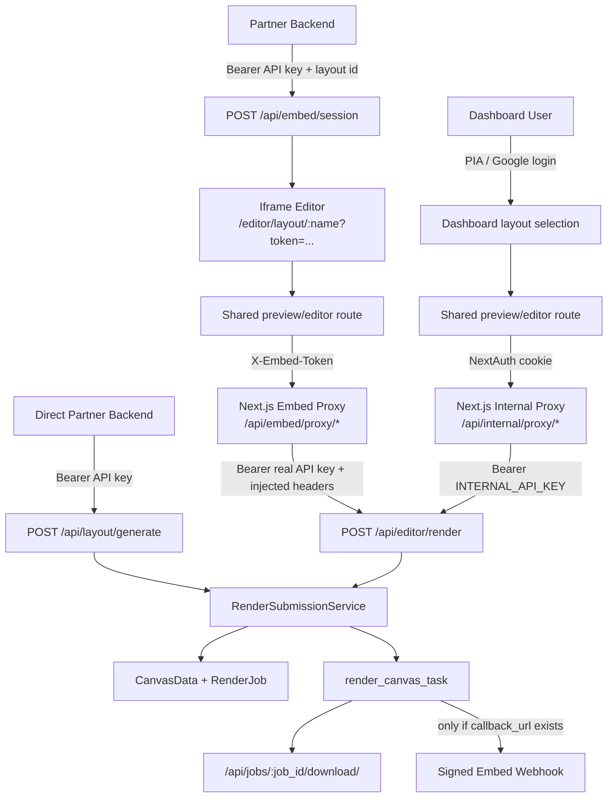

# CLAUDE.md

This file provides guidance to Claude Code (claude.ai/code) when working with code in this repository.

**This file holds current rules and current state only.** The incidents, measurements and dated reversals that explain *why* a rule exists live in [docs/HISTORY.md](docs/HISTORY.md), organised under the same headings as this file. When a rule here seems arbitrary, look it up there before relaxing it. When you learn something new the hard way, add the rule here and the story there.

## What This Project Does

Product Editor is a full-stack print-file generator for Printo.in. Customers upload and compose photos on an interactive canvas editor; the system asynchronously renders 300-DPI print files (PNG, with PDF as an alternate format) and delivers them either via direct download (dashboard users fetch the ZIP) or via a signed webhook to the embed caller's `callback_url` (printo.in's storefront then pulls the same download URL from its backend). The app does NOT push files to any internal OMS — it's a standalone generator.

## Docs — and which of them to trust

**This file is the current-state reference.** `docs/` is mostly *not*: a few files describe present behaviour and the rest are shipped-feature design records or plans. Count them with `ls docs/*.md` rather than trusting a number written anywhere. Index with per-file status: [docs/README.md](docs/README.md). **Where a doc and the code disagree, the code wins**, and where a doc and this file disagree, this file was more recently verified.

The ones to actually rely on:

| Doc | Use it for |
|---|---|
| [docs/INTEGRATION.md](docs/INTEGRATION.md) | The only doc with an **external** audience — printo.in's storefront team. Webhook payload, HMAC verification, the four download URLs, the daily request cap, drop-in Node/Python handlers. Changing `notify_caller_webhook_task` means updating this. |
| [docs/DATA_LIFECYCLE.md](docs/DATA_LIFECYCLE.md) | Any retention or DPDP question. One clock (`EXPORT_RETENTION_DAYS`, default 7, **prod runs 3**), what the purge deletes, backups (customer data lives at most 7 days there, and a restore re-erases purged orders). |
| [docs/AI_GUARDRAILS.md](docs/AI_GUARDRAILS.md) | Condensed rules that exist because breaking them already cost something. Overlaps this file deliberately. |
| [docs/HISTORY.md](docs/HISTORY.md) | The incidents and reversals behind the rules in this file, dated. |
| [docs/LOAD_BASELINE.md](docs/LOAD_BASELINE.md) | Load numbers. Append runs, never edit old ones. |

Nothing in `docs/` is checked by CI, so no claim there is self-verifying. If you correct a fact in one, check whether this file or `docs/AI_GUARDRAILS.md` states it too.

## Knowledge Graph

A knowledge graph of this codebase lives in `graphify-out/`. Before investigating architecture questions, tracing data flows, or understanding how components interact, query it first — it's much faster than grepping.

```bash
graphify query "how does the render pipeline work"
graphify path "EditorRenderView" "notify_caller_webhook_task"
graphify explain "render_canvas_task"
```

**Read the node/edge/community counts and the source commit out of `graphify-out/GRAPH_REPORT.md`** ("Graph Freshness"), never from a doc; compare the commit to `git rev-parse HEAD` to see whether the graph is stale. Key communities: Render Pipeline Core, Book Layout Engine, Calendar Layout Engine, Auth & API Key System, Validators & Parity Tests, Canvas Editor UI, Layout Templates, Data Lifecycle & DPDP. The doc nodes (this file, the PRDs) are hubs because they reference so much code; `S3Backend` is the in-memory S3 test double in `services/tests/fake_s3.py`, not production code.

Rules for maintaining it:

- **Committed:** `graph.json`, `GRAPH_REPORT.md`, `manifest.json`, `cost.json`, `.graphify_labels.json`. **Not committed:** `graph.html` — regenerate it with `graphify export html` (seconds, no API key) and open it in a browser. It was committed until 2026-10-13, when its history made up most of the repository's size.
- **After code changes:** `$(cat graphify-out/.graphify_python) scripts/graphify-refresh.py` — AST only, no LLM, a few seconds. Keeps the committed doc nodes, drops nodes whose file is gone, carries community names across by overlap, and prints an `unlabeled>=3` count for new communities to name.
- **After doc changes:** only a full `/graphify` run re-extracts docs (subagents, no API key). Build from the repo root so shell-script node IDs match the committed graph (`grep -c private_tmp graphify-out/graph.json` must be 0), validate each subagent chunk's ids against the AST before merging (`[name]` files come out as `name_…`, inner hook functions have no AST node and map to their hook), and carry community names across from the old `graph.json` by node overlap rather than re-clustering from scratch.
- **Don't use `graphify update .` or `graphify . --update`.** The first re-adds per-heading doc nodes a full rebuild removes and unnames communities; the second needs an LLM API key the graphify Python doesn't have.
- `.graphifyignore` excludes the vendored Scalar bundle, `backend/django/*/migrations/`, the e2e fixture photos and `public/icons/` (trivial nodes, a vision agent each).
- The health check's ~1,100 "dangling-endpoint" edges are AST imports of external packages (react, os, django) with no node in the corpus. Normal. The semantic layer should show zero.

---

## Hard constraints — git and shipping

This repo has no `staging` branch, so **`main` is production**. `deploy.sh` git-pulls `main` on the server; anything merged is one deploy away from customers. The gate between "written" and "live" is your check-in with the user — there is nothing else.

- **BEFORE ANY CODE EDIT: create a branch from freshly-pulled `main`. NO EXCEPTIONS. NO COMMITS ON MAIN.**
  ```bash
  git checkout main && git pull && git checkout -b feature/your-name
  ```
  Even a one-line fix. Never branch from wherever the tree happens to be. This checkout is shared with other Claude Code sessions, so local `main` goes stale within minutes and another session may switch the branch under you mid-task; prefer a scratchpad worktree (`git worktree add <dir> -b <branch> origin/main`) for anything longer than a few minutes.
- **Never push, open a PR, or merge without checking in first.** A request to do the work is not a request to ship it. Do the work, run the checks, STOP and report what changed and what you verified, then wait for an explicit go-ahead before `git push`, `gh pr create`, or `gh pr merge`.
- **Run `git status` and `git log --oneline -5` before every commit. Never `git add -A` or `git commit -a` — stage explicit paths.** Uncommitted files in the shared tree may not be yours. **Say what you found and left behind**, naming the files.
- **Never delete a branch — local or remote — without asking first and getting an explicit yes.** Includes `git branch -d`/`-D`, `git push origin --delete`, `gh pr merge --delete-branch`. Ask ("merged — want me to delete `<branch>`?") every time.
- **A PR number is not something to predict.** Use the URL `gh pr create` returns.

## Commands

### Frontend (Next.js)
```bash
cd frontend/nextjs
pnpm dev          # http://localhost:3000 direct, or http://localhost:5004 via Docker
pnpm dev:clean    # rm -rf .next first — use when routes 404 in dev
pnpm build
pnpm typecheck    # tsc --noEmit, full strict mode — run before pushing
pnpm lint         # eslint src
pnpm lint:fix
```
The dev Mac's system node is v16; prefix `PATH=$HOME/.nvm/versions/node/v22.23.2/bin:$PATH` on every pnpm command.

### Backend (Django)
```bash
cd backend/django
python manage.py migrate
python manage.py showmigrations
python manage.py shell
```

### Tests

Three harnesses: frontend Jest, backend DB-free `services/tests/`, and backend DB-backed `api/tests/`.

**Frontend — Jest** (`next/jest` + SWC + `@happy-dom/jest-environment`; config in `frontend/nextjs/jest.config.ts`). Only `src/**/__tests__/**` is collected. happy-dom rather than jsdom because jsdom auto-requires the native `canvas` module Fabric.js peer-deps.

```bash
cd frontend/nextjs
pnpm test
pnpm test:watch
pnpm test -- src/lib/__tests__/dpi-utils.test.ts
pnpm test -- -t "clamps the offset"
pnpm test:parity          # calendar TS↔Python parity suites only
```

**Editor page characterization suite** — `src/app/editor/layout/[name]/__tests__/page.characterization.test.tsx` renders the whole editor page under Jest against `FakeBackend` (`editor-page-harness.tsx`) and pins what the page sends and when (Add-Files appends, autosave only after restore settles and without `data:` previews, the quantity rules, the embed render payload and `pe:render_job` target origin, the dashboard download hand-off, the calendar holiday gate, the book page count, Escape behaviour in the prompts, the pinned toolbar, card keyboard handling, the template-first rule). It must pass unchanged across any editor refactor. Real timers, ~35 s. Gotchas: `useRouter`/`useParams` stubs must return the **same object every render**, and the over-quantity prompt is `role="alertdialog"`.

**Editor smoke suite (Playwright)** — `pnpm e2e`. Drives Chrome against the local stack and a production build on :3057: embed journeys inside a fake storefront, the slow-restore check, quantity rules, HEIC, the canvas editor, the dashboard (minted cookie, never PIA credentials) with a real render to a ZIP, the calendar preview, a phone-profile tap-to-swap. Local only, purges what it creates, skips the render test without a Celery worker. Setup: [frontend/nextjs/e2e/README.md](frontend/nextjs/e2e/README.md).

**Backend — `services/tests/`: standalone modules, no pytest, no `manage.py test`.** Every `test_*.py` ends in an `if __name__ == "__main__":` block that runs its own `test_*` functions. CI globs them, so a new module needs no workflow edit. Keep them DB-free and mediapipe-free (CI installs a mediapipe-stripped requirements subset). Count them with `ls backend/django/services/tests/test_*.py | wc -l`.

Run through the container — the dev Mac has no Pillow/Django. **Override the entrypoint**: it ignores `$@` and would boot gunicorn and hang. **The image bakes in source via `COPY`**; `docker-compose run backend` tests the last build, not your tree, and a new module reads as "not found" rather than "not rebuilt". Either `docker-compose build backend` first, or mount the tree over `/app`:

```bash
docker-compose run --rm --entrypoint /opt/venv/bin/python backend -m services.tests.test_caption_layout
# or, against a worktree without rebuilding:
docker run --rm --network product-editor_web --env-file .env -e DEBUG=1 -e SENTRY_DSN= \
  -v "$PWD/backend/django:/app" -w /app --entrypoint /opt/venv/bin/python product-editor-backend:latest \
  -m services.tests.test_caption_layout
```

All of them, as CI does:
```bash
docker-compose run --rm --entrypoint bash backend -c 'for f in services/tests/test_*.py; do /opt/venv/bin/python -m "services.tests.$(basename "$f" .py)" || echo "FAIL $f"; done'
```
With a local venv the bare form works; `DEBUG=1` is mandatory or the production `DJANGO_SECRET_KEY` fail-fast aborts first.

**Backend — `api/tests/`: ordinary Django `TestCase`s, real Postgres + Redis, `manage.py test`.** For things that genuinely need the DB or the real cache (`LayoutCatalogue` collation, `invalidate_layout_caches`, order purge, templates, the API-key daily cap). Don't fake the DB with sqlite — the case-sensitivity guarantee is Postgres collation. `api/tests/__init__.py` must exist or discovery crashes.

```bash
docker-compose up -d db redis backend
docker-compose exec backend python manage.py test api.tests --verbosity 2
```
**If you touch `invalidate_layout_caches` or `LayoutCatalogue`, run this suite** — nothing else catches a regression there.

**CI** (`.github/workflows/ci.yml`, push/PR to `main`): `backend` (the DB-free loop + OpenAPI schema validation), `backend-db` (Postgres 16 + Redis 7 service containers, `manage.py test api.tests`), `frontend` (`typecheck` → `lint` → `test -- --ci`). The org is on GitHub Free with Actions billing-locked, so checks may show red for reasons unrelated to the code — verify locally.

### Verifying UI changes in a real browser (no PIA login)

**Editor route** (`/editor/layout/[name]`) is not auth-gated; use an embed token:

```bash
docker-compose up -d db redis backend        # backend on :8000
# frontend must run from source (pnpm dev) — the Docker image serves a BUILD
KEY=$(grep -E "^DIRECT_API_KEY=" .env | cut -d= -f2-)
curl -s -X POST http://localhost:8000/api/embed/session \
  -H "Authorization: Bearer $KEY" -H 'Content-Type: application/json' \
  -d '{"order_id":"TEST-1"}'
# → open http://localhost:3000/editor/layout/<name>?token=<token>
```

**Auth-gated pages** (`/dashboard`, `/editor/layouts`) — mint a NextAuth cookie. Run **inside `frontend/nextjs`** so `next-auth` resolves, with `AUTH_SECRET` from `frontend/nextjs/.env.local` (it differs from the root `.env`; the wrong one silently yields a rejected cookie):

```js
import { encode } from 'next-auth/jwt';
const now = Math.floor(Date.now() / 1000);
await encode({ salt: 'authjs.session-token', secret: AUTH_SECRET, token: {
  id: 'LOCAL-DEV', name: 'Local Dev', email: 'local@printo.in',
  role: 'admin',
  is_staff: false,                 // ADMIN tier — gates /django-admin/
  is_ops_team: true,               // OPS tier — template/calendar/holiday writes
  registration_status: 'ACTIVE',    // anything else is refused per request
  accessToken: 'x', refreshToken: 'x', accessTokenExpires: (now + 3600) * 1000,
  sub: 'LOCAL-DEV', iat: now, exp: now + 3600 } });
// then: document.cookie = "authjs.session-token=<jwt>; path=/"
```

Mint one per tier (`is_staff: true` Admin; `is_ops_team: true` alone Ops; both false Editor). `role: 'admin'` is legacy and expresses none of the tiers.

**You cannot swap that cookie a second time from JavaScript.** Once the page calls `/api/auth/session`, NextAuth re-issues it HttpOnly and a second `document.cookie` write is silently ignored. Sign out server-side first:

```js
const { csrfToken } = await fetch('/api/auth/csrf').then(r => r.json());
await fetch('/api/auth/signout', { method: 'POST',
  headers: { 'Content-Type': 'application/x-www-form-urlencoded' },
  body: new URLSearchParams({ csrfToken, json: 'true' }) });
```
Corollary: **`authjs.session-token` missing from `document.cookie` does not mean there is no session.** Read `/api/auth/session` and assert on the flags there. Local dev only; delete the script afterwards.

**Getting a photo onto the canvas:** draw on an off-screen canvas, wrap in `File`/`DataTransfer`, assign through the native setter (`Object.getOwnPropertyDescriptor(HTMLInputElement.prototype,'files').set`) on the input with `multiple=true` (the other is the replace-photo input), then dispatch a bubbling `change`.

**Known automation limits:**
- The layout-card action buttons (View Raw JSON / Delete / Edit / Duplicate) do not respond to synthetic clicks. Automation artifact, reproduced on unmodified `main`. Verify via code + `curl` and ask the user for one manual click.
- To assert Fabric object state, walk the React fiber from `canvas.lower-canvas` (`__reactFiber$…`) up through `memoizedState` for a hook whose `.current` has `_objects` + `renderAll`; `fc.fire('object:moving', {target})` exercises the real handlers.
- Pixel-sampling a Fabric canvas must allow for alpha blending (guides draw at 0.7–0.8 opacity): test hue dominance, not an exact hex.
- `next.config.mjs` is **not** hot-reloaded; restart the dev server after editing it.
- Routes 404ing in dev → `pnpm dev:clean`.
- IntersectionObserver never fires in automated browser panes; screenshots force delivery.

### Checking a deployed UI change on production (Claude in Chrome)

For a layout or sizing change, check the *deployed* build, not only the local one: the dashboard puts two header bars above the cards that the embed does not (a local embed check missed a 41px overflow, PR #289). The user signs in themselves in the Chrome tab (never enter their credentials), then, from that session and **only with the user's go-ahead for each write**:

- **Measure** with `javascript_tool` against `/editor/layout/<name>`: add a photo with the `DataTransfer` trick above and read `getBoundingClientRect()` of the card (`[role=button][aria-label^="Edit canvas"]`, its parent) against `innerHeight`; step window sizes with `resize_window` (outer size; note the original first and restore it, the screen caps the height).
- **Make test data without an API key** through the dashboard's own proxy, same-origin with the session cookie: `POST /api/internal/proxy/ops/layouts/<name>` (multipart `layout_data`) creates a layout; `POST /api/internal/proxy/embed/session` with `{"order_id":"ZZ-..."}` returns an embed token. Load `/editor/layout/<name>?token=<token>` in a **same-origin `<iframe>`** (build it from a blank same-origin page such as `/api/health`) to measure the embed at storefront sizes; a cross-origin printo.in page can only be screenshotted. Keep tokens out of logs.
- **Purge is the user's call.** `DELETE .../ops/orders/<id>/purge?api_key=DIRECT` (the dashboard authenticates as `DIRECT` while the two keys are equal) is refused by the auto-mode classifier as irreversible; test orders (`PE-…`, `ZZ-…`) otherwise expire on the retention clock (3 days). Name test layouts `zz_…` and tell the user what was left behind.

### Real-phone check (needs the user's phone)

A desktop window narrowed under 640 px is **not** a phone: touch, the address-bar height, safe areas and the on-screen keyboard are not emulated. So before calling a change to the editor's phone layout (`<sm`: the 86vw `max-w-sm` card, the quick-action rail, the toolbar, the sideways-scrolling two-sided row, tap-to-swap, pinch) verified, **ask the user for a screenshot from a real phone with a short message**, and say exactly what to look at:

1. Send me a phone (iPhone Safari and/or Android Chrome) screenshot of the editor with **one photo** and then with **several**.
2. Is the whole card visible without sideways scrolling, and is the quick-action rail (rotate, fit, blur, delete) fully on the card?
3. Are Save & Continue / Download reachable without a zoom?
4. For a front/back product, does the row scroll sideways with both sides reachable?

To give the user something to open, create a session as above and send them `https://product-editor.printo.in/editor/layout/<name>?token=<token>` (valid about 2 hours) or have them use a real product page on `alpha.printo.in/product-editor`. Until a phone screenshot exists, report phone behaviour as **not verified on a device**. State of play (2026-10-23): the card-sizing rules (#285, #286, #289) change nothing below `sm` and were checked only in desktop windows down to 500 px.

### Docker (primary workflow)
```bash
docker-compose up -d
docker-compose exec backend python manage.py migrate   # always via the backend container
docker-compose ps celery-worker-standard celery-beat
docker-compose logs -f <service>
```

**First run on a fresh clone:** the `proxy` service bind-mounts `proxy/nginx/certs/{origin.crt,origin.key}`, which are gitignored. Run `./deploy.sh` once (it generates a self-signed bootstrap cert) or:
```bash
mkdir -p proxy/nginx/certs
openssl req -x509 -nodes -days 3650 -newkey rsa:2048 \
  -keyout proxy/nginx/certs/origin.key -out proxy/nginx/certs/origin.crt \
  -subj "/CN=localhost/O=product-editor self-signed"
chmod 600 proxy/nginx/certs/origin.key
```
Copy `.env.example` → `.env` and fill the required secrets (`DJANGO_SECRET_KEY`, `AUTH_SECRET`, `EMBED_INTERNAL_SECRET`, `INTERNAL_API_KEY`, `POSTGRES_PASSWORD`, `DIRECT_API_KEY`). Sibling projects take 5432/5004; this repo's `.env` remaps to 5434/5005.

### Utilities
```bash
./deploy.sh                                                    # Production deployment (on the server)
./fresh-install.sh
./reset-db.sh
./benchmark.sh
API_KEY=<key> [BASE=<url>] ./scripts/smoke-test-embed.sh       # embed flow end-to-end
API_KEY=<key> [BASE=<url>] ./scripts/smoke-test-calendar.sh    # calendar/ops surface
API_KEY=<key> [BASE=<url>] ./scripts/smoke-test-book.sh
API_KEY=<key> [BASE=<url>] ./scripts/smoke-test-templates.sh  # + ENABLE_OPS_WRITE=1 [SMOKE_RENDER=1]
./scripts/test-backup-restore.sh                               # restore into a throwaway DB + assert row counts
```
Smoke tests default to `BASE=http://localhost:5004`; for the nginx edge use `BASE=https://localhost` with `-k`. Rebuild the frontend image before testing frontend-side changes. The scripts print their own pass/fail totals — read those. The shared colour/print helpers are `scripts/lib/print.sh` (deploy, reset-db) and `scripts/lib/smoke.sh` (the smoke tests).

## Architecture

### Stack
- **Frontend**: Next.js 16 (App Router), React 19, TypeScript, Fabric.js 7.2, Tailwind CSS
- **Backend**: Django 5 + DRF, Celery 5.3.4, Pillow 10.3.0
- **Infrastructure**: PostgreSQL 16, Redis 7, nginx 1.27 (edge proxy), Docker Compose

### Key Data Flow

All exports go through one unified server-side pipeline: every Submit/Download triggers a Celery render job regardless of canvas count (the client-side shortcut was removed in v1.8).

**Access-mode invariant:** the dashboard login flow and the iframe embed flow must produce the same print output for the same layout, uploads, transforms, overlays, calendar data, colours, `export_format` and `include_uploads`. Authentication and delivery differ; editor state, render behaviour and the artifact contract must not.

**Editor → render → delivery:**

1. Customer composes on the Fabric.js editor (`frontend/nextjs/src/app/editor/`).
2. On Save & Continue (embed) or Download (dashboard), `executeServerRender()` (`useServerRender.ts`) uploads every `File` via the chunked upload API (2 MB chunks, 4 parallel; `src/lib/upload-utils.ts`), then POSTs `/api/editor/render` with `{ layout_name, order_id, canvases[] }`.
3. Backend creates `CanvasData` + `RenderJob` through `RenderSubmissionService` and dispatches `render_canvas_task`.
4. Celery: `LayoutEngine` consumes the submit-time `CanvasData.render_state` snapshot — **and only that**; `editor_state` is the autosave's field and is never read by the pipeline — and Pillow renders at 300 DPI (PNG, or PDF when `export_format='pdf'`).
5. Files land under `EXPORTS_DIR/<job_id>/`, served by `GET /api/jobs/<job_id>/download/`.
6. **Embed delivery:** if `EmbedSession.callback_url` was set, `notify_caller_webhook_task` POSTs the payload below with `X-Signature: sha256=<hmac>` signed with the api_key; the caller fetches the ZIP(s) with Bearer auth. *No internal OMS push exists.*
7. **Dashboard delivery:** the browser polls `/api/render-status/{job_id}/` with backoff and fetches the ZIP directly.
8. After submit the embed posts `window.parent.postMessage({ type: 'pe:render_job', jobId, orderID })` for the parent's "preparing your design" UX; files travel by webhook, not postMessage.

**Direct partner API (`GenerateLayoutView`, `POST /api/layout/generate`)** shares the same `RenderSubmissionService` and output contract; direct callers poll `/api/render-status/<job_id>/`. Webhooks are configured only via `EmbedSession.callback_url`. External partners have been told embed-only; the direct endpoints are kept deliberately.



### Frontend Structure

- `src/pia-auth.ts` — NextAuth v5 config; Credentials providers (PIA password, Google ID token); `jwt`/`session`/`redirect` callbacks; `CredentialsSignin` subclasses for outage vs. timeout; PIA fetches use `AbortSignal.timeout(10_000)`.
- `src/proxy.ts` — Next.js 16 proxy file (formerly `middleware.ts`). Server-side auth gate for `/dashboard/*` and `/editor/layouts/*`; bounces logged-in users off `/login`. Excludes `/editor/layout/[name]`, which serves both the dashboard and the embed.
- `src/app/login/page.tsx` + `src/app/actions/auth.ts` — login form + server action; per-IP rate limit (5/min, in-memory, single-process — swap for Redis if the frontend is ever scaled).
- `src/types/next-auth.d.ts` — type augmentation for `Session`/`JWT`; never `(session as any)`.
- `src/app/editor/layout/[name]/` — the editor page and its split. `page.tsx` (~700 lines) holds shared state, the active-side sync effects, the hook calls in their original order, and the markup. **"Add Files" appends, it does not replace** (a native file input is never cumulative). Pieces beside it:

  | File | Owns |
  |---|---|
  | `editor-utils.ts` | helpers and constants (`resolveRotation`, `activatesCard`, `isLostLocalImage`, …) |
  | `useEditorEnvironment.ts` | layout name, embed token, parent origin, order id and its URL sync, ordered qty, `?template=`/`template_flow`, which proxy to call; `useLoginRedirect` |
  | `useLayoutLoader.ts` | the `/editor/init` load (adopts the embed session's order id *before* setting the layout), fonts, templates; `useActiveSurfaceLayout` |
  | `useSubmitGuards.ts` | blank-side and low-resolution warnings |
  | `useCanvasGeneration.ts` | `useObjectUrls`, `useRenderCanvas`, `generateCanvases` (orientation, smart crop, edits kept by file identity, template seeding) |
  | `useFileIntake.ts` | `handleFileChange` (appends), `processSelectedFiles` (CMYK, calendar 12-page cap, qty check, multi-surface dealing, book overflow, re-pick-over-edits), Replace, the prompt decisions and state |
  | `useCardActions.ts` | open/close the canvas editor (`?canvas=` deep link), quick actions via `updateCanvasState`, remove, tap-to-swap, drag-and-drop; `usePanGesture.ts` |
  | `useServerRender.ts` | `executeServerRender` (blank sides sent blank under their key, each photo uploaded once, `pe:render_job` to `parentOrigin` or poll+download), `executeBatchDownload`, `handleSubmitDesign`, submit-side state |
  | `useDesignPersistence.ts` | `useAutosaveAndRestore` (one debounced writer `scheduleAutosave`, run-once restore, `reclaimUnusedFiles`), `usePhotoStore` (IndexedDB) |
  | `useCalendarEditor.ts` | theme/type/palette/per-day entries, `selectCalendarDate`, day-photo upload, `printedHolidays`; `useCalendarDefaults` |
  | `useBookPages.ts` | page count via `reconcilePageCount`, pages held back on shrink, overflow prompt state, spread/spine memos |
  | `useImposition.ts` + `ImpositionModal.tsx` | print-sheet settings, Fabric sheet preview, full-res export |
  | `useStickyToolbar.ts`, `EditorToolbar.tsx` (+`useDashboardHeader`), `EditorBanners.tsx`, `ProcessingOverlay.tsx`, `EditorNotices.tsx`, `EmbedSubmittedOverlay.tsx` | page chrome |
  | `CanvasGrid.tsx`, `CanvasCard.tsx`, `EmptyState.tsx`, `BookSpreadPreview.tsx`, `CalendarSection.tsx`, `CalendarCards.tsx`, `dialogs/` (eight dialogs) | main content |
  | `FabricEditor.tsx`, `CanvasEditorModal.tsx`, `CanvasEditorSidebar.tsx`, `AlignmentToolbar.tsx`, `IconBrowser.tsx` | the canvas editor modal |
  | `fabric-renderer.ts`, `frame-fill.ts` | the thumbnail renderer and the client-shared frame fill |
  | `canvas-merge.ts`, `layout-template.ts`, `template-authoring.ts`, `imposition.ts`, `pinch-utils.ts` | pure logic |

  Two things stay in `page.tsx` on purpose: `duplicateFills` (reads `intentionalDupesRef` during render, tolerated only there by the compiler lint) and the document-level Escape handler plus beforeunload guard (they read state several hooks own).
- `src/components/` — shared React components; `ui/Dropdown.tsx` and `ui/NumberField.tsx` are the on-brand controls; `CalendarLayoutEditor.tsx` and `BookLayoutEditor.tsx` are the ops authoring UIs (same-named `draftToLayoutJson`/`validateDraft` in each are different schemas, not a duplicate).
- `src/components/ServiceWorkerRegistration.tsx` + `public/sw.js` — production-only cache-first SW for `/_next/static/*` and `/static/*`; bump `CACHE_VERSION` to bust.
- `src/lib/` — pure modules: `fabric-renderer`-adjacent maths (`dpi-utils.ts`, `caption-layout.ts`, `calendar.ts`, `book-layout.ts` — each with a Python twin and parity tests), `upload-utils.ts`, `zip-utils.ts` (still used by imposition; don't delete), `file-store.ts` (IndexedDB, falls back to memory under Safari ITP), `file-identity.ts` (`fileExtension`, `fileFingerprint` — the one place a File's identity string is defined), `heic-convert.ts`, `pdf-import.ts`, `ml-orientation.ts`, `submit-guards.ts`, `roles.ts`, `ops-guard.ts`, `read-error.ts`, `units.ts`, `layout-utils.ts` (`getCanvasSpec`, `getFrames`), `icon-raster.ts`, `overlay-fonts.ts`, `overlay-text.ts`, `overlay-geometry.ts`, `shape-catalog.ts`.
- `src/app/api/embed/proxy/[...path]/route.ts` — embed proxy; resolves token → `{ apiKey, orderId, callbackUrl, includeUploads, qty }`, injects `X-Order-ID`, `X-Callback-URL`, `X-Include-Uploads`, `X-Order-Qty`, caches in-process (110 min, 10k cap). **Anything injected as a header must be in the cached tuple.** Streams upstream bodies.
- `src/app/api/internal/proxy/[...path]/route.ts` — dashboard proxy; NextAuth session → `INTERNAL_API_KEY`; the ops-tier gate lives here (see Role model). Streams upstream bodies.
- `src/app/dev/calendar-preview/` — developer page, `notFound()` in production builds.

### Backend Structure

- `api/views/` — a package split by area; `__init__.py` re-exports so `from api.views import X` works. `render.py` (`GenerateLayoutView`, `EditorRenderView`, `RenderStatusView`), `downloads.py`, `embed.py` (`EmbedSessionView`, `EmbedSessionValidateView`, `EditorInitView`, `CanvasStateView`), `uploads.py`, `layouts.py`, `layout_admin.py` (`LayoutManagementView`, `invalidate_layout_caches`, `_store_uploaded_masks`), `templates.py`, `calendar_assets.py`, `system.py` (`HealthView`, `ConfigView`, `CSPReportView`), `ops.py`, `media.py`, `_common.py` (`is_safe_layout_name`). **A test that patches a name must patch the module the view lives in**, not the package re-export. **Pillow's 500 MP pixel ceiling is set at startup** in `api/apps.py` from `services/image_loader.MAX_IMAGE_PIXELS`, pinned by `services/tests/test_image_pixel_cap.py`.
- `api/render_submission.py` — `RenderSubmissionService`, the one place a render is accepted (CanvasData upsert, RenderJob, queue, dispatch).
- `api/tasks.py` — `render_canvas_task`, `notify_caller_webhook_task` (only when `callback_url` set; HMAC-SHA256 of api_key), `notify_caller_render_failed_task`, `garbage_collector_task` (`soft_time_limit=3300` / `time_limit=3600`).
- `api/models.py` — `APIKey`, `EmbedSession`, `CanvasData`, `RenderJob`, `UploadedFile`, `ExportedResult`, `APIRequest`, `LayoutCatalogue`, `LayoutTemplate`.
- `api/authentication.py` — `BearerTokenAuthentication` (API keys; enforces the daily cap), `PIAAuthentication`.
- `api/middleware.py` — `APIRequestLoggingMiddleware` (audit rows + the quota counter), `RateLimitMiddleware`; `_get_client_ip` is shared so both trust the same hop.
- `api/validators.py` — `MAX_FILE_SIZE_MB` from `settings.MAX_UPLOAD_FILE_SIZE_MB`; `validate_calendar_layout`, `validate_book_layout`.
- `api/purge.py` — `purge_order_data` (DPDP erasure); `services/purge_ledger.py` records each purge so a restore can re-apply it.
- `layout_engine/engine.py` — Pillow renderer at 300 DPI; `_smart_downscale` to 2× frame target; transpose fast-path for 90/180/270; per-frame pan/zoom/rotation; explicit `Image.close()` + `gc.collect()` between canvases; `_composite_canvas` calls `services.overlay_renderer.render_overlays` after frames and before the mask; `_load_mask` reads local disk then `get_storage().read_mask()` and never prints without the mask.
- `services/` — pure modules: `overlay_renderer.py`, `shape_catalog.py` (Python twin of `lib/shape-catalog.ts`), `google_fonts.py` + `fonts.py` (variable-font axes set **by tag**, never by position), `image_loader.py` (**the single choke point for opening customer photos** — never `Image.open(...).convert("RGBA")` directly, it drops the ICC profile), `heic.py`, `calendar_layout.py`, `calendar_renderer.py`, `calendar_holidays.py`, `holiday_refresh.py`, `book_layout.py`, `template_decoration.py`, `order_qty.py`, `request_quota.py`, `storage.py` (`LocalStorage`, `S3Storage`, `get_storage`), `asset_store.py`, `fs_utils.py` (`is_uuid`, `dir_size_bytes` — shared by the GC sweeps), `orphan_exports.py`, `chunk_staging.py`, `gc_status.py`, `jobs_per_day.py`, `url_safety.py`, `ops_config_backup.py`.
- `product_editor/celery.py` — queue routing (all tasks → `standard`), `worker_max_tasks_per_child = 50`, `worker_prefetch_multiplier = 1`, `task_acks_late`, and `close_old_connections` on **both** `task_prerun` and `task_postrun`.
- `product_editor/settings.py` — `CONN_HEALTH_CHECKS: True`; django-csp after `SecurityMiddleware`, report-only via `CSP_REPORT_ONLY`; Redis split: `REDIS_URL` db 0 is the durable broker, `REDIS_CACHE_URL` (`redis-cache`, allkeys-lru) is the Django cache.
- **Backend Dockerfile** is multi-stage; `collectstatic` runs at build time with an inline build-only `DJANGO_SECRET_KEY`. Verify Dockerfile/settings-import changes with a **clean** build.

### API reference (Scalar) — `GET /docs/api/`

Scalar renders the OpenAPI document drf-spectacular generates from `@extend_schema` decorators. Schema at `/api/schema/`; page template `api/templates/scalar.html`.

- **A view with no `@extend_schema` is dropped from the document**, not merely undocumented. Body-carrying methods need explicit `request=`, every operation explicit `responses=`.
- Auth schemes come from `OpenApiAuthenticationExtension` subclasses in `api/schema.py`, registered from `ApiConfig.ready()`. (`SECURITY_DEFINITIONS` is a drf-yasg name and is ignored.) `api/schema.py` also holds `ProductEditorAutoSchema`, which names a detail route after its trailing parameter so dual-mounted views get stable operationIds.
- `FontsView`, `CalendarStylesView`, `HolidaysView` declare `AllowAny` and gate writes in the handler; their operations carry explicit `auth=` (`auth=[]` on reads, `OPS_WRITE_AUTH` on writes). **If you add a method to one of these, set `auth=` explicitly.**

Verify after touching any decorator (must exit 0 silently; not in CI; rebuild first or you validate the last build):
```bash
docker-compose run --rm --entrypoint /opt/venv/bin/python backend \
  manage.py spectacular --validate --fail-on-warn --file /dev/null
```

### Async Queue

**One** Celery worker service, `celery-worker-standard`, consuming `-Q priority,standard`. Nothing routes to `priority`; the worker drains it anyway so a task someone sends there cannot sit in Redis forever. It is a safety net, **not** a QoS tier — Celery round-robins across `-Q` queues. Express orders that need to jump the line need a second worker *and* a dispatch site.

Concurrency auto-detects from CPU count per replica (2 slots on the 2-core prod box); cap with `CELERY_CONCURRENCY`. Memory cap 2 GB per replica. Scale: `docker compose up -d --scale celery-worker-standard=4`.

Retry: `self.retry()` with exponential backoff (2s → 4s → 8s), max 3; `MemoryError` and `SoftTimeLimitExceeded` skip retries. **Never `autoretry_for`.** `render_canvas_task` has a poison-pill guard (counts only genuine broker redeliveries via `delivery_info.redelivered`, aborts after 3) and a 500 MB disk pre-flight. Always `transaction.on_commit(lambda: task.apply_async(...))` **inside** the `atomic()` block.

### Garbage collection

`garbage_collector_task` runs **every 6 hours** (00/06/12/18 UTC): exports expire in a 03:00–12:00 UTC wave, so a nightly sweep lagged a day. If retention or the customer timezone changes, re-plot expiries by hour before trusting the schedule.

- **Check whether it is running via `garbage_collector.stale` / `.failing` on `GET /api/celery/monitor/`** (ops-only), recorded by `services/gc_status.py` to `storage/gc_last_run.json`. Do NOT infer it from `ExportedResult.is_deleted` — the sweep tombstones and hard-deletes in the same pass, so that count reads 0 either way. Alert on `stale` OR `failing`; they answer different questions. Read `docker-compose logs --since 24h celery-worker-standard` before theorising; those logs die on container recreation.
- The same endpoint carries a live `disk` block (`used_percent`, `free_gb`, `pressure` at >80%), read at request time.
- **Orphaned export directories** (`services/orphan_exports.py`): the one sweep that deletes on the *absence* of a DB row. `GC_ORPHAN_SWEEP` = `off` | `dry_run` | `delete` (prod runs `delete`). Five conditions must all hold (`_classify`): UUID name, no `RenderJob`, no `ExportedResult` path, no `CanvasData.order_id`, mtime older than retention + 1 day. **Any new export-directory naming convention must be added there.** A DB failure keeps everything.
- **Abandoned chunk staging** (`services/chunk_staging.py`): reclaims `UPLOADS_DIR/.chunks/<uuid>/` untouched for `CHUNK_STAGING_MAX_AGE_HOURS` (24), judged by the newest mtime of the directory *and its contents*. Deletes by default — part files are unusable without `/complete`.
- Expired `EmbedSession` rows older than 30 days and `APIRequest` rows older than `API_AUDIT_RETENTION_DAYS` are swept here too. **Before adding a sweep, grep the whole of `garbage_collector_task`** — an existing one may report under an unexpected counter name.

### Celery and stale database connections

`CONN_MAX_AGE` does nothing in a worker on its own (no request signals). Two halves, both required: `close_old_connections` on `task_prerun` **and** `task_postrun` in `celery.py`, and `CONN_HEALTH_CHECKS: True` in settings. Pinned by `services/tests/test_gc_status.py`.

## Layout Loading

**Layouts load from the Postgres `LayoutCatalogue`, not disk.** Every path — dashboard, embed init, embed submit, direct API sync and async — queries `LayoutCatalogue` and passes the definition in:

```python
layout_obj = LayoutCatalogue.objects.get(name=layout_name, is_deprecated=False)
engine = LayoutEngine(storage.layouts_dir(), job_exports_dir, layout_definition=layout_obj.definition)
```
**Missing `layout_definition` causes `[Errno 2] No such file or directory` on render.** Customer-facing lookups go through `LayoutCatalogue.resolve_active(name)` (walks `renamed_to`).

## Server-Side Render Flow

**Triggers:** always — `handleSubmitDesign` (embed) and `executeBatchDownload` (dashboard) both call `executeServerRender()`.

| Step | Detail |
|---|---|
| Collect files | every canvas → frame → `originalFile`, deduplicated; a lost `source: 'local'` image (`isLostLocalImage`) blocks the submit and is named |
| Upload | `uploadFiles()` — 2 MB chunks, 4 parallel; resumes acked chunks; a GC'd session (404) restarts once |
| Build payload | per frame `{ upload_id, offset_x, offset_y, scale, rotation, fit_mode }`; per canvas the **real `surface_key`** (`surfaceStates[0]?.key ?? activeSurfaceKey` — a literal matched no surface and printed blank) |
| Submit | `POST /api/editor/render` (or via the embed proxy); `order_id` in body |
| Embed | `postMessage({ type: 'pe:render_job', jobId, orderID })` → submitted panel |
| Dashboard | poll `/api/render-status/{job_id}/`; fetch the ZIP on `completed` |

### Chunked Upload API

```
POST /upload/init               { filename, file_size, total_chunks }  → { upload_id, chunk_size }   # UUID v4; 50 MB per file
PUT  /upload/{upload_id}/chunk?index=N   raw bytes                       → { chunk_index, received, total }
POST /upload/{upload_id}/complete                                        → { file_path, filename, file_size }
```
UUID v4 regex guard on chunk and complete; chunks staged in `UPLOADS_DIR/.chunks/{upload_id}/`, assembled with size + PIL validation; `UploadedFile.upload_session_id` maps `upload_id → file_path`. `total_chunks` is bounded, disk is pre-checked (507), each chunk body is capped at 2× `CHUNK_SIZE`.

### POST /api/editor/render

```json
{ "layout_name": "circle_48mm", "order_id": "EXT-JOB-123", "export_format": "png",
  "canvases": [ { "canvas_index": 0, "surface_key": "front",
      "frames": [ { "frame_index": 0, "upload_id": "<uuid>", "offset_x": -12.5, "offset_y": 3.0, "scale": 1.2, "rotation": 0, "fit_mode": "cover" } ] } ] }
```
Response `202`: `{ "job_id", "order_id", "status_url": "/api/render-status/<uuid>/", "queue": "standard" }`. `order_id` priority: `X-Order-ID` header (embed proxy) → body.

### Embed Session & Order ID Flow

```
Caller → POST /api/embed/session { order_id, callback_url, qty, include_uploads, template_id, template_flow }
       ← { token, order_id, callback_url, qty, expires_at, editor_url }
iframe loads ?token=<uuid>; every request → embed proxy resolveSession(token)
       → path+method allowlist (403 before token resolution) → cache 110 min
       → inject X-Order-ID, X-Callback-URL, X-Include-Uploads, X-Order-Qty
EditorRenderView persists callback_url onto CanvasData, snapshots include_uploads into render_state,
and looks qty up from EmbedSession (order_id + api_key) — NOT the header — to reject over-count with 400.
After render, only when canvas.callback_url is set: notify_caller_webhook_task POSTs with X-Signature.
```

Neither `order_id` nor `callback_url` ever appears in the iframe URL. Validation at session creation: `order_id` `^[A-Za-z0-9_.\-]{1,64}$`; `qty` via `parse_order_qty` — a whole positive integer ≤ `MAX_ORDER_QTY` (10,000), **numeric strings and integral floats accepted** (`"12"`, `12.0`), absent means NULL (unchecked), `0`/negative/fraction/bool rejected 400 — NULL and 0 must stay distinguishable; `callback_url` https, ≤ 2000 chars, SSRF-checked, no domain allowlist (the api_key is the auth).

**Sliding session TTL:** 2 h at creation; `EmbedSessionValidateView` extends by 1 h when under 30 min remain.

**Webhook payload:**
```json
{ "order_id", "job_id", "status": "completed|failed",
  "download_url", "print_download_url", "mock_download_url", "uploads_download_url",
  "expires_at", "file_count", "layout_name", "export_format",
  "qty_summary": { "ordered_qty", "placed_photos", "shortfall", "customer_acknowledged_shortfall", "summary" } }
```
`X-Signature: sha256=<hex>` = HMAC-SHA256(api_key, raw body). `download_url` is the combined archive (`1_customer_uploads/`, `2_mock/`, `3_print/`); the three `*_download_url`s are the same job split by `?content=print|mock|uploads` on one endpoint, nothing duplicated on disk; `uploads_download_url` is `null` when `include_uploads=false`; `content=mock` on a job without previews is 404. `qty_summary` is `null` unless the session set an enforceable qty; counts are server-derived, only `customer_acknowledged_shortfall` comes from the editor. `file_count` counts output files, not photos.

**Embed proxy allowlist — path AND method** (`ALLOWED_PATH_METHODS` in [route.ts](frontend/nextjs/src/app/api/embed/proxy/[...path]/route.ts); pinned by `__tests__/allowlist.test.ts`):

| Prefix | Methods |
|---|---|
| `layouts`, `layouts/masks`, `templates`, `templates/assets`, `editor/init`, `render-status`, `jobs`, `fonts`, `holidays`, `calendar-styles`, `config`, `embed/session` | **GET** only |
| `canvas-state` | GET, PUT |
| `upload` | POST, PUT |
| `editor/render`, `orientation`, `heic` | POST |

Fail-closed: anything else is 403 before token resolution. **The method half is load-bearing**: the proxy injects the session's real api_key, and `fonts`/`holidays`/`calendar-styles` accept ops writes upstream. **A new customer-facing endpoint must be added here AND in `allowlist.test.ts`**; ops/admin paths (`ops/*`, `exports/*`, `celery/monitor`, `django-admin`) must never be.

### HEIC decoding (iPhone photos)

`convertHeicFileIfNeeded` (`lib/heic-convert.ts`) tries, in order: `heic2any` (bundled libheif, 2021), the browser's own codec (Safari/iOS only), then `POST /api/heic/convert` → `services/heic.py` (pillow-heif). Current iPhones write gain-map HDR HEICs that `heic2any` cannot decode and Chrome has no codec for, so the server path is what makes them work there. `services/heic.py` preserves the ICC profile (colour-managed later by `image_loader`), writes **no EXIF** (libheif already applied `irot`/`imir`), and does not `register_heif_opener()` (global Pillow patch).

### Order quantity (`qty`)

Stored on `EmbedSession.qty` (nullable). The browser's copy reaches the editor via `X-Order-Qty` → `EditorInitView`; **the submission-time cap does not trust that header** — `EditorRenderView` looks `EmbedSession.qty` up by `(order_id, api_key)`, most recent wins, so a direct POST with the real key is capped too.

| Photos placed | Behaviour |
|---|---|
| **Over** `qty` | **Hard cap, both sides.** The picker offers *Keep first N* / *Choose again* (which must actively reopen the picker); the server rejects with 400. |
| **Under** `qty` | **Warn and proceed, both sides.** Banner + `QtyShortfallWarning`; submit works. |

Under-upload must never block (a wrong caller-supplied qty would strand a real order). **`qty_violation` has one `>` and no lower bound; don't add one.** Single-surface products only: `checkOrderQty` opts out on `surfaceCount > 1`; the server also exempts `productType` calendar/book — **the server half is deliberately narrower than the browser's and fails open** (unreadable layout, absent or unparseable value → don't check). Both halves count *placements* (frames with an `upload_id`), not distinct uploads — auto-fill repeats one photo. The legacy `?qty=N` URL param is a fallback the editor reads when the session carries none; nothing server-side honours it.

**Calendars measure against their own photo count, not `qty`.** The session's `qty` counts calendars bought, so for `productType: calendar` the editor uses `calendarPhotoSlots(layout)` (pages = `monthRange.count`, 12 when unreadable, × photo windows per page) in its place (`photoQty` in `page.tsx`): the same "X of Y photos" banner, *Choose which to repeat* picker and `QtyShortfallWarning`, and the page cap on cards (no longer a literal 12; the poster is 1). Skipping leaves today's print behaviour: page *i* uses photo *(i mod N)*. The server writes `qty_summary` for every calendar submit with `calendar_qty_summary` (same shape, calendar wording), whatever the session's `qty`, and never caps or summarises a calendar by `qty`. Twins `calendarPhotoSlots` ↔ `calendar_photo_slots`, pinned by `storage/parity-fixtures/calendar-photo-slots.json`.

| | File |
|---|---|
| Browser rule | `checkOrderQty` — `src/lib/submit-guards.ts` |
| Server rule | `backend/django/services/order_qty.py` |
| Header plumbing | embed proxy `route.ts` |

### API key daily request cap

`APIKey.max_requests_per_day` is enforced (`services/request_quota.py`): one counter per key per **IST calendar day** in the Redis cache, advanced by `APIRequestLoggingMiddleware` for exactly the requests the audit trail records (same exemptions; a 429 is not spend), checked by `BearerTokenAuthentication`, which answers **429 with `Retry-After`** until midnight IST once reached. **Blank = no cap (the default); 0 blocks.** Fails open when Redis is unavailable. Set it in the Django admin; `entrypoint.sh` deliberately does not seed a value, so an admin-set cap survives deploys. Pinned by `services/tests/test_request_quota.py` and `api/tests/test_apikey_quota.py`; the partner-facing description is in `docs/INTEGRATION.md`.

### postMessage Contract

| Type | When | Payload |
|---|---|---|
| `pe:render_job` | after every embed submit | `{ type, jobId, orderID }` |
| `pe:back` | customer taps the embed's Back button | `{ type, orderID }` |

`pe:back` exists because an iframe shares the tab's one session history: `history.back()` inside the frame can walk the *parent* off printo.in mid-checkout. The parent decides what Back means. **`targetOrigin` is never `'*'`**: `parentOrigin` = `ancestorOrigins[0]` → `document.referrer` origin → `NEXT_PUBLIC_EMBED_PARENT_ORIGIN` → `https://printo.in`.

### Engine behaviour worth knowing

- `_smart_downscale` pre-shrinks sources to 2× the frame target (BOX resample) before compositing; the defensive `.copy()` was removed, callers reassign the return value.
- PNGs are written without `optimize=True`; ZIPs use `STORED`.
- Source images open inside `with Image.open(...)`; canvases, intermediates and masks are closed and `gc.collect()`ed per canvas.
- Per-frame transform order: rotate (`expand=True`) → smart downscale → `extra_scale` → cover/contain → pan (`int(offset)`) at paste.
- Partial failure on a multi-surface/calendar/book render removes every output so far and raises a tagged error naming the surface; the retry re-renders all.

### Known Limitations

- **50 MB per-file limit** (`ChunkedUploadInitView`); RAW files may exceed it.
- **No duplicate render guard**: the same `order_id` submitted twice creates a new `RenderJob` each time; the button is disabled during `isDownloading`.

## Auth & Login Flow

The dashboard side is auth-gated; the embed iframe is not (embed token, not session).

- **NextAuth v5** in `src/pia-auth.ts`; Credentials provider POSTs to `${PIA_API_BASE_URL}/auth/`; JWT strategy; the `jwt` callback silent-refreshes via `/auth/token/refresh/`.
- **Server gate** `src/proxy.ts` for `/dashboard/*` and `/editor/layouts/*`.
- **Login server action** (`actions/auth.ts`): per-IP limit 5/60 s (IP from `X-Forwarded-For` as nginx sets it), then `signIn("credentials", …)`, mapping `PiaTimeout` / `PiaServiceUnavailable` to messages.

| PIA response | `authorize` | UX |
|---|---|---|
| 2xx + `access` | user object | logged in |
| 4xx | `null` | "Invalid credentials" |
| 5xx | `PiaServiceUnavailableError` | "temporarily unavailable" |
| timeout | `PiaTimeoutError` | "taking too long" |

**Google Sign-In:** a second Credentials provider (`id: "google"`) takes a GIS ID token (client-id only) and POSTs `{ id_token }` to `{PIA_API_BASE_URL}/auth/google/login/`, which returns the same payload as `/auth/`. The `@printo.in` domain gate is enforced server-side in `authorize` (`hd === 'printo.in'` or verified email) → `GoogleDomainNotAllowedError`. Client ID from `NEXT_PUBLIC_GOOGLE_CLIENT_ID` (build-time). `/login` carries no CSP; if it ever does, GIS needs `script-src`/`frame-src`/`connect-src https://accounts.google.com`. Anything reading PIA flags must fail closed — the Google path has omitted fields before.

**Open-redirect protection:** the `redirect` callback clamps `callbackUrl` to same-origin.

**Session shape** (`src/types/next-auth.d.ts`):

```ts
session.user.id / name / email
session.user.role            // "admin" | "user" — legacy; expresses none of the tiers. Use lib/roles.ts.
session.accessToken          // PIA JWT, forwarded by /api/internal/proxy as Bearer
session.is_staff             // ADMIN tier — /django-admin/. Read via lib/roles.ts.
session.is_ops_team          // OPS tier — template / calendar / holiday writes. Admin implies ops.
session.registration_status  // checked at login AND per request; ABSENT counts as active on purpose
session.is_deliveryq, session.pia_access   // other PIA products; nothing gates on them
session.error                // "RefreshAccessTokenError" → redirect to /login
```
`is_super_user` never existed in PIA; `is_superuser` there is disputed and nothing reads it — never gate on it. **PIA flags are captured only at sign-in**; a flag granted later needs a sign-out/in. `[pia-login]` in the frontend logs prints what PIA sent. `session.error === 'RefreshAccessTokenError'` is checked by `proxy.ts`, the internal proxy and every protected page — keep them in sync.

### Role model (three tiers)

Rules live in **`src/lib/roles.ts`**; the gate and the header badge both import them. For an administrator the badge reads **Django Admin** and *is* the link to `/django-admin/` (`lib/header-role-label.ts`); hidden below `lg`.

| Tier | Flag | Gets |
|---|---|---|
| **Admin** | `is_staff` | `/django-admin/`, plus everything below |
| **Ops** | `is_ops_team` | template / calendar / holiday **writes** |
| **Editor** | authenticated | upload, generate, download |

`is_staff` is held by two people, granted by PIA's tech team; if it ever widens to most of engineering, revisit the table rather than quietly widening the gate.

**Why the gate has to be in the internal proxy:** everything through it presents the shared ops-flagged `INTERNAL_API_KEY`, so Django's `IsOpsTeam` sees one privileged identity whoever is signed in. **A Django-side permission class cannot substitute.** `requiresOpsTier()` is method-aware (reads stay open; POST/PUT/PATCH/DELETE under `ops/` and on `OPS_OWNED_PATHS` — `fonts`, `calendar-styles`, `holidays` — need Ops). **Views mounted on a second, non-`ops/` path must be gated on both sides**: `OPS_OWNED_PATHS` in the proxy and `http_method_names=READ_ONLY` in `api/urls.py` (pinned by `lib/__tests__/ops-guard.test.ts`, `ops-tier-gate.test.ts`, `services/tests/test_ops_write_routes.py`). `isDestructiveOpsPath()` keeps the DPDP purge gated regardless of method. Deactivated employees are rejected per request (`isRegistrationActive` in the proxy and `verify-django-admin`). `ops/*` is absent from the embed allowlist.

### Django admin SSO

Passing the nginx `auth_request` gate signs you into the admin: `verify-django-admin` returns `X-PE-Admin-Id/-Email/-Exp/-Sig`, nginx forwards them, `product_editor/admin_sso.py` verifies and provisions an `auth_user` with `is_staff` + `is_superuser` and no usable password. **The signature is not decoration** — anything reaching `backend:8000` on the Docker network could otherwise mint itself superuser. Key = `HMAC(EMBED_INTERNAL_SECRET, "django-admin-sso/v1")` over `id\nemail\nexp`, 60 s TTL; pinned by `services/tests/test_admin_sso.py`. Flags are asserted on **every** request, so a deliberately-limited `auth_user` whose username collides with a PIA id is raised to superuser. The admin mounts at `/django-admin/`; the "must arrive via the proxy" middleware keys off `admin_sso.ADMIN_PATH_PREFIX` — don't reintroduce a literal.

## Coordinate System

Fabric.js uses pixels; layouts specify mm. DPI conversion must match in `fabric-renderer.ts` and `engine.py`. Output is PNG or PDF only.

## Adding a New Layout Property

1. `src/types/` 2. `fabric-renderer.ts` 3. `layout_engine/engine.py` 4. `api/views/layout_admin.py` (`LayoutManagementView`) persists it.

## Three Frame Renderers — the drift trap

Anything drawn *inside a frame* exists in **three** implementations; add a feature to one and it silently disagrees with the other two:

| Renderer | File |
|---|---|
| Live editor | `editor/layout/[name]/FabricEditor.tsx` |
| Thumbnail / preview | `editor/layout/[name]/fabric-renderer.ts` |
| Print | `backend/django/layout_engine/engine.py` (+ `services/overlay_renderer.py`) |

Shared modules exist to stop the drift — extend them rather than adding parallel drawing code: `frame-fill.ts` (client blur/border/captions), and the TS↔Python twins pinned by parity tests on both sides with fixtures under `storage/parity-fixtures/`: `caption-layout.ts` ↔ `_resolve_caption_box`; `calendar.ts` ↔ `calendar_renderer.py`; `resolveDefaultYear` ↔ `resolve_default_year` (anything showing calendar months resolves the year through it, never `new Date()`); `printedHolidayLocale` ↔ the `holidaySource` gate in `materialize_surfaces` (anything showing holidays gates on it; an absent block is *off*, a missing locale is `generic`); `monthHeadingEnabled` ↔ `month_heading_enabled` (the month name above each calendar grid); `shape-catalog.ts` ↔ `shape_catalog.py`; `overlay-text.ts` ↔ `overlay_renderer` text layout; `book-layout.ts` ↔ `book_layout.py`; `checkOrderQty` ↔ `order_qty.py` (deliberately asymmetric, see above). Change one formula and both suites must change together.

**Text overlays** lay out as Fabric's `Textbox` on all three sides: `fontSize` is print px used unscaled, words wrap greedily in a box of `width` % of the canvas (80 when absent; a word wider than the box widens it), lines `fontSize × 1.13 × 1.16` apart centred on `y`, absent `textAlign` is centre. A text overlay prints in its `fontFamily` at its `fontWeight` through `services/google_fonts.py`; unknown or generic families print in the bundled Inter. **Shapes** come from the shared catalogue with Fabric's placement rules (`x/y` is the corner including the stroke, `strokeWidth` in print px, Paths placed by their bounds); a path the flattener can't draw is skipped with a warning, never printed as a rectangle. Pinned by `test_overlay_text_layout.py`, `test_overlay_shape_geometry.py`, `test_shape_catalog_parity.py` and the client twins. Captions render only when `layout.frameCaptionsEnabled` is set.

**Fonts:** `active_fonts()` returns Google Fonts only (`['Inter']` when ops chose nothing). **Ops never delete a font, they switch it off** — `save_fonts` moves it to `fonts/retired`, and the print allows active ∪ retired so a design never loses its font. For a *listed* font every failure is `FontUnavailable`, which the engine re-raises so the job retries and then fails rather than printing in another font. Font files cache memory → storage (`font-cache/`) → Google (`fonts.googleapis.com/css2` + `fonts.gstatic.com` only, redirects refused, names regex-checked). `deploy.sh` runs `manage.py refresh_fonts`. `services/fonts.py` serves the bundled `Inter-Variable.ttf`; axes set **by tag** (fvar order is `[opsz, wght]`).

## Layout Identity

A layout's identifier is its **unique, case-sensitive, immutable `LayoutCatalogue.name`**. `display_name` is the ops-editable customer-facing name, carried as `displayName` on every layout-serving response, auto-filled by `default_display_name_for(name)` (mirrored by `formatLayoutDisplayName()`), and never blanked by a save that omits it. **`name` cannot be renamed** — the view rejects a differing `old_name` with 400 and `LayoutCatalogue.save()` raises if `.name` changed. The alias mechanism (`renamed_to` + `resolve_active`) remains so a pre-retirement rename keeps resolving; nothing can create a new pointer. Ops endpoints surface `isDeprecated` and `renamedTo`.

## Code Style

Use comments sparingly; only for complex or non-obvious logic.

**No direct DOM manipulation.** Drive UI through React state, props and refs. Exempt: off-screen `document.createElement('canvas')`, Fabric/Three roots via `useRef`, transient `<a>` for downloads, `window`/`document` listeners in an effect with cleanup. Raise existing violations rather than silently rewriting them.

**TypeScript:** full `strict` mode. Fabric custom properties are typed via `src/types/fabric-augmentation.d.ts`. No explicit `as any` casts in non-test source; use narrow typed casts. Plain `any` annotations still exist, so `@typescript-eslint/no-explicit-any` stays `off`. Run `pnpm typecheck` before pushing.

**Lint:** `eslint.config.mjs` (flat); `pnpm lint` exits 0 with 0 warnings and must stay that way; react-hooks rules are `error`; `^_` prefix marks intentionally unused bindings.

**Don't copy a helper into a second file.** `fileExtension`/`fileFingerprint` live in `lib/file-identity.ts`, `is_uuid`/`dir_size_bytes` in `services/fs_utils.py`, the shell print helpers in `scripts/lib/`, `NumberField` in `components/ui/`, `readError` in `lib/read-error.ts`.

## UI Conventions

- Glassmorphism: blur, transparency, vibrant gradients. Icons `lucide-react`; conditional classes `clsx`.
- A missing closing `` ` `` in a `className={`...`}` literal triggers ~17 cascade TypeScript errors.
- **`indigo` is not indigo:** `tailwind.config.ts` overrides Tailwind's `indigo` scale with Printo purple (`600 = #64318E`). Don't "fix" a class back to a hex and don't add a second purple scale. The accent orange `#F17A26` has no scale.
- `components/ui/Dropdown.tsx` over native `<select>` where the highlight must be on-brand; `CalendarLayoutEditor`'s selects stay native (its Jest suite drives them with `selectOptions`).
- Header height is measured (`HeaderContext.headerHeight` from a `ResizeObserver`), never hardcoded.
- **z-index ladder:** header `z-[2000]`; editor dialogs and the print-sheet window `z-[2001]`; toasts `z-[3000]`; full-screen modals that must clear the header (the JSON Specification modal) `z-[200000]`.
- `TagFilter` + `lib/product-tags.ts` shared by dashboard and template library.
- **a11y:** `lib/use-modal-a11y.ts` for every modal (focus in, Tab trap, focus return, optional Escape). The nine editor dialogs pass `onClose: null` and the page's one document-level handler closes them on Escape (cancelling the pick on the file-pick prompts). All carry `dialog`/`alertdialog`, `aria-modal`, an accessible name. Canvas cards are `role=button` + Enter/Space only when the card itself has focus (`activatesCard`).

## Export Flag

`isExport` controls frame outlines and preview overlays; they must be absent from download output. If they appear, the flag isn't reaching `FabricEditor.tsx` or `fabric-renderer.ts`.

## Storage

| Resource | Location | Endpoint | Editable by |
|---|---|---|---|
| **Layouts** | `LayoutCatalogue` (Postgres) | `GET /api/layouts`, `GET/PUT/DELETE /api/ops/layouts/<name>` | ops |
| **Templates** | `LayoutTemplate` (Postgres) | `GET /api/templates`, `/api/ops/templates[/<id>]` | ops |
| **Fonts** | S3 `ops-config/fonts/fonts.json` + `retired.json` (local `storage/fonts.json`) | `GET/PUT /api/fonts` | ops |
| **Masks** | S3 `<prefix>/masks/<file>` (`S3Storage.mask_key`; local `storage/masks/`) | `GET /api/layouts/masks/<file>` (302 to the CDN) | ops |
| **Stickers** | S3 `<prefix>/ops-config/stickers/<file>` (local `storage/stickers/`) | `GET /api/templates/assets/<file>` (302 to the CDN) | ops |
| **Calendar styles / holidays / palettes** | S3 `ops-config/…`; git seeds under `storage/` are the default for keys S3 has never held | `/api/ops/calendar-styles/<name>`, `/api/ops/holidays/<locale>/<year>` | ops |

**Production runs `STORAGE_BACKEND=s3`** (the code default is `local`); the S3 paths are live. Rules that keep them honest:

- `S3Storage.read_calendar_asset`: a key ops deleted is a **tombstone** object (`x-amz-meta-pe-tombstone: 1`), never a removed key, so the seed cannot resurrect; a read S3 couldn't answer raises `CalendarAssetUnavailable` (503 uncached on previews, defaults uncached for fonts, retried render in the print) — never "no holidays". Only `NoSuchKey`/`AccessDenied` count as absent. Pinned by `test_calendar_assets_s3.py`.
- Lists come from `list_calendar_assets` (seeds ∪ S3 − tombstones).
- **Masks may be PNG or SVG.** An SVG is validated on upload (`services/svg_mask.py`: no scripts, DOCTYPE or external links; needs a viewBox) and drawn by resvg at the canvas's exact pixel size at print time, stretched like the preview; `_load_mask` takes the canvas size for that reason.
- Masks print from S3 too: `_load_mask` reads local then S3, raises `FileNotFoundError`/`MaskUnavailable`, never prints without the mask (`test_mask_loading.py`). Uploaded masks and stickers are content-fingerprint named (`<layout>[_<target>]_mask_<sha256[:10]>.png`, `sticker_<sha256[:16]>.png`) so the CDN never needs invalidation.
- **Mask/sticker CDN:** `S3_CDN_DOMAIN=cdn-product-editor.printo.in` → CloudFront `product-editor-masks` (`E3C4UVH2TRZVQ`, OAC, `CORS-With-Preflight` response headers — `fabric-renderer.ts` loads masks `crossOrigin: 'anonymous'`), Cloudflare CNAME **DNS only**. Bucket `pia-oms-uploads` is **shared** with RiderPro/POPS/Wiki: edit its policy by *adding* statements (one for `product-editor/masks/*`, one for `product-editor/ops-config/stickers/*`), never replace it, never let CloudFront write it. `pia-oms-user` needs `s3:PutObject` on `product-editor/*` — check that grant first if ops saves start failing.
- **Backups:** `scripts/backup.sh` (pg_dump + ops-config from S3 via `backup_ops_config`, tombstones kept, + exact-count manifest; 7 daily / 4 weekly; runs on prod at 03:15 UTC), `scripts/restore.sh` (gated; runs `reapply_purges --since <dump ts>` after restore), `scripts/test-backup-restore.sh`. **The weekly tier is PII-free**: `PII_TABLES` in `backup.sh` are dumped schema-only and `uploads/` is left out, so customer data lives at most 7 days in backups. **Add any new table holding customer content or IPs to `PII_TABLES` and to the test.**
- Never `git reset --hard` or `git checkout -- storage/` on prod (see HISTORY: storage divergence).

**There is no SKU→layout mapping here.** printo.in resolves SKU → layout name and passes it to `POST /api/embed/session`. Both smoke tests assert `/api/sku-layouts/` is 404.

## Layout templates

A **template** is ops-authored decoration (background and paper colour, text, stickers) for one generic layout; the customer picks it, adds photos, every card gets the decoration. Not for calendars and books.

- **The decoration lives on the customer's cards, not in the render path.** `layout-template.ts` is the one place a template is copied onto a card (`seedCard`, `applyTemplateToCards`); every copied overlay carries `templateId`, which keeps template decoration out of the re-pick confirm (`canvasHasRealEdits`) and tells a re-apply what to replace. When the customer changes one in the canvas editor, Save marks it `templateEdited` (`markEditedTemplateOverlays`, matched by overlay id against the card as the editor opened it): the re-pick confirm then protects it, and a re-apply still replaces it, as its confirm says. A **sticker is an image overlay with `source: 'clipart'`** and an absolute `/api/templates/assets/<file>` src, rasterised at submit like an icon (`lib/icon-raster.ts`).
- **A template never holds a customer file**: `services/template_decoration.py::validate_decoration` refuses `source: 'local'` and any `fileId`, checks percent coordinates, hex colours, https or ops-sticker `src`.
- `?template=<id>` and `?template_flow=1` ride the editor address; `/editor/init?template=` returns the template with the layout (a 404/400 retries without it and shows a notice). `POST /api/embed/session` validates `template_id` and answers with `editor_url`; the session stores nothing new. **A restored design wins** over the address. **The picker opens first on a fresh design**: always on the dashboard, in the embed only with `template_flow=1`; "Start blank" is its close control. A pick before the first photo is autosaved (`activeTemplateId` trigger) and restored outside the cards guard.
- Server: `api/views/templates.py`; `templateCount` on `GET /api/layouts` and the ops list is read per request, not cached. Ops pages under `/editor/layouts/templates/<layout>[/<id|new>]` (Ops tier). **"This card only / all cards" is not a per-edit prompt, by decision (2026-10-13)**: the picker's "Apply to all cards" is the only whole-design action; don't reopen without a new product ask.
- Covered by `scripts/smoke-test-templates.sh` (read-only by default; `ENABLE_OPS_WRITE=1` creates, publishes and hides a template; with `SMOKE_RENDER=1` it also renders a sticker design and finds the sticker's colour at its place in the print PNG) and `e2e/templates.spec.ts` (dashboard badge and picker-first, embed `template_flow`, embed `template_id` through a real render with the same print check). Not in `deploy.sh`'s default smoke list.
- **The toolbar must fit with the Templates button showing.** On desktop the heading and the Add Photos box shrink and truncate before the actions do, and Blur Effect / Templates are icon-only between `md` and `lg`. Until 2026-10-17 a 1,300 px embed iframe cut Save & Continue in half. Pinned by the 768–1300 px check in `e2e/templates.spec.ts`.

## Calendar product type

A calendar layout is a multi-surface layout plus `productType: "calendar"` and a `monthRange + calendars[] + calendar` style block. Ops authoring at `/editor/layouts/calendar/[name]` (`CalendarLayoutEditor.tsx`, frames edited in **mm**, fractions stored); customers edit in the shared editor route (`CalendarSection.tsx`, `useCalendarEditor.ts`, `CalendarEditPanel.tsx` with `CalendarDayPicker.tsx`). The style controls sit above the cards; on a one-month-a-page layout each card is a month's page with its date grid drawn at the layout's `calendars[0]` block (`calendarCardPages`, `CalendarCards.tsx`) — tap the grid for the day editor, the photo for the photo editor — and months past the last photo show as repeat cards. The whole-year poster keeps the separate 12 month tiles.

**Render:** `LayoutEngine.generate()` calls `services/calendar_layout.py::materialize_surfaces()` (one template → 12 per-month surfaces with `displayLabel`, `year`, `month`, `holidays`, `activePalette`; honours `surfaceOverrides`); `monthRange.count == 1` aggregates all 12 onto one poster surface; each surface → `calendar_renderer.py::render_calendar()`; filenames from `displayLabel` (`January 2026.png`). Theme colours resolve server-side from `storage/calendar_styles/<preset>.json` (ops layout colours win); Gen-Z palette from `calendar.defaultGenzPalette` else `butter`; `calendar.monthTitle` can synthesise a per-month title overlay.

**Month name:** every calendar block prints its month and year ("January 2026"), bold and centred, in the top 12% of the block above the weekday row (`MONTH_HEADING_FRACTION`), in the theme's `monthText` colour. On by default; ops switch it off with `calendar.showMonthName: false` ("Print month name above the dates" in the calendar editor), and it is off when `calendar.monthTitle.enabled` (that overlay already prints one). The customer's month tiles (`MonthTileThumb`) draw the same heading; both sides gate on `monthHeadingEnabled` ↔ `month_heading_enabled`, pinned by `storage/parity-fixtures/calendar-month-heading.json`.

**Customer state:** per-day entries are ONE flat `{ iso_date: [CellOverride] }` map (`calendarState.cells`); legacy 12-slot `cellsPerCanvas` arrays are still read and merged flat. **Photo → month:** the frontend caps photo canvases at 12; month *i* composites photo-canvas *(i mod N)*. `_extract_calendar_state` in `tasks.py` carries the customer's theme/type/palette and cells.

**Holidays:** `storage/holidays/<locale>/<year>.json` (S3 on prod), locales `en-IN`, `generic`, years 2026–2030; refresh with `manage.py refresh_holidays --year <y>` (offline `holidays` package; keeps custom entries; maps names via `NAME_ALIASES`; *keeps* a stored date that disagrees with the source and warns — remove a wrong hand date first). Ops edit at `/editor/layouts/holidays`. **Auto-load (plus the locale) is the only holiday switch**; `holidaySource.showInCells` is retired and ignored — don't gate on it if it reappears. Previews show holidays only where the print carries them (`printedHolidayLocale` / `holidaySourceAsPrinted`).

**Fail-safes (PRD §11):** Feb 29 toast when the resolved year is non-leap (entries kept); "Image expired — re-upload" banner when a cell image's upload is gone; English↔Financial flip warning counting orphaned entries; partial-render cleanup.

Smoke: `scripts/smoke-test-calendar.sh`. Benchmark: a 12-surface render was ~1.8 s on the dev container; re-time through the engine if you need a number.

## Book product type

`productType: "book"`: the ops author writes `book.cover` and `book.innerPage` (optional `book.backCover`), each with its **own `canvas`**; page count is **customer state** (`book.pageCount: {min, max, step, default}`, `resolve_page_count` snaps **up** to the step grid); covers are addressed by role, never index. `services/book_layout.py::materialize_pages()` expands to a flat print-order list (front cover, page 1…N, back cover), mirroring `materialize_surfaces` (same `pageOverrides` semantics, `displayLabel`s like `"02 Page 01"` so an alphabetical ZIP listing is collation order). **Gutter mirroring:** `book.gutterMm / 2` shifted by page parity (odd binds left, even right), uniformly across a page's elements, capped by the least headroom; covers never shift. **Spine:** `(pageCount / 2) × paperThicknessMm + 2 × coverThicknessMm` — leaves, not sides: `paperThicknessMm` is the thickness of ONE sheet (two pages), and the ops editor labels the field "Paper thickness per sheet" and shows the working. Catalog Ops agreed 2026-10-17 to enter per-sheet values; not yet caliper-checked against a printed proof, so do one before the first cover ships. Engine dispatch keys on `materialize_pages`'s `key`s (`cover`, `page_01`, …, `back_cover`); `_extract_book_state` carries the count. **`GenerateLayoutView` does not support books** and raises. Ops editor `/editor/layouts/book/[name]` (`BookLayoutEditor.tsx`; per-role mask upload `mask_<role>`; saves merge into the stored layout). Customer: `useBookPages.ts`. Files: `services/book_layout.py`, `lib/book-layout.ts`, parity fixtures `storage/parity-fixtures/book-layout.json`. Not built: smoke script, Playwright.

## Auto-orientation

`resolveRotation` (`editor-utils.ts`) combines two layers per photo; **rotate-to-fill runs first and wins** (ops decision): `shouldAutoRotate90` turns the photo 90° only when that brings its aspect ≥30% closer to the frame's and never in a near-square frame (ratio 0.8–1.25). Then **server-side MediaPipe Pose** (`POST /api/orientation/detect`, `services/orientation.py`, ~30–150 ms CPU) decides when rotate-to-fill didn't turn it. **Calendars skip rotate-to-fill** (`resolveRotation(…, { fillByRotating: false })`), like a near-square frame: a month photo keeps people upright and Fit + Blur Effect fill the sides; the pose model still straightens genuinely sideways photos. PDF pages skip both. Calendar day-cell images are not auto-rotated at all (`useCalendarEditor` does not pass `autoOrient`).

`AUTO_ORIENTATION_MODE=mediapipe|hybrid|off` (`docker compose restart backend` is enough); `/api/config` exposes it so the client skips the call when `off`; `detectFileOrientation` (`lib/ml-orientation.ts`) memoises per file identity. Models in `services/ml_models/` (Lite 5.5 MB, Full 9 MB). Runtime needs `libgl1` + `libglib2.0-0` or `import mediapipe` fails and the service silently disables itself. Inline rather than Celery because `generateCanvases` needs the rotation before drawing.

## Hardening surfaces (grep these before touching related code)

- **Never-lose-edits** — `canvas-merge.ts` plans reuse BY FILE IDENTITY; restore repopulates `files` from hydrated frames; "Replace photo" + "Photo missing" badge when `(fileId||fileName) && !originalFile`; lost added images (`isLostLocalImage`) block the submit and open the editor on Re-upload/Delete.
- **Autosave never writes before the restore lands** — every `canvas-state` PUT goes through `scheduleAutosave`, armed only after `restoreSettled` flips (not `restorePending`, which the embed never sets). Autosave deliberately writes empty state, so an early write wipes the saved design. Don't add another writer.
- **Embed order id** — `EditorInitView` echoes `X-Order-ID` as `order_id`; the page adopts it before `setLayout`; `CanvasStateView.put` prefers the header.
- **Mobile** — `pinch-utils.ts` + pointer handlers for two-finger pinch; tap-to-swap (`swapCards`); bottom-sheet sidebar `<md`; per-card Blur toggle and swap button on the quick-action rail.
- **Storage degrade** — `file-store.ts` falls back to memory when IndexedDB is blocked; `pruneStaleOrders()`; `FileStoreQuotaError`; photos stored once per `File` (`fileIdByFileRef`), reclaimed after a successful autosave (`reclaimUnusedFiles`, only this tab's records) and on restore (`pruneUnreferencedFiles`, >24 h); reference collection is a deep walk over every `fileId` (`file-refs.ts`), deliberately over-inclusive.
- **Per-surface render grouping** — `surface_key` on every canvas → `_extract_canvases_meta` → `engine.generate(canvases_meta=…)`; an omitted side prints blank.
- **Submit guards** — `lib/submit-guards.ts`: empty-surface + duplicate-fill warnings (qty auto-fill exempt via `intentionalDupesRef`). Warn-and-proceed.
- **SSRF** — `services/url_safety.py`: `validate_public_https_url` at session-create AND `post_webhook_safely` at send time (pins the socket to the validated IP, `allow_redirects=False`). **Never `requests.post` a customer callback_url directly.**
- **Rate-limit IP** — `_get_client_ip` and `clientIp()` trust nginx's `X-Real-IP` (else the right-most XFF hop), never the left-most.
- **DPDP purge** — `DELETE /api/ops/orders/<order_id>/purge` (ops-only, not on the embed allowlist): hard-deletes uploads/exports/CanvasData/EmbedSession rows and files; `?api_key=<name>` scopes to one key, `?all_tenants=true` for all; only an all-tenant purge sweeps the upload folder (order ids are unique only per key). Every purge is recorded in `storage/purge_ledger.jsonl` (HMAC of order id, no order id stored) and `restore.sh` re-applies them. **Any test that calls `purge_order_data` must override `STORAGE_ROOT`.**
- **Deploy fail-fast** — production requires `EMBED_INTERNAL_SECRET`, `AUTH_SECRET`, `DJANGO_SECRET_KEY`, `INTERNAL_API_KEY`; internal ports bind `127.0.0.1`.

## Migrations

Run only via the `backend` container. Current latest: `0022_apikey_daily_cap_opt_in`.

| Migration | Change |
|---|---|
| 0001 | Initial schema |
| 0002 | `CanvasData.callback_url` |
| 0003 | `CanvasData.editor_state` + `UploadedFile.upload_session` |
| 0004 | `CanvasData.updated_at` + GC index |
| 0005 | `CanvasData` unique on `(order_id, api_key)` — tenant isolation |
| 0006 | `EmbedSession.order_id` |
| 0007 | `(is_deleted, created_at)` partial index on `ExportedResult`; drop `CanvasData.soft_proof`; `export_format` choices `png`/`pdf`; `EmbedSession.callback_url` |
| 0008 | `CanvasData.render_state` — submit-time snapshot, separating the autosave writer from the submit writer |
| 0009 | Consolidates drifted `RenderJob` indexes |
| 0010 | `EmbedSession.include_uploads` |
| 0011 | `UploadedFile.order_id` — order linkage at upload time, so erasure can find files |
| 0012 | `expires_at` defaults + backfill on `UploadedFile` / `ExportedResult` — all sweeps on one stored clock. **Deploy before lowering `EXPORT_RETENTION_DAYS`.** |
| 0013 | `CanvasData.image_paths` `default=list` (first autosave for a new order 500'd without it) |
| 0014 | `APIRequest.api_key` → nullable `SET_NULL`, + `auth_source` |
| 0015 | `EmbedSession.qty` (nullable) |
| 0016 | `LayoutCatalogue` + idempotent import |
| 0017 | Imported the production layouts |
| 0018 | Index renames |
| 0019 | `LayoutCatalogue.renamed_to` |
| 0020 | `LayoutCatalogue.display_name` + backfill |
| 0021 | `LayoutTemplate` |
| 0022 | `APIKey.max_requests_per_day` → `PositiveIntegerField`, default blank (no cap), every existing unchosen value blanked; the field is enforced from here on |

**Ownership contract:** `editor_state` is frontend-owned — written only by `CanvasStateView` (autosave), read by the restore path. `render_state` is pipeline-owned — written only by `EditorRenderView` at submit, read only by `render_canvas_task`. Never cross the streams.

## API audit trail

`APIRequest` rows are written by `APIRequestLoggingMiddleware`, one per API call (credential, `auth_source`, endpoint, status, duration, sizes, IP, UA, `error_message`). `/api/health`, `/api/config`, `/api/render-status/` and chunk `PUT`s are exempt (`AUDIT_EXEMPT_PREFIXES`); `/complete` is recorded. **If you add a high-frequency endpoint, exempt it; if you add one that touches customer data, make sure it is not exempt** (`test_audit_middleware.py` pins both). The write can never break a request. Rows are swept on `API_AUDIT_RETENTION_DAYS` (90). `error_message` carries the reason for every 4xx/5xx (framework rejections via `process_exception`); `request_size_bytes` grouped by status is the fastest way to find a payload problem. **Jobs per day comes from here, not from `RenderJob`** (`jobs_per_day` on `/api/celery/monitor/`, IST days, `dashboard` = `DIRECT` + `INTERNAL`, else embed — prod has no `INTERNAL` row while the two keys are equal, so `dashboard` is an upper bound). The daily request cap counts the same requests.

## Deployment (`deploy.sh`)

`./deploy.sh [frontend|backend|workers|both]` runs **on the prod server** (`ssh -i … ubuntu@…`, `/home/ubuntu/product-editor`) and **git-pulls `main` first** — push to `main` before deploying. It rebuilds images, migrates *before* swapping containers, force-recreates, health-checks, refreshes fonts, and syncs the nginx config. Prod `.env` is `/home/ubuntu/product-editor/.env`, not the same as local — edit in place (back up as `.env.bak.<ts>`), **never scp local over it**. A `deploy.sh` change takes effect on the deploy *after* the one that pulls it.

- **A changed `nginx.conf` needs the proxy RECREATED, not reloaded** — it is a single-file bind mount (binds the inode; `git pull` replaces the file). `deploy.sh::sync_proxy_config` does this and verifies; manually: `docker-compose up -d --force-recreate proxy`, then `docker-compose exec proxy nginx -T | grep -c <your change>`.
- **`entrypoint.sh` (web path) IGNORES its `$@`**: it always runs `migrate` → seeds `DIRECT`/`EXTERNAL`/`TESTING`/`INTERNAL` keys from env → `exec gunicorn`. Use `docker-compose run --rm --entrypoint /opt/venv/bin/python backend manage.py <cmd>`. The celery paths honour `$1`. The container self-migrates on every boot.
- **collectstatic runs at image build time** with an inline build-only secret; verify Dockerfile/settings changes with a clean build.
- **Recovery when a deploy hangs:** `pkill -f "deploy.sh"`, `docker rm -f` the throwaway `*-backend-run-*` container, `docker-compose up -d`; verify 9 containers `(healthy)` and `/api/health` → 200.
- Prod's `docker-compose` is the hyphenated 2.37.1 binary; profile-disabled services behave differently there than under the newer plugin.

## Observability — owned outside this repo

**This stack ships no monitoring services** (Loki/Grafana/Alloy were removed 2026-09-07; the server lead maintains monitoring). **Don't add them back**; point the external collector at container stdout — every service inherits `x-default-logging` (json-file, 50 MB × 3).

| Signal | Where |
|---|---|
| Exceptions | **Sentry** — `SENTRY_DSN` (backend/workers), `NEXT_PUBLIC_SENTRY_DSN` (frontend), blank by default |
| Container logs | `docker-compose logs <service>` — **lost on container recreation**, which every `deploy.sh` does; capture before redeploying |
| nginx access log | JSON to stdout |
| GC health | `garbage_collector.stale` / `.failing` + `disk` on `GET /api/celery/monitor/` |
| API audit trail | `APIRequest` rows, 90 days |

**Never put the production `SENTRY_DSN` in a local `.env`** (local runs label events `production`); if you enable Sentry locally set `ENVIRONMENT=local`.

## Frontend Proxy Routes

- **`/api/internal/proxy/[...path]`** — dashboard + editor; NextAuth session cookie → `INTERNAL_API_KEY`; 401 on `RefreshAccessTokenError`; the ops-tier gate (above).
- **`/api/embed/proxy/[...path]`** — customer iframe; `X-Embed-Token` from `/api/embed/session`; the allowlist (above).

`src/proxy.ts` (the auth gate) is unrelated to these despite the name.

## Environment Variables

**Required in production:** `PUBLIC_HOST`, `AUTH_SECRET` (≥ 32 chars), `INTERNAL_API_KEY` (its own value; `entrypoint.sh` seeds an ops-flagged `INTERNAL` row from it, skipping with a warning if it still equals `DIRECT_API_KEY`), `PIA_API_BASE_URL` (default `https://pia.printo.in/api/v1`), `POSTGRES_*` / `REDIS_URL`.

| Var | Default | Effect |
|---|---|---|
| `DEBUG` | `0` | Production-safe default. Don't flip it. |
| `MAX_UPLOAD_FILE_SIZE_MB` | `50` | Single source for settings, validators, upload init |
| `MAX_IMAGE_DIMENSION_PX` | `16384` | Max image side at upload; total pixels capped by the 500 MP ceiling |
| `DB_CONN_MAX_AGE` | `600` | `0` if PgBouncer is in front |
| `CSP_REPORT_ONLY` | `True` | Read at runtime by Django but at **image build time** by the frontend — a flip reaches the editor only after `./deploy.sh` rebuilds |
| `CELERY_CONCURRENCY` | unset | auto from CPU count |
| `GC_STALE_AFTER_HOURS` | `36` | |
| `GC_ORPHAN_SWEEP` | `dry_run` | prod runs `delete` |
| `CHUNK_STAGING_MAX_AGE_HOURS` | `24` | |
| `API_AUDIT_RETENTION_DAYS` | `90` | must outlive the data it describes |
| `EXPORT_RETENTION_DAYS` | `7` | **prod runs 3**; env changes need `up -d`, not `restart` |
| `PURGE_LEDGER_RETENTION_DAYS` | `45` | |
| `SECURE_SSL_REDIRECT` | `True` if `DEBUG=0` | redundant behind nginx |
| `CORS_ALLOW_ALL_DEVELOPMENT` | `true` | only when `DEBUG=1` |
| `NEXT_PUBLIC_EMBED_PARENT_ORIGIN` | `https://printo.in` | last-resort postMessage target |
| `NEXT_PUBLIC_EMBED_FRAME_ANCESTORS` | `'self' https://printo.in https://*.printo.in` | CSP `frame-ancestors` on the iframe routes |
| `REDIS_URL` / `REDIS_CACHE_URL` | `redis://redis:6379/0` / derived `/1` | broker vs cache |
| `AUTO_ORIENTATION_MODE` | `mediapipe` | `hybrid` / `off` |
| `STORAGE_BACKEND` | `local` | **prod runs `s3`** (+ `AWS_*`, `S3_BUCKET`, `S3_CDN_DOMAIN`) |

## Security Rules

- API keys must never appear in URLs — use the `EmbedSession` token.
- File-serving endpoints validate UUID v4 on `upload_id` before touching any derived path.
- New API endpoints use `IsAuthenticatedWithAPIKey`; ops-only surfaces also need a gate in the internal proxy's `route.ts` (a Django `IsOpsTeam` check alone cannot restrict proxied traffic).
- `DEBUG` defaults off. django-csp is report-only until the policy is validated (Fabric needs `'unsafe-eval'`; Google Fonts and Cloudflare's beacon are allowed).
- The `redirect` callback clamps `callbackUrl`; don't loosen it.
- **Embed proxy is allowlist-only**, path and method, checked before token resolution.
- **postMessage `targetOrigin` is never `'*'`.**
- **`order_id` is regex-validated**; don't relax it — it flows into headers, logs, file paths and lookups.
- **Never `requests.post` a customer URL directly** — `post_webhook_safely`.

## Known Issues

No open P0/P1. Watch list:

- NextAuth 5 is still in beta; on a bump recheck `next-auth.d.ts` against upstream.
- Plain `any` annotations remain (`layout: any`, `NormalizedLayout._raw`, Fabric handlers), so `no-explicit-any` stays `off`.
- Not changed by the overlay drift fix: Fabric measures glyphs with the browser and Pillow with FreeType, so a line within a few px of the box edge can still break differently, and GPOS kerning applies in the browser only.

## What to Do Next

The live prioritised list is [docs/PRD.md](docs/PRD.md) **§8.0**. Printo.in's storefront integration is confirmed live in production (callback traffic from `alpha.printo.in` is production traffic). Open follow-ups touching this codebase:

| Action | Owner |
|---|---|
| **Flip CSP to enforcing.** Report-only since April. Check Sentry for `CSP violation` events over the last couple of weeks; if the only sources are the already-allowed ones (Google Fonts, Cloudflare beacon), set `CSP_REPORT_ONLY=False` in prod `.env` and `./deploy.sh` (the frontend must rebuild). Roll back by flipping it back and deploying again. | Kanna |
| Rate limiter → Redis if the frontend container is ever scaled horizontally (`actions/auth.ts` is in-memory). | Kanna / DevOps |
| Book spine: caliper-check one printed sample against the resolved spine before the first cover ships (convention itself settled 2026-10-17). | Catalog Ops |
| Big files: `editor/layouts/page.tsx` (~1,930 lines, one component) and `components/CalendarLayoutEditor.tsx` (~1,920) are now the largest files in the repo; `engine.py` and `tasks.py` are both over 1,400 and `garbage_collector_task` alone is ~380 lines of sequential sweeps. Split with a characterization test first, as the editor page was. | Kanna |
| Cloudflare Origin Certificate on prod (`proxy/nginx/certs/`) and SSL mode **Full (strict)**; `deploy.sh` otherwise bootstraps a self-signed cert that needs "Full". | Kanna |
